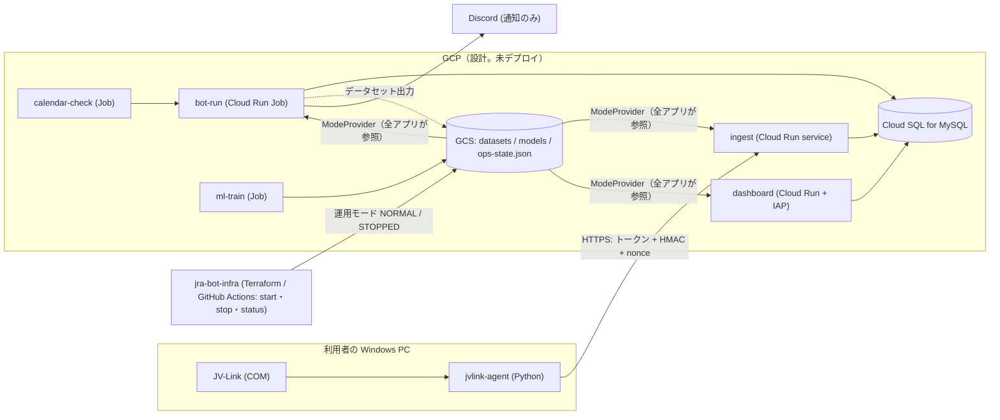

# jra-bot-web

JRA（日本中央競馬会）のレース情報から期待値の高い買い目の候補を判定し、Discord へ通知する個人用ツール **JRA Bot** を、Python（Streamlit + SQLite）から **Kotlin / Spring Boot + MySQL** へ段階的に作り替えるプロジェクトです（参照元: [`puttun777/jra-bot`](https://github.com/puttun777/jra-bot)）。

> **English summary.** A staged rewrite of a personal horse-race betting-signal bot from Python/SQLite to Kotlin/Spring Boot/MySQL (Doma, Flyway), designed for a single private user with a multi-tenant data model, a Windows-only data feed (JV-Link) behind an authenticated ingest API, and a cost-conscious GCP deployment (Cloud Run Jobs, start/stop as a single operation). This repository is design- and test-heavy: the domain logic is verified against the legacy Python implementation with golden fixtures built from synthetic data. **No betting is performed**, no real data is included, and the service is not publicly available. Most of the code and documents in this repository were generated by an AI coding assistant (Claude Code); see "AI の利用範囲".

**ソースコードの公開とサービスの公開は別です。** サービス（本番 GCP・データベース・Discord 通知・ダッシュボード）は本人専用・非公開で、このリポジトリの公開状態には依存しません。利用者の登録・招待・共有の機能はありません。

## 目的と使われ方
- 開催日の必要な時間帯だけ Bot が動き、発走前のオッズから買い目の候補を計算し、**通知する**（購入・送金などの自動操作はしない）。
- ダッシュボードは通常運用中は曜日によらず閲覧できる。運用の起動・停止は 1 回の操作で一括（STOPPED ではダッシュボード・Bot・定期処理・DB をまとめて停止し、費用を抑える）。
- 利用者は本人 1 名（私的・非営利）。`tenant_id` によるデータ分離と認証認可の構造は残している（`docs/REQUIREMENTS.md` §0）。

## 現在の完成状況（正本は `docs/PROGRESS.md`・`docs/PLAN.md`）
| 領域 | 状態 |
|---|---|
| 判定ロジックの Kotlin 移植（単勝・ワイド・三連複、Kelly・確率計算・買い目） | 実装済み。旧 Python との**ゴールデン比較**（合成入力。Kotlin が検証する 31 ケース/988 呼び出しで全一致、最大絶対誤差 1.07e-14。未対応 6 呼び出しは成功に数えない。値は 2026-10-29 のローカル実行〈`docs/PROGRESS.md`〉で、CI では最新の変更に対して未確認）|
| DB（Flyway V1〜V5、Doma の Repository、テナント境界・最小権限 GRANT） | 実装済み。MySQL 8.4 / 9.7 での検証は CI の定義（`ci.yml`）にあり、結果は下記「検証」を参照 |
| ingest API（Windows エージェントからの取込）・Python エージェント | 実装済み。実 JV-Link・実機は**未検証**（合成データと Mock COM のみ） |
| 開催日制御・Bot の評価ループ・Discord 通知・保留（PENDING）の再適用 | main に T3.1〜T3.7、ブランチ `claude/stage3-bot-orchestration` に T3.8（**未マージ・CI 未実行**）|
| ML（Kotlin 推論・Python 学習 Job・署名付きモデル検証） | 実装済み（合成データ。実モデルは含まない。昇格操作は未実装）|
| 結果・払戻の取込と決済（T3.9）、ダッシュボードの画面、運用 Runbook | **未実装**（設計: `docs/T39_DESIGN.md`、`docs/FRONTEND_DESIGN.md`）|
| 本番デプロイ（Terraform apply 等） | **未実施**（インフラは別リポジトリ・Private。承認なしに課金リソースを作らない方針）|

## アーキテクチャ

- Gradle モジュール: `:domain`（純粋なロジック。Spring・DB・クラウド SDK に依存しない）/ `:persistence`（Doma）/ `:db-migration`（Flyway）/ `:cloud-gcp` / `:bot` / `:ingest` / `:dashboard`。**bot・ingest・dashboard は相互に依存せず**、個別にデプロイ・スケールできる（依存方向は `checkModuleDependencies` が CI で強制）。Python は `agent/`（Windows 取得）`ml/`（学習）`tools/`（ゴールデン・移行・CI 補助）。
- 詳細: `docs/ARCHITECTURE.md`、契約: `docs/CONTRACTS.md`、DB: `docs/DATA_MIGRATION_DESIGN.md`。

## 主な設計判断とトレードオフ（正本は `docs/DECISIONS.md`）
| テーマ | 判断 | トレードオフ・限界 |
|---|---|---|
| Python → Kotlin | 一括書き換えではなく段階移行。旧実装を固定コミットで実行して**合成入力のゴールデン**を作り、Kotlin と数値比較。ML 学習は Python を維持し、Kotlin は署名検証済みモデルの推論だけ（D-106, D-152〜） | 合成データでの一致は実データでの正確性を意味しない。未承認の数値改善は入れていない |
| クラウドと費用 | GCP の Cloud Run（min=0）・Job 中心。STOPPED では全て止める。追加の API 従量課金を前提にしない（`docs/CLOUD_COSTS.md` は infra 側）| 常時稼働より起動遅延がある。費用の実績は無い（未デプロイ） |
| PENDING 再適用 | 取込で依存するレースが無い観測は保留にし、レースが届いたら**観測時刻のまま**再適用。新しい順のキーセットで全件走査、総数の上限なし（D-227, D-229）| **全件を走査することと、失敗行の再処理の保証は別**。失敗行は PENDING に残り、次のレース観測／完了済みバッチの再送でだけ再試行される（定期ジョブは無い）。索引は未追加で、行数が多いと 1 走査が遅い（実測は D-229）|
| リースと並行処理 | Bot の実行は DB のリース + checkpoint。長い処理の各段階でリースを確認し、失効していれば確定・送信しない（D-225）| リース失効時は**取りこぼしを許容**し、自動再送しない |
| 通知の保証範囲 | 評価の結果を DB に**確定してから**送る（確定前に送らない）。確定後・送信前に落ちたら**再送しない**（D-18/D-220）| exactly-once は保証しない（欠落しうる）。送信結果が不明な場合も自動再送しない（重複より欠落を選ぶ）|
| DB 移行 | MySQL 8.4 / Flyway / Doma。V1/V2 は運用開始まで作り直し可、以降は追加のみ。`tenant_id` を全 PK/FK の先頭に | 既存データ重複がある場合の UNIQUE 追加は何も変えずに失敗させる（V5）|
| 一括起動・停止 | 運用モード（NORMAL/STOPPED）を GCS の 1 ファイルに持ち、全アプリが参照。GitHub Actions の 1 操作で start/stop/status（infra リポジトリ）| モードが読めないときは UNKNOWN として動かない（fail closed）|
| Windows 依存 | JV-Link は COM。取得だけを小さな Python エージェントに隔離し、サーバへ認証付きで送る | 実機での検証は未了 |

## ローカルでの確認（秘密情報・実データ・本番環境は不要）
UI は未実装のため、**テストと検証ツールの実行**が確認手段です（画面例はありません）。前提: JDK 25（無い場合の簡易確認は `docs/DEVELOPER_GUIDE.md`）、統合テストは Docker。
```bash
./gradlew :domain:test                                   # 判定ロジック・PENDING 再適用の性質試験など（Docker 不要・合成データ）
python3 -m tools.golden.verify                           # 旧 Python から作った合成フィクスチャの整合性
MYSQL_IMAGE=mysql:8.4 ./gradlew :ingest:integrationTest  # 使い捨て MySQL（Testcontainers）で取込パイプラインを検証
```
詳細な手順・各モジュールの確認方法は `docs/DEVELOPER_GUIDE.md`。

## 検証とCI（実測値のみ。範囲は `docs/CI_AND_IMAGES.md`）
- CI: `.github/workflows/ci.yml`（main 向け PR・main への push・手動・月次）。変更内容で実行ジョブを選び、required check にする設計の集約ジョブは `ci gate`（スキップを成功に数えない）。ただし GitHub Free の Private リポジトリでは分岐保護を設定できない（API が 403）ため、現状は強制されていない。外部アクションは SHA 固定、権限は `contents: read`、Secrets 不使用。
- 実績: main の直近のマージ（PR #29）の CI は成功（[run 40470840736](https://github.com/puttun777/jra-bot-web/actions/runs/40470840736)）。**T3.8・V5 を含む現在のブランチは CI 未実行**（Actions の費用条件を確認できていないため）。
- ローカルでは JDK 21（`-PjdkVersion=21`）と MySQL 8.4 までで確認し、**JDK 25 と MySQL 9.7 は CI でのみ**確認する。実 Discord・実 JV-Link・Cloud Run は未検証。性能は、`docs/DECISIONS.md` D-229 の 1 件の単発測定を除き**測っていない**。

## 既知の制約・未実装・今後
`docs/UNRESOLVED.md`（分類 A〜G の管理表）が正本。主なもの:
- **データ利用の確認（COMP-4）が未回答**: 公式回答が得られるまで、実データをクラウドへ投入しない。ソース公開について JRA-VAN の許可は得ていない（E-7）。
- 払戻の単位・同着・返還・取消の扱いなど JV-Data 仕様の確認（T1.17）が未了。T3.9（結果・払戻・決済・reconcile・成績集計）は設計のみ。V6 は未承認。
- 学習データの天候・馬場は、観測時点を確認できない行を除外（G-31）。実データでは学習に使える行が大きく減りうる。
- ダッシュボードの画面・運用 Runbook・本番デプロイは未実装。

## AI の利用範囲
- このリポジトリのコードと文書は、**ほぼ全て AI コーディングアシスタント（Claude Code）が生成**しました（コミットの作者の大半が `Claude`。人の名義のコミットは主にマージコミット）。
- 人が行ったこと（記録で確認できるもの）: 要件・方針の決定と承認（`docs/DECISIONS.md` の「ユーザー承認」付きの項目、`docs/UNRESOLVED.md`）、PR のマージ。
- **人がコードの各行をどこまでレビューしたかは、記録からは確認できません**（確認事項: 所有者が追記する）。AI が書いたテストが通ったことを、人が読んで正しさを確認したことと同一視していません。

## 権利・利用条件（Public 公開時）
- **ライセンスは付与していない（All rights reserved）**。ソースを公開していても、利用・複製・改変・再配布・派生物の作成を許諾しない。GitHub 上の閲覧と、GitHub の利用規約が認める範囲の fork だけが可能（それ以上の権利は与えない）。外部からの Pull Request・Issue は募集しない（`SECURITY.md`）。
- 旧実装 `puttun777/jra-bot`（MIT, Copyright (c) 2026 puttun777）由来の部分と第三者 OSS の表示は `NOTICE.md`。既存の MIT 等の表示は削除しない。
- JRA-VAN Data Lab. のデータ・SDK（JV-Link）・仕様書・学習済みモデルは含まない。ソースコードの公開について JRA-VAN からの許可は**得ていない**（確認事項は `docs/UNRESOLVED.md` E-7）。

## Git に含めないもの
実データ（JV-Data・SQLite・DB ダンプ）、学習済みモデル（`*.pkl` 等）、秘密情報、JV-Link SDK の資料、ビルド生成物（`.gitignore` と `repo-hygiene` ジョブで防ぐ）。テストデータは合成データだけを使う。

## 文書
最初に `CLAUDE.md` → `docs/PROGRESS.md` → `docs/PLAN.md`。一覧は `CLAUDE.md` の表。開発者向けの手順は `docs/DEVELOPER_GUIDE.md`。
