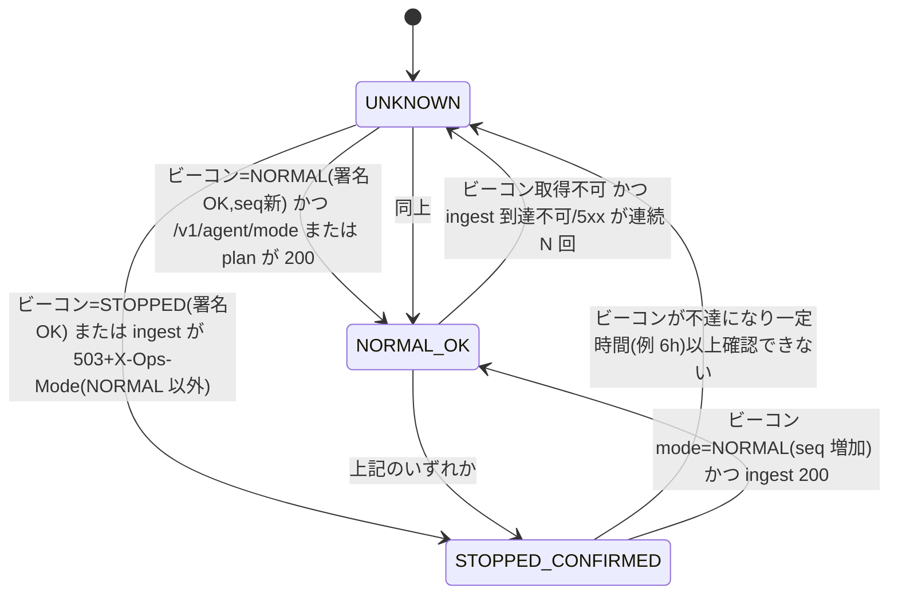

# CONTRACTS（web ⇔ infra 受け渡し契約・正本は本ファイル）

状態: **0.4.0（第1段階 / T1.10 で確定。設計契約）**。infra の `docs/CONTRACTS.md` §2 の差異 D1〜D12 をすべて取り込んだ（対応表は §12）。実装・実リソースで確かめる必要がある箇所は「検証ゲート」として ID を書いている（一覧は `STAGE2_HANDOFF.md` §11）。
- 正本はこのファイル。infra 側は版番号を参照し、変更点を同期する。infra の文書を直す必要がある箇所は `PROGRESS.md` の「infra への引継ぎ」に記録する。web のセッションから infra を直接変更しない。
- 用語: **mode** は現在のフェーズ（`NORMAL | STARTING | STOPPING | STOPPED`）。**desired** は利用者の意図（`NORMAL | STOPPED`）。アプリが読み取りに失敗したときや、内容が不正なときの判定値は **`UNKNOWN`** とする。UNKNOWN はアプリ内部だけの値で、正本には書かない。旧版の `phase` は廃止して `mode` に統一した（実装はまだ無いため互換フィールドは置かない）。

## 1. 成果物（web → infra）
| 成果物 | 内容 | 識別 |
|---|---|---|
| コンテナイメージ `dashboard` | Spring Boot（`:dashboard`）。Web UI と `/api/v1/**` | Artifact Registry。タグ=git SHA（不変）。デプロイは **digest 指定** |
| コンテナイメージ `ingest` | Spring Boot（`:ingest`）。エージェント受信（§3.1） | 同上 |
| コンテナイメージ `bot` | Spring Boot（`:bot`）。**1 イメージで `--task=` を切り替える**: `bot-run` / `calendar-check` / `reconcile` / `retention` / `export-dataset` | 同上 |
| コンテナイメージ `db-migration` | Flyway CLI ラッパ（`:db-migration`）。`--mode=info\|validate\|migrate`（§4） | 同上 |
| コンテナイメージ `ml-train` | Python 学習 Job（`ml/`）。常駐しない（§5.1） | 同上。Python とライブラリの版をマニフェストに記録 |
| `release-manifest.json` | §10 のスキーマ | GitHub Release asset（web, Private）。infra はこれだけを入力にする |
| Windows エージェント配布物 | zip（秘密を含まない）+ 署名付き更新 manifest | GitHub Release asset（Private）。トークンは利用者が別途配置 |

web→Artifact Registry の push 権限と、infra 側の manifest 取得権限は**推測しない**。第5段階でユーザーの確認を得てから、Workload Identity Federation で付与する（infra 案: `sa-gha-web-push`）。

## 2. 環境変数/設定（infra → app）
| 名前 | 供給元 | 対象 | 用途 |
|---|---|---|---|
| `APP_ENV` | Terraform | 全 | `local` / `prod` |
| `TZ` | 固定 | 全 | `Asia/Tokyo`（表示・開催日判定用。保存は UTC: §8） |
| `DB_URL` | Terraform | DB を使う全て | `jdbc:mysql://<private-ip>:3306/jrabot?sslMode=VERIFY_CA&…`（§8） |
| `DB_USER` / `DB_PASSWORD` | Terraform / **Secret Manager** | 同上 | 用途別ユーザー（§8.2）。Secret 名は `db-<用途>-password` |
| `DB_POOL_MAX` | Terraform | 同上 | §8.3 の上限（アプリ既定値と同じ値を明示） |
| `OPS_MODE_SOURCE` | Terraform | dashboard / ingest / bot / ml-train | `gs://<prj>-ops-state/state/ops-state.json`（§5.2） |
| `AGENT_HEARTBEAT_PREFIX` | Terraform | ingest | `gs://<prj>-ops-state/agent/`（§5.4） |
| `MODE_BEACON_URL` | Terraform / 配布 | エージェント | `https://storage.googleapis.com/<prj>-mode-beacon/beacon/mode.json`（§7.2） |
| `MODE_BEACON_PUBKEYS` | 配布（エージェントに同梱） | エージェント | Ed25519 公開鍵（`kid` 付き、最大 2 本。ローテーション用） |
| `IAP_AUDIENCE` | Terraform | dashboard | IAP JWT の `aud`（§11.1） |
| `INTERNAL_ID_TOKEN_AUDIENCE` / `OPS_SA_EMAIL` | Terraform | ingest（dashboard は `OPS_SA_EMAIL` のみ） | `/internal/*` の ID トークン検証（§11.2） |
| `ALLOWED_USERS` / `ADMIN_USERS` | Terraform | dashboard | 許可リスト（メール）。**空なら全拒否**。DB の `app_user` との突合は §11.1 |
| `MODEL_STORE_URI` | Terraform | bot / ml-train | `gs://<prj>-model-store`（非公開）（§5.1） |
| `MODEL_SIGNING_KEY` | **Secret Manager**（`model-signing-key`） | ml-train のみ | モデル JSON の Ed25519 署名 |
| `MODEL_VERIFY_PUBKEY` | Terraform（公開値） | bot | 署名検証 |
| `INGEST_TOKEN_PEPPER` | **Secret Manager**（`ingest-token-pepper`） | ingest / dashboard（発行） | エージェントトークンのハッシュ用ペッパー（§3.3） |
| `DISCORD_WEBHOOK_URL` / `DISCORD_ERROR_WEBHOOK_URL` | **Secret Manager** | bot（通知）/ 全（エラー） | 通知 |
| `RELEASE_ID` / `REQUIRED_SCHEMA_VERSION` | イメージに焼き込み（ビルド時） | 全 | 版の表示と ready 判定（§4.3） |

- 秘密は Secret Manager だけに置く。GitHub、イメージ、ログ、Terraform の state に秘密の値を置かない。値が state に載る Terraform リソースは使わない（第5段階）。
- 名前は 0.4.0 で確定した。変更するときは契約のマイナー版を上げ、infra と同期する。

## 3. API 契約

### 3.1 サービス境界
直接 IAP は**人間のブラウザ用**で、機械クライアント（Windows エージェント）は通れない。OIDC の ID トークンを取るには長期鍵が必要になるため、その方式は採らない。そこで **ingest を dashboard とは別のサービス**にし、IAP の外に置いてアプリ層で認証する（D-020）。`dashboard` / `ingest` / `bot` は互いに依存しない（ARCHITECTURE §2）。

### 3.2 エンドポイント
| API | 提供 | 呼び出し元 | 認証（§11） | 内容 |
|---|---|---|---|---|
| `GET /internal/health` | dashboard / ingest | infra（start S8・status） | dashboard: IAP + ops SA / ingest: Google ID トークン（ops SA） | プロセスの生存確認。DB にもモードにも依存しない。`200 {status:"UP", release}` |
| `GET /internal/ready` | dashboard / ingest | 同上 | 同上 | 受付の準備ができているか（§4.3）。DB 接続 OK かつスキーマ版 ≥ `REQUIRED_SCHEMA_VERSION` で 200、それ以外は 503。**mode が NORMAL でなくても判定する**（start の S8 は mode=STARTING の間に呼ばれるため） |
| `GET /internal/ops/mode` | dashboard / ingest | infra（status） | 同上 | そのインスタンスの `ModeProvider` から見えるモード `{mode, desired, seq, cacheAgeMs, source:"gcs"\|"unknown"}`。**読み取り専用**。bot は使わない（bot は GCS を直接読む: §5.2） |
| `GET /api/v1/**` | dashboard | ブラウザ | IAP + `app_user` | DTO のみ返す。テナント境界は必須。一般/管理者の区別は §11.1 |
| `POST/PUT/DELETE /api/v1/admin/**` | dashboard | ブラウザ（管理者） | IAP + `ROLE_ADMIN` + CSRF | 手動補正、手動起動（開催検証あり）、エージェントの発行/失効。**mode=NORMAL のときだけ**受け付け、それ以外は 409 `OPS_MODE_NOT_NORMAL` |
| `GET /v1/agent/mode` | ingest | エージェント | トークン + 署名 | **DB に触れず**、現在のビーコンと同じ内容（署名付き）を返す |
| `GET /v1/agent/plan` | ingest | エージェント | トークン + 署名 | 取得計画 `{planId, validUntil, items:[{dataspec, key, option, notBefore, interval}], idle}`。NORMAL 以外は 503（§3.6） |
| `POST /v1/agent/ingest` | ingest | エージェント | トークン + 署名 | 生レコードのバッチ（§3.4）。NORMAL 以外は 503 |
| `POST /v1/agent/heartbeat` | ingest | エージェント | トークン + 署名 | 状態通知（§3.5）。最終接続時刻の写しを GCS に書く（§5.4） |
| `GET /v1/agent/update` | ingest | エージェント | トークン + 署名 | 署名付き更新 manifest（NORMAL のときだけ） |
| `POST /v1/agent/register` | ingest | エージェント（初回） | 登録コード | `agent_id` とトークンを発行する。登録コードは管理者が事前に発行する 1 回限りのもの |

- `/v1` はエージェントプロトコルのメジャー版。破壊的な変更をするときは `/v2` を並行して提供する。
- 人向けの HTML ルート（`/`、`/races/...` など）は `/api/v1` と同じアプリケーションサービスを使う（FRONTEND_DESIGN §4.4）。

### 3.3 エージェント認証・権限（機械連携の分離）
- 主体: `agent_id`（テナントに属する）。トークンは 256bit ランダム、**サーバはハッシュ（SHA-256+ペッパー）のみ保存**、有効期限 90 日・ローテーション可・即時失効可。
- リクエスト署名: `X-Agent-Id`, `X-Timestamp`（±300 秒）, `X-Nonce`, `X-Signature = HMAC-SHA256(token, method|path|timestamp|nonce|sha256(body))`。トークン自体は送らない。nonce は 10 分保持（リプレイ防止）。
- 権限: エージェントは自テナントの ingest / heartbeat / plan / mode / update のみ。ダッシュボード API・管理 API は不可。
- 保管: PC 側は DPAPI。ログにトークン・本文を出さない。
- 失効・盗難時: 管理者 API で失効→以後 401。

### 3.4 ingest 封筒（JSON, gzip 可）
```json
{ "protocol": 1, "agentId": "…", "batchId": "uuidv7", "class": "S|R",
  "observedAt": "2026-11-01T01:23:45.678Z",
  "dataspec": "RACE", "option": 2, "fromtime": "20261101000000", "lastFileTimestamp": "20261031200000",
  "eof": true,
  "records": [ { "id": "RA", "bytesB64": "…cp932…", "sha256": "…" } ] }
```
- 1 バッチ ≤ 1 MB（gzip 後）・≤ 200 レコード。同一内容は**同一 `batchId` で再送**。
- 応答: `200 {accepted, duplicates, ackTs, serverTime}`。`ackTs` を受けて初めてエージェントはチェックポイントを前進（JVLINK_DESIGN §5.2）。
- 冪等: サーバは `batchId` と `record_hash` で重複を吸収。重複でも 200（`duplicate=true`）。

### 3.5 ハートビート
`{agentVersion, clockSkewMs, queueDepth, oldestQueuedAt, ackedTs:{…}, lastJvResult:{…}, diskFreeMb, lastError, mode:{local judgement}}`。NORMAL 時 60 秒毎。STOPPED/UNKNOWN 時は送らない（ビーコンのみ）。

### 3.6 ステータスコードと意味
| 応答 | 意味 | エージェントの扱い |
|---|---|---|
| 200 | 受理 | チェックポイント前進 |
| 400/413/422 | 不正な封筒（バグ） | そのバッチを DEAD へ、アラート。リトライしない |
| 401/403 | 認証失敗・失効 | **送信停止**し、ローカルアラート（トークン再発行が必要）。自動リトライしない |
| 409 | `batchId` は処理中 | 待って同一バッチで再送 |
| 429 | レート超過 | `Retry-After` に従う |
| **503 + `X-Ops-Mode: <STARTING|STOPPING|STOPPED>`** | **運用モードが NORMAL 以外（確定）** | §7: 送信・取得を止める。バックオフではなく**モード待機** |
| 503（ヘッダなし）/ 502 / 504 / タイムアウト / 接続不可 | 障害または STOPPED の副作用で**区別不能** | §7: UNKNOWN。安全側（送らない）。ビーコンで判別を試みる |
| その他 5xx | サーバ障害 | 指数バックオフ（上限あり）。ただし §7 の UNKNOWN 規則が優先 |

## 4. DB マイグレーション契約（D6）
### 4.1 原則
- Flyway は `db-migration` イメージを Cloud Run Job として実行する。**アプリの起動時には実行しない**。アプリのイメージには Flyway を入れない（`spring.flyway.enabled` に頼らず、依存として持たない）。
- 実行する場面は 2 つ。① **deploy**: mode=NORMAL のときにリリースごとに 1 回 `migrate`。② **start**: S4 で `info` → `validate`。未適用の版があれば start を失敗させる。`apply_pending_migrations=true` を指定したときだけ `migrate` する（infra OPERATIONS_DESIGN §5）。
- 後方互換は expand/contract で保つ。旧アプリ版が新スキーマで動くようにし（ロールバック可能性のため）、破壊的な変更は 2 リリースに分ける（DATA_MIGRATION_DESIGN §3.1）。
- deploy workflow の順序: NORMAL を確認 → `migrate` → ingest → Jobs 定義 → dashboard → status。
- `db-migration` は `ModeProvider` を参照しない。いつ実行するかは呼び出し側（infra）の責任とする。

### 4.2 `db-migration` の CLI
| 引数 | 動作 | 終了コード |
|---|---|---|
| `--mode=info` | 現在版・未適用版・失敗版を **JSON 1 行で標準出力**: `{"current":"2","pending":["3"],"failed":[],"latest":"3"}` | 0（DB に接続できないときは 75） |
| `--mode=validate` | 適用済みのチェックサム一致・失敗版なし・`outOfOrder` なしを検証する。結果を JSON で出力 | 0=適用済みが正しく未適用なし / **10=正しいが未適用あり** / 1=不一致・失敗版あり / 75=DB 不達 |
| `--mode=migrate` | 未適用版を適用する。その後 `R__grants.sql` で権限を再適用する（§8.2） | 0=成功 / 1=失敗（Flyway が失敗版を記録。自動の修復はしない）/ 75=DB 不達 |
- `--mode` は必須で既定値は無い。未指定なら終了コード 2。
- 固定する設定: `validateOnMigrate=true`、`outOfOrder=false`、`baselineOnMigrate=false`、`cleanDisabled=true`、`group=true`（1 回の実行の版をまとめる。MySQL は DDL が暗黙コミットされるため、効くのは DML だけ）。
- 接続ユーザーは `migrate`（DDL 権限）だけを使う（§8.2）。

### 4.3 アプリの起動・ready とスキーマ版
- 各アプリのイメージには、ビルド時に `REQUIRED_SCHEMA_VERSION`（そのアプリが必要とする最小のスキーマ版）を焼き込む。
- `/internal/ready` と Job の開始時に `flyway_schema_history` の最大成功版を読み、`REQUIRED_SCHEMA_VERSION` 未満なら ready=503。Job は終了コード 1 で終える（不一致のまま動かない）。
- スキーマ版が `REQUIRED_SCHEMA_VERSION` より**新しい**ことは許容する（expand/contract の前提）。

## 5. 運用モード契約（D1・D4・D5）
### 5.1 ML 成果物・ジョブ契約（D12）
- **モデル成果物**: `model_schema_version: 1` の JSON と `.sig`（ML_DESIGN §5.2）。置き場は `MODEL_STORE_URI/{tenant_id}/models/{model_id}.json`。レジストリは DB の `ml_model`。bot は `ACTIVE` のモデルだけを読む。読む前に `sha256`・署名・`feature_schema_hash`・重みの長さを検証する。検証に失敗したら読み込みを拒否し、フォールバック理由を記録する。
- **データセット**: bot の `--task=export-dataset` が `MODEL_STORE_URI/{tenant_id}/datasets/{dataset_id}.csv.gz` に出力する（gzip CSV、列順は `feature_schema`）。保持は 90 日（GCS のライフサイクル）。**Git や CI のログには載せない**。
- **ml-train Job**: 入力は `--tenant-id`、`--dataset-id`、学習設定。**学習データは GCS のデータセットだけから読み、DB の業務テーブルには触れない**。出力はモデル JSON・署名・評価レポートを GCS に書き、`ml_model` に `CANDIDATE` の行を INSERT する（品質ゲート不合格なら `REJECTED`）。ACTIVE への昇格は管理者が dashboard で行う（ml-train にはその権限が無い）。
- **DB 権限**（DB ユーザー `mltrain`）: `ml_model` の `SELECT, INSERT` だけ（§8.2）。UPDATE、DELETE、他テーブルへのアクセスは不可。テナントは引数で受け取り、INSERT する行の `tenant_id` はその値に固定する。DB の行単位権限が無いので、越境はテナント引数の検証と監査（`created_by=ml-train:<execution>`）で防ぐ。
- **モード**: Job の開始時に §5.2 の方法でモードを確認し、NORMAL 以外なら何もせず終える（§9）。
- **infra の義務**: ①バケット（東京・非公開・バージョニング・データセットはライフサイクル 90 日）と IAM（ml-train: models の書込とデータセットの読取 / bot: models の読取とデータセットの書込〔export-dataset〕）、②署名鍵の Secret、③`ml-train` Job の定義（Scheduler は最初 paused）、④STOPPED のときに Job を起動しない。
- 互換性: bot は `model_schema_version` の N と N-1 を読める。

### 5.2 正本と `ModeProvider`（D1・D4）
- **正本**は GCS の `ops-state.json`（infra OPERATIONS_DESIGN §2.2、`schema_version: 1`）。DB には依存しない。DB 内のモードは表示用の写し（D-005）。
- アプリが使うフィールドは `schema_version`、`seq`、`mode`、`desired.mode`、`desired.set_at`、`operation.type/status` だけ。それ以外は無視する（前方互換）。
- `ModeProvider`（`:domain` のポート。GCS 実装は `:cloud-gcp`）:
  | 項目 | 規則 |
  |---|---|
  | 取得 | ランタイム SA の ADC で `OPS_MODE_SOURCE` を読む（読取のみ）。タイムアウト 3 秒 |
  | キャッシュ | **成功した結果を 15 秒**保持する。失敗した結果はキャッシュせず、次の呼び出しで再取得する（ただし再試行は最短 5 秒間隔） |
  | 検証 | `schema_version==1`、`mode ∈ {NORMAL, STARTING, STOPPING, STOPPED}`、`desired.mode ∈ {NORMAL, STOPPED}`、`seq` が整数 |
  | 判定 | 取得失敗・タイムアウト・JSON 不正・検証 NG・未知のスキーマ版 → **`UNKNOWN`**。**UNKNOWN は NORMAL として扱わない**。直前の成功値も使わない（キャッシュが切れたら UNKNOWN） |
  | 単調性 | 同じプロセス内で `seq` が以前より小さい値を読んだら UNKNOWN にして警告を出す（書き戻りや改竄の検知） |
  | ログ | 状態が変わったときだけ INFO（`mode`、`seq`）。UNKNOWN になったら WARN と理由 |
- 型: `enum OpsMode { NORMAL, STARTING, STOPPING, STOPPED, UNKNOWN }`。UNKNOWN は正本には存在しない値で、アプリ内部の判定結果だけに使う。

### 5.3 モードごとのアプリの振る舞い
| 対象 | NORMAL | STARTING / STOPPING / STOPPED | UNKNOWN |
|---|---|---|---|
| bot `calendar-check` / `reconcile` / `retention` / `export-dataset`、`ml-train` | 実行 | **DB に接続する前に**判定して何もせずに終了。exit 0、理由 `MODE_<mode>` | 何もせず終了。**exit 75**（§9、異常として通知） |
| bot `bot-run` | 実行。各サイクルの開始時に再確認（キャッシュ ≤15 秒） | 開始前なら exit 0。実行中なら DRAINING → checkpoint を保存して exit 0（`STOPPED_BY_MODE`） | 開始前なら exit 75。実行中なら新しいサイクルを始めず、**3 回連続（約 45 秒）UNKNOWN** になったら DRAINING → checkpoint → exit 75 |
| ingest `/v1/agent/plan\|ingest\|heartbeat\|update` | 処理 | **DB に触れず** `503` + `X-Ops-Mode: <mode>` | `503`（`X-Ops-Mode` なし） |
| ingest `/v1/agent/mode`、`/internal/*` | 応答 | 応答（`/v1/agent/mode` はビーコンと同じ内容） | 応答（`/v1/agent/mode` は 503） |
| dashboard 閲覧 | 可 | STARTING/STOPPING は上部に固定バナーを出して閲覧可（DB が動いていれば）。**STOPPED では ingress=internal のため外部から到達できない（D11）** | 「運用状態を確認できません」のバナーを出して閲覧可 |
| dashboard 管理操作（書込） | 可 | 409 `OPS_MODE_NOT_NORMAL` | 409 |
| `db-migration` | — | 判定しない（§4.1） | — |

### 5.4 エージェント最終接続の写し（D5）
- ingest は heartbeat を受けたら `AGENT_HEARTBEAT_PREFIX + "heartbeat-<tenant_id>.json"` を更新する。条件は「前回の書込から 5 分以上経った」または「`agent_version` が変わった」。
  ```json
  { "schema_version": 1, "tenant_id": 1,
    "agents": [ { "agent_id": "ag_…", "last_seen_at": "2026-11-01T01:23:45Z", "agent_version": "0.3.0" } ],
    "updated_at": "2026-11-01T01:23:45Z" }
  ```
- 書くのは**時刻・ID・版だけ**。データ本文、トークン、IP、メールアドレスは書かない。`tenant_id` は内部の数値 ID（個人情報ではない）。
- テナント境界: ingest は**認証済みエージェントのテナントのファイルだけ**を更新する（パスは認証結果から組み立て、リクエストの値は使わない）。更新は `ifGenerationMatch` の CAS で行い、412 なら再読込して 1 回だけ再試行する。
- 書込の失敗は警告ログだけにする。heartbeat の応答（200）には影響させない。DB の `agent_heartbeat` は従来どおり正本として残し、GCS の写しは DB 停止中の status 用とする。
- 権限: ingest SA はこのプレフィックスの書込だけ。読むのは `sa-gha-ops`（status）。

### 5.5 start / stop の順序（infra OPERATIONS_DESIGN §5・§6 が詳細の正本）
- start: mode=STARTING → ビーコン STARTING → DB 復帰 → `db-migration info/validate` → ingest の受付再開 → dashboard の受付再開 → `/internal/ready` → Scheduler 再開 → mode=NORMAL → **最後にビーコン NORMAL**。
- stop: **最初に** mode=STOPPING とビーコン STOPPING → Scheduler 停止 → 実行中 Job の排出・キャンセル（§9.2）→ 受付停止（ingress=internal）→ DB 接続の消滅確認 → DB 停止 → mode=STOPPED → ビーコン STOPPED。
- Terraform apply とデプロイは mode を変えない。STOPPED 中は deploy を拒否するのが既定（infra OPERATIONS_DESIGN §8）。
- **エージェントが送信してよいのは mode=NORMAL のときだけ**。STARTING、STOPPING、不明のときはすべて「送らない」。

## 6. 契約バージョン
`contract_version: 0.4.0`。破壊的な変更はメジャー版を上げ、`release-manifest.json` に含める。エージェントプロトコルは `/v1`（`protocol: 1`）。第2段階以降に実装でずれが見つかったら 0.4.x / 0.5.0 として本ファイルで管理する。1.0.0 は第6段階の統合レビューで凍結する。

## 7. Windows エージェントの STOPPED 時動作契約（T1.15）

### 7.1 原則
1. **安全側**: NORMAL が確認できない限り、データを取得もしない・送信もしない。
2. **無限リトライ禁止**: STOPPED/UNKNOWN 中はバッチ再送を行わず、モード確認のみを間隔を伸ばして実施。
3. **未送信データはローカルに安全に保持**（SQLite WAL キュー。上限と TTL は JVLINK_DESIGN §5.3）。
4. **復帰後は重複なく再送**（`batchId`/`record_hash` 冪等、チェックポイントは ACK 後のみ前進）。
5. 通信障害と STOPPED を**区別できる手段を別に持つ**（モードビーコン）。

### 7.2 モードビーコン（D1・D2）
- DB・Web・ingest のどれにも依存しない**静的 JSON**（HTTPS GET、`MODE_BEACON_URL`）。
  ```json
  { "schema_version": 1, "mode": "NORMAL", "seq": 42, "updatedAt": "2026-11-01T00:00:00Z",
    "validUntil": null, "kid": "beacon-2026a", "sig": "<base64url Ed25519>" }
  ```
- `mode` は §5 の 4 値（**`phase` は廃止**）。`seq` は `ops-state.seq` と同じ値で単調増加し、エージェントは巻き戻りを拒否する。`validUntil` は任意（null ならエージェント側の `beaconMaxAge`=6h を使う）。
- **署名**: `sig = Ed25519(秘密鍵, UTF-8(canonical))`。canonical は `sig` を除いたフィールドを**キーの辞書順・空白なし**で直列化した JSON。値は文字列・整数・null だけなので、RFC 8785 と同じ結果になる。
- **秘密鍵は Secret Manager**（`beacon-signing-key`）に置き、`sa-gha-ops` だけが読める。**GitHub に長期の秘密鍵を置かない**（D2）。公開鍵はエージェントに同梱する（`kid` 付きで最大 2 本）。ローテーションは「新しい鍵を同梱したエージェントを配布 → 署名を新しい鍵へ切替 → 次の配布で古い鍵を削除」の順で行う。
- 書くのは infra の start/stop ワークフローだけ（ops-state と同じ操作）。更新のタイミングは、stop では **STOPPING（最初）→ STOPPED（最後）**、start では **STARTING（最初）→ NORMAL（最後）**。`Cache-Control: no-store`。
- 可用性: 停止中も応答できること（コンピュートに依存しない GCS の公開オブジェクト。このオブジェクト専用のバケットに置く）。

### 7.3 エージェントの状態機械

- **NORMAL_OK のみ**: plan 取得・JV-Link 取得・ingest 送信・heartbeat・更新確認を行う。
- **STOPPED_CONFIRMED**: 取得停止（JVOpen を呼ばない）、送信停止、ハートビート停止。ビーコンのみ **60 分間隔**で確認。キューは保持（TTL は進む）。アラートなし（想定内）。
- **UNKNOWN**: 取得停止、送信停止。ビーコン+`/v1/agent/mode` を **5 分→15 分→60 分（頭打ち、ジッタ±20%）**で確認。**UNKNOWN が 30 分続いたらローカル通知（トースト/ログ）**、開催日ウィンドウ中なら 3 時間で重大扱い（エージェントは自己通知手段を持たない。サーバ側のハートビート欠落検知が担当）。
- 判定規則:
  | 観測 | 判定 |
  |---|---|
  | ビーコン NORMAL(署名OK, `seq` 最新, 鮮度 ≤ `beaconMaxAge`=6h) かつ ingest 200 | NORMAL_OK |
  | ビーコン STOPPED/STOPPING/STARTING（署名OK） | STOPPED_CONFIRMED（STARTING は待機） |
  | ingest 503 + `X-Ops-Mode`（値あり） | STOPPED_CONFIRMED |
  | ingest 503（ヘッダなし）/ 接続不可 / タイムアウト + ビーコン不達 | UNKNOWN（安全側）|
  | ingest 503/接続不可 + ビーコン NORMAL | 一時障害。NORMAL_OK 扱いだが**送信は止め**、バックオフ（上限 15 分）で再試行。ビーコンが NORMAL のまま ingest 障害が 30 分続けば UNKNOWN |
  | ビーコンの署名不正・seq 巻き戻し | 無視（UNKNOWN 維持）+ ローカルアラート |
  | 401/403 | 認証障害。送信停止+アラート（モード判定とは別） |

### 7.4 STOPPED 中の挙動と復帰
| 項目 | 動作 |
|---|---|
| 取得 | 実行中の JV-Link 取得は**現在のファイル/バッチ区切りで安全に中断**し、`fetched_ts` は進めず、読込済みは outbox に格納 |
| 未送信データ | outbox に保持。蓄積系(S)は上限内で無期限、速報(R)は TTL 7 日。上限超過は R の古い順に破棄（ログ・ハートビートで通知）。S は取得を停止し JV-Link サーバ側(1 年保持)から後で再取得 |
| 復帰（NORMAL_OK） | ①ジッタ（0〜120 秒）待機→②plan 取得→③outbox を古い順に **最大 2 バッチ/秒**で再送（429 で減速）→④空になったら通常取得へ。S の `fromtime` は `acked_ts - margin`（再取得で穴を埋める） |
| 重複 | 再送は同一 `batchId`。サーバは重複を吸収（200 duplicate）。ACK 前に落ちても二重登録しない |
| STOPPED 中のデータ欠損 | 速報オッズ(R) は STOPPED 中は取得しないため**欠損が発生する**。これは仕様（記録: `ingest_gap(reason=STOPPED)`）。STOPPED はそもそも bot 停止中 |
| STARTING | 受け付け準備中。送らない。ビーコンが NORMAL になるまで待機 |

- 注: STOPPED_CONFIRMED は「NORMAL 以外であることを確認した」状態を指す（STARTING・STOPPING を含む）。

### 7.5 infra の義務（infra OPERATIONS_DESIGN と同期済み）
1. モードビーコンを提供・更新する（§7.2）。署名鍵は Secret Manager に置く。公開鍵の配布手順を用意する。
2. ingest は NORMAL 以外のとき、**DB に触れずに** `503 + X-Ops-Mode` を返す（§5.3）。STOPPED では ingress=internal になり、エージェントから到達できなくなる。その場合もエージェントはビーコンで判別できるので、ビーコンが主で `X-Ops-Mode` は補助。
3. STOPPED 中は ingest を受付停止にしてよい（エージェントは UNKNOWN → ビーコンで STOPPED_CONFIRMED に収束する）。
4. `status` ワークフローの `actual` には、ビーコンの値、ingest の応答、エージェントの最終接続（§5.4 の GCS の写し）を含める。
5. Terraform はビーコンの**箱**（バケット・オブジェクト）だけを管理し、中身は管理しない（apply で NORMAL に戻らないようにする）。

### 7.6 テスト観点（第3・5段階）
STOPPED 中の `ingest` 503、ビーコンのみ STOPPED、両方不達（UNKNOWN）、ビーコン NORMAL + ingest 障害、署名不正/seq 巻き戻し、再起動後の STOPPED 維持、復帰時の再送順序/重複、キュー上限超過、長期 STOPPED（TTL 超過）、時計ずれ、部分失敗した start（ビーコンが NORMAL にならない=エージェントは待機のまま）。


## 8. DB 接続契約（D8・D10）
### 8.1 接続
- Cloud SQL for MySQL **8.4 LTS（暫定の基準、D10）**、Enterprise エディション、`db-g1-small`、**プライベート IP のみ**。9.7 LTS への変更は第2段階のゲート G-DB-0（Testcontainers で 8.4 と 9.7 × Flyway × Connector/J × Doma の互換性を検証）の結果を見て判断する。それまで SQL は 8.4 と 9.7 の共通機能に限る。
- 接続方式の第一案は、Direct VPC egress 経由でプライベート IP へ JDBC 接続し、**TLS を必須**にする（`sslMode=VERIFY_CA` + Cloud SQL のサーバ CA を信頼ストアへ。IP 接続のため `VERIFY_IDENTITY` は使えない見込みで、要確認 G-DB-7）。代替案は Cloud SQL Java Connector（`ipTypes=PRIVATE`）。G-DB-5（IAM DB 認証）の結果と合わせて第2段階で選ぶ。
- 認証は当面パスワード（Secret Manager）。IAM DB 認証が JDBC で使えれば（G-DB-5）、パスワードをやめる。
- 文字セット `utf8mb4`、`serverTimezone=UTC`（接続のセッションも `time_zone='+00:00'`）。時刻は UTC の `DATETIME(6)` で保存し、表示だけ JST にする（DATA_MIGRATION_DESIGN §2）。

### 8.2 用途別の DB ユーザー
| ユーザー | Secret | 使う実行単位 | 権限（`R__grants.sql` で定義、Flyway が適用） |
|---|---|---|---|
| `migrate` | `db-migrate-password` | db-migration | DDL と、他ユーザーへの GRANT/REVOKE |
| `app` | `db-app-password` | dashboard | 全テナント表の SELECT。書込は管理操作の表（`calendar_override`、`agent`、`audit_log`、`ml_model.status` の昇格、`bot_run` への手動起動要求）だけ |
| `ingest` | `db-ingest-password` | ingest | 取込先の表（`races` 系、`odds_snapshots`、`results`、`payouts`、`ingest_batch`、`ingest_raw`、`agent_heartbeat`、`agent_nonce` など）の SELECT/INSERT/UPDATE。DELETE は `agent_nonce` の期限切れだけ |
| `bot` | `db-bot-password` | bot（全 `--task`） | 業務表の SELECT。判定・成績・実行管理の表（`signals`、`bets`、`bet_legs`、`race_evaluations`、`ticket_evaluations`、`bot_run`、`race_schedule` の状態など）の INSERT/UPDATE。DELETE は保持ポリシー対象の表だけ（`retention` 用。ドライランと管理者承認: D-043） |
| `mltrain` | `db-mltrain-password` | ml-train | `ml_model` の SELECT/INSERT だけ（§5.1、D12） |
- ユーザーそのものは infra（Terraform）が作り、パスワードは Secret Manager に置く。**GRANT は web の Flyway（`R__grants.sql`）が `REVOKE ALL` → 最小限の GRANT の順で定義する**。Cloud SQL が API で作ったユーザーに付ける既定の権限と、`migrate` が GRANT できる範囲は要検証（G-DB-6）。
- テナントは行単位では DB で強制できない（MySQL に RLS が無い）。DAO の必須引数、SQL の静的検査、複合 FK、越境テストで多重に防ぐ（DATA_MIGRATION_DESIGN §4）。

### 8.3 接続プールの上限（初期値）
| 実行単位 | プール上限 | 最大インスタンス/同時実行 | 最大接続 |
|---|---|---|---|
| dashboard | 3 | 2 | 6 |
| ingest | 3 | 2 | 6 |
| bot-run | 4 | 1（リースで 1 本） | 4 |
| calendar-check / reconcile / retention | 各 1 | 各 1 | 3 |
| export-dataset | 2 | 1 | 2 |
| db-migration | 2 | 1 | 2 |
| ml-train | 1 | 1 | 1 |
| **合計（全部が同時に動いた最悪の場合）** | | | **24（≤ 25）** |
- HikariCP の `maximumPoolSize` は `DB_POOL_MAX` で上書きできる。既定値はこの表の値。`connectionTimeout` は 10 秒、`maxLifetime` は Cloud SQL 側の `wait_timeout` より短くする。
- インスタンス数・同時実行数・`max_connections` を変えたときは、この表の合計を再計算して見直す（db-g1-small の `max_connections` の既定値は要確認 G-DB-1）。最大インスタンス数を増やすと合計が増えるので、その場合はプール上限を下げる。

## 9. Job の実行契約（D9）
### 9.1 終了コード
| コード | 意味 | 例 | Scheduler/Jobs の扱い |
|---|---|---|---|
| **0** | 正常。何もすることが無かった場合も含む | 非開催日、mode が NORMAL 以外（STARTING/STOPPING/STOPPED）、モードを確認して計画どおり中断 | 何もしない |
| **75** | 一時的な失敗（EX_TEMPFAIL） | DB 不達、GCS 不達、**モード UNKNOWN**、外部 API のタイムアウト | **再試行しない**（`max-retries=0`）。通知する。次の定期起動に任せる |
| 2 | 引数・設定の誤り | `--task` 不明、必須の環境変数が無い | 通知する |
| 1・その他 | 失敗（バグ・検証 NG・スキーマ版不足） | 例外、`REQUIRED_SCHEMA_VERSION` 未満 | 通知する |
- `db-migration` だけは `10`（validate で未適用あり）を追加で使う（§4.2）。
- infra の OPERATIONS_DESIGN §2.4 は「UNKNOWN なら exit 0」と書いている。web は **UNKNOWN を 75** にした（D-048）。開催日に GCS 障害で何もしなかったことに気付けないのを防ぐため。infra への引継ぎ事項として記録した。

### 9.2 SIGTERM（cancel）と checkpoint、再実行
- Cloud Run Jobs の execution を cancel すると SIGTERM が届き、猶予時間の後に SIGKILL される。猶予時間は要確認（G-OPS-4）。アプリは**猶予 10 秒を前提**に設計する。
- bot-run が SIGTERM を受けたら: ①停止フラグを立て、新しいサイクルを始めない → ②実行中の DB トランザクションだけ完了させる（5 秒以内。それを超えたらロールバック）→ ③`bot_run` に checkpoint（レース別ステージ・最終サイクル時刻）と `state=INTERRUPTED` を保存 → ④リースを解放 → ⑤終了する。mode が NORMAL 以外なら exit 0、NORMAL のままの cancel なら exit 75。
- 通知は「claim → 送信 → sent を記録」の順で行う（RACE_CALENDAR_DESIGN §6.3）。SIGTERM が送信中に来たら、送信の完了を待たずに claim を残す。再実行時には、claim 済みで sent になっていないものを**再送しない**（`SEND_UNKNOWN` として記録し、管理画面に表示する）。二重通知より取りこぼしを選ぶ。
- 再実行: bot-run の開始時に `bot_run` を読む。`INTERRUPTED`、またはリースの期限が切れた行があれば、checkpoint と `race_schedule.status` から状態を再導出して続ける。サイクルは `(tenant_id, race_id, cycle_id)` で冪等。結果の反映と決済は `race_id` 単位で冪等。
- 他の Job（calendar-check、reconcile、retention、export-dataset、ml-train）は単位処理ごとに冪等にし、SIGTERM を受けたら現在の単位が終わった時点で終了する。retention の削除は 1 回あたり 1,000 行程度のチャンクでコミットする。
- タイムアウト: bot-run は 14 時間（G-OPS-5 で上限を確認）、その他は 1 時間以内（Job ごとに設定）。

## 10. `release-manifest.json`（D7, schema_version 1）
```json
{
  "schema_version": 1,
  "release": "2026.11.0",
  "git_sha": "<40桁>",
  "built_at": "2026-11-01T00:00:00Z",
  "contract_version": "0.4.0",
  "agent_protocol": 1,
  "images": {
    "dashboard":    "asia-northeast1-docker.pkg.dev/<prj>/jra-bot/dashboard@sha256:<64桁>",
    "ingest":       "…/ingest@sha256:…",
    "bot":          "…/bot@sha256:…",
    "db-migration": "…/db-migration@sha256:…",
    "ml-train":     "…/ml-train@sha256:…"
  },
  "flyway": { "latest_version": "2", "baseline": "1" },
  "required_schema_version": "2",
  "rollback": { "min_app_release": "2026.11.0" },
  "model_schema_versions": [1],
  "feature_schema_hash": "sha256:…",
  "runtime": { "jdk": "25", "python": "3.x.y" },
  "notes": "…"
}
```
| フィールド | 規則 |
|---|---|
| `images.*` | **digest 必須**（`@sha256:`）。タグは書かない。infra は digest 以外を参照しない |
| `flyway.latest_version` | このリリースの `db-migration` が適用する最新版。deploy はこの版まで migrate する |
| `required_schema_version` | このリリースのアプリが必要とする最小のスキーマ版（各イメージの `REQUIRED_SCHEMA_VERSION` と同じ値。CI で一致を検査） |
| `rollback.min_app_release` | **このリリースのスキーマ上で動くことを CI で確認した、最も古いアプリのリリース**。旧イメージ × 新スキーマの統合テストで決める。破壊的な変更（contract）を含むリリースでは、自分自身にする |
| ロールバック規則 | アプリだけを旧リリース O に戻すのは `O.release ≥ 現在の rollback.min_app_release` のときだけ。**DB スキーマは戻さない**（前進修正のみ）。バックアップからの復元は障害復旧手順として扱う（infra OPERATIONS） |
| `contract_version` | infra は自分が対応する範囲（メジャー版が一致）を検査する。一致しなければ deploy を拒否する |
| 生成 | web の CI（release workflow）が生成し、GitHub Release に添付する。手で編集しない。JSON Schema（`docs/schemas/release-manifest.v1.json`）は第2段階の T2.5 で追加する |

## 11. 内部 API・人の認証（D3）
### 11.1 dashboard（直接 IAP）
| 項目 | 規則 |
|---|---|
| 入口 | Cloud Run の直接 IAP。IAP が通したリクエストにだけ `X-Goog-IAP-JWT-Assertion` が付く |
| JWT 検証（アプリ側でも必ず行う） | `alg=ES256`、署名を IAP の公開鍵（JWK、キャッシュ可）で検証、`iss=https://cloud.google.com/iap`、`aud=IAP_AUDIENCE`、`exp`/`iat`（許容 30 秒）。直接 IAP の `aud` の形式（`/projects/<番号>/locations/<リージョン>/services/<名前>` の想定）は要確認（G-OPS-7） |
| 人の主体 | JWT の `email` → **`ALLOWED_USERS` に含まれ、かつ `app_user` に有効な行がある**場合だけ認める。`app_user.tenant_id` と `role`（`VIEWER`/`ADMIN`）を解決する。`ADMIN` は `ADMIN_USERS` にも含まれていなければならない。どれかを満たさなければ 403（deny by default） |
| ops SA | `email == OPS_SA_EMAIL` のときだけ `ROLE_OPS`。**許されるのは `/internal/health|ready|ops/mode` の GET だけ**で、テナントのデータには一切アクセスできない |
| 管理操作 | `ROLE_ADMIN` + CSRF トークン + mode=NORMAL。監査ログ（`audit_log`: who/when/what/before/after/理由）を必ず残す。破壊的な操作（失効・補正の削除）は確認画面と理由入力を必須にする |
| 返却 | DTO だけ返す。Entity は公開しない。他テナントの ID を指定されたら 404（存在を漏らさない） |

### 11.2 ingest（IAP の外）
| 対象 | 規則 |
|---|---|
| `/internal/*` | `Authorization: Bearer <Google ID トークン>`。`RS256` を Google の JWK で検証、`iss ∈ {https://accounts.google.com, accounts.google.com}`、`aud=INTERNAL_ID_TOKEN_AUDIENCE`（サービスの URL）、`email == OPS_SA_EMAIL` かつ `email_verified=true`、`exp`。満たさなければ 401。返すのは**読み取り専用で秘密を含まない情報だけ** |
| `/v1/agent/*` | §3.3 のトークン + HMAC。Google のトークンは受け付けない（経路ごとに認証方式を分け、混ぜない） |
| Cloud Run の invoker | `allUsers`（アプリが認証する）。ingress は NORMAL のとき `all`、STOPPED のとき `internal`（infra） |

### 11.3 実行単位とクラウドの権限（要約。詳細は infra ARCHITECTURE §5・OPERATIONS_DESIGN §11）
- ランタイム SA は実行単位ごとに分ける（dashboard / ingest / bot / db-migration / ml-train）。各 SA は自分の Secret、`ops-state` の読取、必要なバケットのプレフィックスだけを持つ。
- GitHub Actions → GCP は WIF だけを使う。長期の SA キーは作らない。

## 12. infra との差異 D1〜D12 の解消状況（T1.10）
| ID | 内容 | 本ファイル | 状態 |
|---|---|---|---|
| D1 | `mode`（4 値）と `desired`（2 値）に統一し、`phase` を廃止 | 冒頭・§5.2・§7.2 | 解消 |
| D2 | ビーコンの署名鍵を Secret Manager に置く | §7.2 | 解消 |
| D3 | `/internal/*` の認証（IAP JWT・Google ID トークン、iss/aud/主体/権限） | §11 | 解消（aud の形式は G-OPS-7） |
| D4 | ModeProvider（GCS、15 秒キャッシュ、UNKNOWN を NORMAL にしない） | §5.2・§5.3 | 解消。**UNKNOWN の終了コードは 75**（infra の記述は 0。引継ぎ） |
| D5 | エージェントの最終接続を GCS に写す（テナント単位） | §5.4 | 解消 |
| D6 | `db-migration --mode=info\|validate\|migrate`、起動時の migrate を禁止 | §4 | 解消（validate の終了コード 10 を追加。引継ぎ） |
| D7 | release-manifest のスキーマ | §10 | 解消（`required_schema_version` と `rollback.min_app_release` を追加。引継ぎ） |
| D8 | プライベート IP + TLS、用途別ユーザー、合計 ≤25 | §8 | 解消（最悪の場合 24。G-DB-1/5/6/7） |
| D9 | 終了コード 0/75/その他、SIGTERM、checkpoint | §9 | 解消（G-OPS-4/5） |
| D10 | MySQL 8.4 LTS を暫定の基準に | §8.1、VERSIONS | 解消（G-DB-0） |
| D11 | STOPPED では dashboard に到達できない | §5.3、FRONTEND_DESIGN §2.9 | 解消 |
| D12 | ml-train の DB 権限を最小化し、GCS のデータセットで学習 | §5.1・§8.2 | 解消 |

## 13. 変更履歴
0.1.0（第0段階）→ 0.2.0（ingest の別サービス化、エージェント認証、封筒、STOPPED 契約、ビーコン）→ 0.3.0（ingest/ml-train イメージ、モデル成果物・データセット・署名鍵）→ **0.4.0（T1.10: D1〜D12 を取り込み、`phase` を廃止、ModeProvider、heartbeat の写し、db-migration の CLI、DB 接続とユーザー、Job の終了コード、release-manifest、内部 API の認証、bot イメージの `--task` 化）**。
