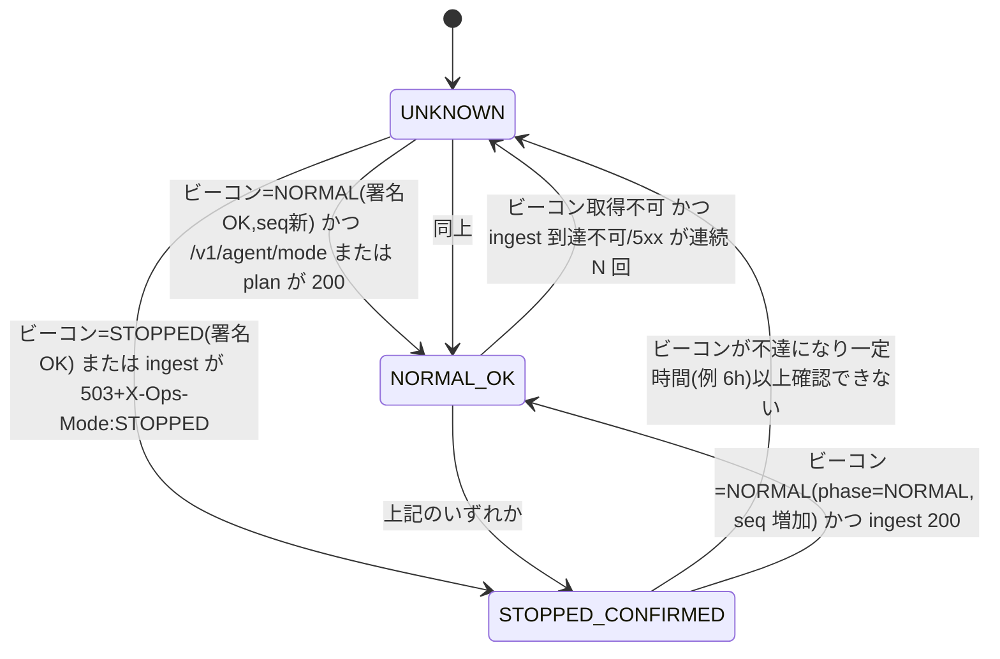

# CONTRACTS（web ⇔ infra 受け渡し契約・正本は本ファイル）

状態: **ドラフト 0.2.0（第1段階 / T1.2・T1.3・T1.15 を反映）**。クラウド選定（T1.7）後に確定する。infra 側 `docs/CONTRACTS.md` は本ファイルの版を参照する（infra 側の同期は T1.18）。変更時は両リポジトリの PROGRESS に記録する。

## 1. 成果物（web → infra）
| 成果物 | 内容 | 識別 |
|---|---|---|
| コンテナイメージ `dashboard` | Spring Boot dashboard | Artifact Registry、タグ=git SHA（不変）+ semver。デプロイは **digest 指定** |
| コンテナイメージ `bot` | bot-run / bot-scheduler-check（同一イメージで引数切替も可、第1段階で決定） | 同上 |
| コンテナイメージ `db-migration` | Flyway 実行 Job | 同上。マイグレーション版と対応 |
| `release-manifest.json` | 各イメージ digest、アプリ版、Flyway 最新版、契約版、ビルド日時、git SHA | GitHub Release asset または Artifact Registry 上の artifact。infra はこれのみを入力とする |
| Windows エージェント配布物 | zip（秘密を含まない） | GitHub Release asset（Private）。設定/トークンは別途ユーザー配置 |

web のレジストリ公開先・infra 側の pull 権限は **推測せず**、第5段階でユーザー確認の上 Workload Identity で付与する（別 Private リポジトリへの権限は未確認として扱う）。

## 2. 環境変数/設定（infra → app）※名称は暫定
| 名前 | 供給元 | 用途 |
|---|---|---|
| `APP_ENV` | Terraform | local/prod |
| `DB_URL` `DB_USER` | Terraform | 接続先（秘密でない） |
| `DB_PASSWORD` | Secret Manager | DB パスワード |
| `DISCORD_WEBHOOK_URL` | Secret Manager | 通知 |
| `ALLOWED_USERS` / `ADMIN_USERS` | Terraform（メールの許可リスト） | 空なら **全拒否** |
| `IAP_AUDIENCE` | Terraform | IAP JWT 検証 |
| `OPS_MODE_SOURCE` | Terraform | 運用モード正本（DB 非依存ストア）の参照先 |
| `MODE_BEACON_URL` `MODE_BEACON_PUBKEY` | Terraform / 配布 | モードビーコンの URL と検証用公開鍵（§7.2）。公開鍵はエージェントにも配布 |
| `INGEST_TOKEN_*` | Secret Manager（サーバ側はハッシュのみ保持） | エージェントトークンの発行・失効（§3.3） |
| `TZ` | 固定 | `Asia/Tokyo` |

## 3. API 契約（案）

### 3.1 サービス境界（重要）
直接 IAP は**人間のブラウザ用**で、機械クライアント（Windows エージェント）を通せない（OIDC ID トークン取得に長期鍵が必要になるため採用しない）。したがって **ingest は dashboard とは別のデプロイ単位（`ingest` サービス）**とし、IAP の外に置いてアプリ層で認証する（D-020）。ingest は DB 停止中は 503 を返す。`ingest` と `dashboard` と `bot` は互いに依存しない。

### 3.2 エンドポイント
| API | 呼び出し元 | 認証 | 内容 |
|---|---|---|---|
| `GET /internal/health` `/internal/ready` | infra | 機械用 | 正常性確認（起動手順の「正常性確認」） |
| `GET /internal/ops/mode` | bot / infra | 機械用 ID トークン | `{desired: NORMAL\|STOPPED, phase, actual:{...}, updatedAt}`（bot 用。モード正本から読む） |
| `GET /api/**` | ブラウザ | IAP + 許可リスト | 一般/管理者ロール分離。**テナント境界必須** |
| `POST /api/admin/**` | ブラウザ（管理者） | IAP + 管理者 | 手動補正・手動起動（開催検証あり）・エージェント発行/失効 |
| **`GET /v1/agent/mode`** | エージェント | トークン | DB 非依存の軽量応答 `{mode, phase, seq, updatedAt, sig}`。STOPPED 時も応答できる場合は応答（応答できないときはビーコン §7.2 で代替） |
| **`GET /v1/agent/plan`** | エージェント | トークン | 取得計画 `{planId, validUntil, items:[{dataspec, key, option, notBefore, interval}], idle:boolean}`。NORMAL 以外は `idle=true` |
| **`POST /v1/agent/ingest`** | エージェント | トークン + 署名 | 生レコードのバッチ（§3.4）。NORMAL 以外は 503（§7） |
| **`POST /v1/agent/heartbeat`** | エージェント | トークン | 状態通知（§3.5） |
| `GET /v1/agent/update` | エージェント | トークン | 署名付き更新 manifest（NORMAL のみ） |
| `POST /v1/agent/register` | エージェント（初回） | 登録コード | `agent_id` とトークンを発行（管理者が事前発行した 1 回限りコード） |
`/v1` はエージェントプロトコルのメジャーバージョン。破壊的変更は `/v2` を並行提供。

### 3.3 エージェント認証・権限（機械連携の分離）
- 主体: `agent_id`（テナントに属する）。トークンは 256bit ランダム、**サーバはハッシュ（SHA-256+ペッパー）のみ保存**、有効期限 90 日・ローテーション可・即時失効可。
- リクエスト署名: `X-Agent-Id`, `X-Timestamp`（±300 秒）, `X-Nonce`, `X-Signature = HMAC-SHA256(token, method|path|timestamp|nonce|sha256(body))`。トークン自体は送らない。nonce は 10 分保持（リプレイ防止）。
- 権限: エージェントは自テナントの ingest / heartbeat / plan / mode / update のみ。ダッシュボード API・管理 API は不可。
- 保管: PC 側は DPAPI。ログにトークン・本文を出さない。
- 失効・盗難時: 管理者 API で失効→以後 401。

### 3.4 ingest 封筒（JSON, gzip 可）
```json
{ "protocol": 1, "agentId": "…", "batchId": "uuidv7", "class": "S|R",
  "observedAt": "2026-11-01T01:23:45.678Z",
  "dataspec": "RACE", "option": 2, "fromtime": "20261101000000", "lastFileTimestamp": "20261031200000",
  "eof": true,
  "records": [ { "id": "RA", "bytesB64": "…cp932…", "sha256": "…" } ] }
```
- 1 バッチ ≤ 1 MB（gzip 後）・≤ 200 レコード。同一内容は**同一 `batchId` で再送**。
- 応答: `200 {accepted, duplicates, ackTs, serverTime}`。`ackTs` を受けて初めてエージェントはチェックポイントを前進（JVLINK_DESIGN §5.2）。
- 冪等: サーバは `batchId` と `record_hash` で重複を吸収。重複でも 200（`duplicate=true`）。

### 3.5 ハートビート
`{agentVersion, clockSkewMs, queueDepth, oldestQueuedAt, ackedTs:{…}, lastJvResult:{…}, diskFreeMb, lastError, mode:{local judgement}}`。NORMAL 時 60 秒毎。STOPPED/UNKNOWN 時は送らない（ビーコンのみ）。

### 3.6 ステータスコードと意味
| 応答 | 意味 | エージェントの扱い |
|---|---|---|
| 200 | 受理 | チェックポイント前進 |
| 400/413/422 | 不正な封筒（バグ） | そのバッチを DEAD へ、アラート。リトライしない |
| 401/403 | 認証失敗・失効 | **送信停止**し、ローカルアラート（トークン再発行が必要）。自動リトライしない |
| 409 | `batchId` は処理中 | 待って同一バッチで再送 |
| 429 | レート超過 | `Retry-After` に従う |
| **503 + `X-Ops-Mode: STOPPED`** | **運用モードが STOPPED（確定）** | §7: 送信・取得を止める。バックオフではなく**モード待機** |
| 503（ヘッダなし）/ 502 / 504 / タイムアウト / 接続不可 | 障害または STOPPED の副作用で**区別不能** | §7: UNKNOWN。安全側（送らない）。ビーコンで判別を試みる |
| その他 5xx | サーバ障害 | 指数バックオフ（上限あり）。ただし §7 の UNKNOWN 規則が優先 |

## 4. DB マイグレーション契約
- Flyway は `db-migration` イメージを Job として **デプロイごとに 1 回**。アプリ起動時 migrate は無効。
- 後方互換: 旧アプリ版が新スキーマで動く expand/contract 方式（ロールバック可能性のため）。破壊的変更は 2 リリースに分割。
- infra の deploy workflow は「migrate 成功 → dashboard/bot 更新」の順。

## 5. 運用モード契約
- 正本: infra 側 desired-state（**DB 非依存**のオブジェクトストア。T1.8 でクラウド確定後に具体化）。DB 内の値は表示用コピー（D-005）。
- start 順: DB 復帰 → migrate 要否確認 → Web/ingest 復帰 → 正常性確認 → bot 制御再開（Scheduler 有効化）→ **最後にビーコンを NORMAL へ更新**。
- stop 順: **ビーコンと desired を STOPPED に更新（最初）** → Scheduler 停止 → 実行中 Job に停止要求 → Web/ingest 受付停止 → DB アクセス終了 → DB 停止。
- Terraform apply/デプロイは mode を変更しない。STOPPED 中はリソースを起動しない（infra 側で `ignore_changes` 等。検証は T5.5）。
- `phase`: `NORMAL | STOPPING | STOPPED | STARTING`。**エージェントが送信を許可するのは `NORMAL` のみ**。`STARTING`/`STOPPING`/不明はすべて「送らない」。

## 6. 契約バージョン
`contract_version: 0.2.0-draft`。破壊的変更でメジャーを上げ、`release-manifest.json` に含める。エージェントプロトコルは `/v1`（`protocol: 1`）。
変更履歴: 0.1.0（第0段階）→ 0.2.0（ingest 別サービス化、エージェント認証、封筒、STOPPED 契約、ビーコン）。

## 7. Windows エージェントの STOPPED 時動作契約（T1.15）

### 7.1 原則
1. **安全側**: NORMAL が確認できない限り、データを取得もしない・送信もしない。
2. **無限リトライ禁止**: STOPPED/UNKNOWN 中はバッチ再送を行わず、モード確認のみを間隔を伸ばして実施。
3. **未送信データはローカルに安全に保持**（SQLite WAL キュー。上限と TTL は JVLINK_DESIGN §5.3）。
4. **復帰後は重複なく再送**（`batchId`/`record_hash` 冪等、チェックポイントは ACK 後のみ前進）。
5. 通信障害と STOPPED を**区別できる手段を別に持つ**（モードビーコン）。

### 7.2 モードビーコン
- DB・Web・ingest に依存しない**静的 JSON**（HTTPS GET）。`{mode, phase, seq, updatedAt, validUntil?, sig}`。`sig` は Ed25519（秘密鍵は infra の CI シークレット、公開鍵はエージェントに埋め込み）。`seq` は単調増加（巻き戻しは拒否）。キャッシュ禁止ヘッダ。
- 誰が書く: infra の start/stop ワークフローのみ（desired-state と同一操作）。**stop は最初、start は最後に更新**（§5 の順序）。
- クラウド非依存: URL が HTTPS で返せれば実装は任意（オブジェクトストレージの公開オブジェクト等。T1.8）。
- 可用性: 停止中も応答すること（コンピュート非依存）。

### 7.3 エージェントの状態機械

- **NORMAL_OK のみ**: plan 取得・JV-Link 取得・ingest 送信・heartbeat・更新確認を行う。
- **STOPPED_CONFIRMED**: 取得停止（JVOpen を呼ばない）、送信停止、ハートビート停止。ビーコンのみ **60 分間隔**で確認。キューは保持（TTL は進む）。アラートなし（想定内）。
- **UNKNOWN**: 取得停止、送信停止。ビーコン+`/v1/agent/mode` を **5 分→15 分→60 分（頭打ち、ジッタ±20%）**で確認。**UNKNOWN が 30 分続いたらローカル通知（トースト/ログ）**、開催日ウィンドウ中なら 3 時間で重大扱い（エージェントは自己通知手段を持たない。サーバ側のハートビート欠落検知が担当）。
- 判定規則:
  | 観測 | 判定 |
  |---|---|
  | ビーコン NORMAL(署名OK, `seq` 最新, 鮮度 ≤ `beaconMaxAge`=6h) かつ ingest 200 | NORMAL_OK |
  | ビーコン STOPPED/STOPPING/STARTING（署名OK） | STOPPED_CONFIRMED（STARTING は待機） |
  | ingest 503 + `X-Ops-Mode: STOPPED` | STOPPED_CONFIRMED |
  | ingest 503（ヘッダなし）/ 接続不可 / タイムアウト + ビーコン不達 | UNKNOWN（安全側）|
  | ingest 503/接続不可 + ビーコン NORMAL | 一時障害。NORMAL_OK 扱いだが**送信は止め**、バックオフ（上限 15 分）で再試行。ビーコンが NORMAL のまま ingest 障害が 30 分続けば UNKNOWN |
  | ビーコンの署名不正・seq 巻き戻し | 無視（UNKNOWN 維持）+ ローカルアラート |
  | 401/403 | 認証障害。送信停止+アラート（モード判定とは別） |

### 7.4 STOPPED 中の挙動と復帰
| 項目 | 動作 |
|---|---|
| 取得 | 実行中の JV-Link 取得は**現在のファイル/バッチ区切りで安全に中断**し、`fetched_ts` は進めず、読込済みは outbox に格納 |
| 未送信データ | outbox に保持。蓄積系(S)は上限内で無期限、速報(R)は TTL 7 日。上限超過は R の古い順に破棄（ログ・ハートビートで通知）。S は取得を停止し JV-Link サーバ側(1 年保持)から後で再取得 |
| 復帰（NORMAL_OK） | ①ジッタ（0〜120 秒）待機→②plan 取得→③outbox を古い順に **最大 2 バッチ/秒**で再送（429 で減速）→④空になったら通常取得へ。S の `fromtime` は `acked_ts - margin`（再取得で穴を埋める） |
| 重複 | 再送は同一 `batchId`。サーバは重複を吸収（200 duplicate）。ACK 前に落ちても二重登録しない |
| STOPPED 中のデータ欠損 | 速報オッズ(R) は STOPPED 中は取得しないため**欠損が発生する**。これは仕様（記録: `ingest_gap(reason=STOPPED)`）。STOPPED はそもそも bot 停止中 |
| STARTING | 受け付け準備中。送らない。ビーコンが NORMAL になるまで待機 |

### 7.5 infra への義務（infra 側ドキュメントへ同期: T1.18）
1. モードビーコンを提供・更新（stop=最初、start=最後）。署名鍵の管理は CI シークレット。公開鍵の配布手順を用意。
2. ingest サービスは STOPPED/STARTING 中、**DB に触れずに** `503 + X-Ops-Mode` を返せること（または受付停止で到達不能になってもエージェントがビーコンで判別できること）。Cloud Run を `ingress` 制限やスケールゼロにした場合の応答は保証されないため、ビーコンが主、`X-Ops-Mode` は補助。
3. STOPPED 中に ingest を完全停止してもよい（エージェントは UNKNOWN→ビーコンで STOPPED_CONFIRMED に収束）。
4. `status` ワークフローは `actual` に「ビーコン値」「ingest 応答」「最後のエージェントハートビート時刻」を含める。
5. Terraform は ビーコンの**箱**（バケット/オブジェクト）だけを管理し、内容は管理しない（apply で NORMAL に戻らない）。

### 7.6 テスト観点（第3・5段階）
STOPPED 中の `ingest` 503、ビーコンのみ STOPPED、両方不達（UNKNOWN）、ビーコン NORMAL + ingest 障害、署名不正/seq 巻き戻し、再起動後の STOPPED 維持、復帰時の再送順序/重複、キュー上限超過、長期 STOPPED（TTL 超過）、時計ずれ、部分失敗した start（ビーコンが NORMAL にならない=エージェントは待機のまま）。

