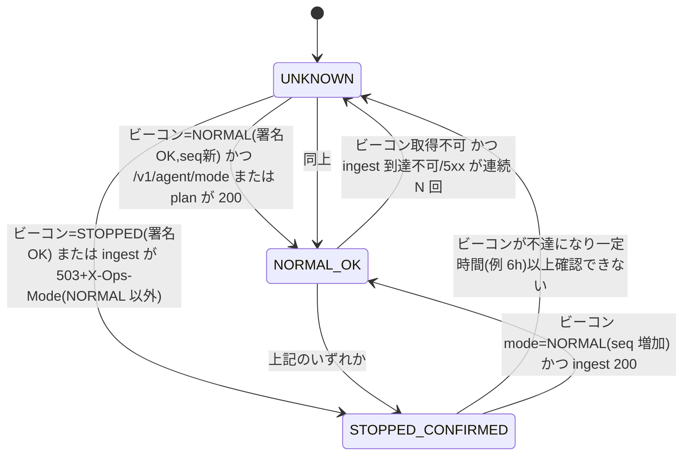

# CONTRACTS（web ⇔ infra 受け渡し契約・正本は本ファイル）

状態: **0.4.16（第4段階 / T4.1: 人の認可を実装。変更履歴を参照）。直前の 0.4.15（第3段階 / Flyway V5〈承認済み 2026-10-29〉: ①**スキーマ版 5**〈bot / ingest / dashboard の `requiredSchemaVersion` はすべて 5〉。`race_evaluations` に新方式の行だけの UNIQUE〈生成列 `uq_native`〉、新表 `race_timing_notice`〈PK `(tenant_id, race_id, timing_centi)`。通知内容の不変スナップショット `notice_json`・`notice_schema`・`notice_sha256`。追記専用〉 ②GRANT: bot は `race_timing_notice` の SELECT/INSERT のみ、app は SELECT のみ〈UPDATE・DELETE は誰にも付けない〉 ③§9.1: データ不足・checkpoint 隔離による評価機会の喪失も FAILED・exit 1〈`ALL_RACES_OFF_WITH_GAPS` は廃止〉、`EVALUATION_LOSS_ALREADY_RECORDED`〈exit 0〉 ④§9.2: 通知は**確定した行から**送り、確定の後・送信の前の中断は自動で再送しない〈at-most-once。exactly-once は保証しない〉。**infra への影響〈T5.0〉**: migrate を先に実行〈V5〉、`R__grants.sql` の同期〉）**。0.4.14（第3段階 / 包括バグ監査の修正〈AUDIT_FIX_DESIGN〉: ①§9.1 の bot-run の終了コード・理由の語彙に `EVALUATION_OPPORTUNITY_LOST`〈FAILED・exit 1〉と `ALL_RACES_OFF_WITH_GAPS`〈SUCCEEDED・exit 0・警告〉を追加 ②Job の最大実行時間は `BOT_RUN_MAX_RUNTIME_MINUTES` + 15 分以上 ③export-dataset の manifest に `quality.skipped.conditions_newer_than_as_of`〈1 件以上のときだけ〉 ④DB 接続の分離レベルを REPEATABLE READ に固定 ⑤エージェントは待機後に運用モードを再確認、Discord のシグナル通知は再試行前に運用モードを確認。既存の変数・意味・スキーマ版〈4〉・GRANT は変えていない。V5 は提案のみ〈D-217。未承認〉）**。0.4.13（T3.8 レビュー修正: ①`BOT_RUN_TIGHTEN_NEAR` を `false`/`true`/`legacy` の 3 値に ②任意の `BOT_RUN_PRIORITY_MODE`・`BOT_RUN_HIT_RATE_MIN_EV`・`BOT_RUN_HIT_RATE_MIN_EV_SCHEDULE`〈明示したときだけ有効〉 ③bot-run の運用モード確認は 15 秒以下の間隔で、UNKNOWN の 3 回連続は最初の観測から 45 秒以内に停止。既存の変数の意味・スキーマ・GRANT の変更なし）。0.4.12（第3段階 / T3.8: `bot-run` の業務ループ。①§2 に `BOT_RUN_*`（既定なし・必須）と `CALENDAR_*` の bot-run への適用、ML 有効時の `MODEL_STORE_URI`・`MODEL_VERIFY_PUBKEY` ②§9.1 に bot-run の終了コード・理由の語彙 ③§9.2 に SIGTERM の実装（シグナルハンドラ）・checkpoint のスキーマ・通知の出どころ ④§8.2: GRANT の変更なし〈bot は `race_evaluations` に既に INSERT 可〉・スキーマ版は 4 のまま）。0.4.11（第3段階 / T3.7: Discord 通知。①`DISCORD_MENTION_USER_ID`（任意・本人の個別メンション。ASCII 数字 17〜20 桁。`@everyone`・ロール・他のユーザーは常に不許可）を §2 に追加 ②`DISCORD_WEBHOOK_URL` / `DISCORD_ERROR_WEBHOOK_URL` は **`https://discord.com/api/webhooks/<id>/<token>` 形式だけ**を受け付け、他は exit 2（SSRF 対策。値はログに出さない）③§9.2 に通知の配送規則（DELIVERED / NOT_SENT / UNKNOWN と Signal の状態の対応、5xx・タイムアウト・切断は再送しない、一部のチャンクだけ送れた場合は UNKNOWN）④BACKFILL・非 NORMAL・停止要求では通知しない。契約の意味（claim → 送信 → 記録・二重通知より取りこぼし）は変えていない。infra への影響: T5.0 で `bot` の Secret に任意の `DISCORD_MENTION_USER_ID` を追加するだけ）**。0.4.10（第3段階 / T3.6-B: ①`export-dataset` の引数（`--dataset-id` `--from` `--to` `--feature-schema` 必須ほか）と `MODEL_STORE_URI`、データセットの manifest 保管（`{dataset_id}.manifest.json`・CSV の後に書く確定の印）②ml-train Job の具体化（引数・環境変数・終了コード・成果物の配置・model_id の決定的な導出・CANDIDATE/REJECTED のみ登録・品質ゲートは設定が無ければ fail closed）③V4（馬マスタの時点履歴 `horse_master_history`）④**`release-manifest` を schema_version 2 に改訂（破壊的）: `feature_schemas`（スキーマ別 hash）を追加し、`feature_schema_hash` を『スキーマ集合の hash』に確定（G-17 ⑧）**⑤ml-train イメージ（5 つ目）。infra への影響は §13 末尾と PROGRESS の I-H 項目）**。0.4.9（第3段階 / T3.6-A: §5.1 のモデル成果物・データセットの契約を具体化（正準 JSON・sha256・Ed25519 署名の対象と書式・検証鍵の書式・理由コード・データセットの列と manifest・レジストリの読取り）。契約の意味は変えない）**。0.4.8（第3段階 / T3.5: §3.2 の mode・plan・update の実装、§3.3.2 登録（register）の保留、§3.4 の重複 ACK への fetch・cursor の追加。P-1/P-2 は引き続き未承認）**。0.4.7（第3段階 / T3.4: V3、エージェント API の実装、環境変数の追加。§3.3 の署名方式と §3.4 の取得セッション・応答の追加は『提案 P-1 / P-2 / P-3』で、ユーザーの承認まで確定仕様ではない。0.4.5 以前の説明は下に残す）** — **0.4.5（第2段階 / T2.5 後半で §1・§10 にイメージの形式と manifest の検証規則を補足。T2.8 の 0.4.4 は §2・§3.2・§4.3・§9.1・§11。0.4.0 の契約の意味は変えていない）**。0.4.0 は第1段階 / T1.10 で確定した設計契約。infra の `docs/CONTRACTS.md` §2 の差異 D1〜D12 をすべて取り込んだ（対応表は §12）。実装・実リソースで確かめる必要がある箇所は「検証ゲート」として ID を書いている（一覧は `STAGE2_HANDOFF.md` §13）。
- 正本はこのファイル。infra 側は版番号を参照し、変更点を同期する。infra の文書を直す必要がある箇所は `PROGRESS.md` の「infra への引継ぎ」に記録する。web のセッションから infra を直接変更しない。
- 用語: **mode** は現在のフェーズ（`NORMAL | STARTING | STOPPING | STOPPED`）。**desired** は利用者の意図（`NORMAL | STOPPED`）。アプリが読み取りに失敗したときや、内容が不正なときの判定値は **`UNKNOWN`** とする。UNKNOWN はアプリ内部だけの値で、正本には書かない。旧版の `phase` は廃止して `mode` に統一した（実装はまだ無いため互換フィールドは置かない）。

## 1. 成果物（web → infra）
| 成果物 | 内容 | 識別 |
|---|---|---|
| コンテナイメージ `dashboard` | Spring Boot（`:dashboard`）。Web UI と `/api/v1/**` | Artifact Registry。タグ=git SHA（不変）。デプロイは **digest 指定** |
| コンテナイメージ `ingest` | Spring Boot（`:ingest`）。エージェント受信（§3.1） | 同上 |
| コンテナイメージ `bot` | Spring Boot（`:bot`）。**1 イメージで `--task=` を切り替える**: `bot-run` / `calendar-check` / `reconcile` / `retention` / `export-dataset` | 同上 |
| コンテナイメージ `db-migration` | Flyway CLI ラッパ（`:db-migration`）。`--mode=info\|validate\|migrate`（§4） | 同上 |
| コンテナイメージ `ml-train` | Python 学習 Job（`ml/`）。常駐しない（§5.1） | 同上。Python とライブラリの版をマニフェストに記録 |
| `release-manifest.json` | §10 のスキーマ | GitHub Release asset（web, Private）。infra はこれだけを入力にする |
| Windows エージェント配布物 | zip（秘密を含まない）+ 署名付き更新 manifest | GitHub Release asset（Private）。トークンは利用者が別途配置 |

web→Artifact Registry の push 権限と、infra 側の manifest 取得権限は**推測しない**。第5段階でユーザーの確認を得てから、Workload Identity Federation で付与する（infra 案: `sa-gha-web-push`）。

## 2. 環境変数/設定（infra → app）
| 名前 | 供給元 | 対象 | 用途 |
|---|---|---|---|
| `APP_ENV` | Terraform | 全 | `local` / `prod`。**0.4.4: 3 アプリとも必須**（未設定・他の値は起動失敗/Job は exit 2）。ローカル専用の挙動（モードのローカルファイル・スタブの成功終了・DB ユーザーの制限緩和）は `local` のときだけ |
| `TZ` | 固定 | 全 | `Asia/Tokyo`（表示・開催日判定用。保存は UTC: §8） |
| `DB_URL` | Terraform | DB を使う全て | `jdbc:mysql://<private-ip>:3306/jrabot?sslMode=VERIFY_CA&…`（§8） |
| `DB_USER` / `DB_PASSWORD` | Terraform / **Secret Manager** | 同上 | 用途別ユーザー（§8.2）。Secret 名は `db-<用途>-password` |
| `DB_POOL_MAX` | Terraform | 同上 | §8.3 の上限（アプリ既定値と同じ値を明示） |
| `OPS_MODE_SOURCE` | Terraform | dashboard / ingest / bot / ml-train | `gs://<prj>-ops-state/state/ops-state.json`（§5.2） |
| `AGENT_HEARTBEAT_PREFIX` | Terraform | ingest | `gs://<prj>-ops-state/agent/`（§5.4） |
| `MODE_BEACON_URL` | Terraform / 配布 | エージェント | `https://storage.googleapis.com/<prj>-mode-beacon/beacon/mode.json`（§7.2） |
| `MODE_BEACON_PUBKEYS` | 配布（エージェントに同梱） | エージェント | Ed25519 公開鍵（`kid` 付き、最大 2 本。ローテーション用） |
| `IAP_AUDIENCE` | Terraform | dashboard | IAP JWT の `aud`（§11.1） |
| `INTERNAL_ID_TOKEN_AUDIENCE` / `OPS_SA_EMAIL` | Terraform | ingest（dashboard は `OPS_SA_EMAIL` のみ） | `/internal/*` の ID トークン検証（§11.2） |
| `ALLOWED_USERS` / `ADMIN_USERS` | Terraform | dashboard | 許可リスト（メール）。**空なら全拒否**。DB の `app_user` との突合は §11.1 |
| `MODEL_STORE_URI` | Terraform | bot / ml-train | `gs://<prj>-model-store`（非公開）（§5.1） |
| `MODEL_SIGNING_KEY` | **Secret Manager**（`model-signing-key`） | ml-train のみ | モデル JSON の Ed25519 署名 |
| `MODEL_VERIFY_PUBKEY` | Terraform（公開値） | bot | 署名検証。Ed25519 公開鍵の生 32 バイトの Base64（カンマ区切りで複数 = ローテーション。§5.1） |
| `INGEST_TOKEN_PEPPER` | **Secret Manager**（`ingest-token-pepper`） | ingest / dashboard（発行） | エージェントトークンの**識別用**ハッシュのペッパー（§3.3。**署名の検証には使えない**: §3.3.1） |
| `AGENT_KEK_KEYS` / `AGENT_KEK_ACTIVE_KID` | **Secret Manager**（`agent-kek`）（**0.4.7・提案 P-1**） | ingest（本番は必須。無いと起動失敗） | エージェントの署名鍵を暗号化する鍵（KEK、256bit）。`AGENT_KEK_KEYS` は `kid:base64` のカンマ区切り（ローテーション用に複数）、`AGENT_KEK_ACTIVE_KID` が暗号化に使う kid。**DB には置かない**（DB だけが漏れても署名を偽造できない）。未設定の local は認証できず `/v1/agent/**` は 503 |
| `INGEST_ODDS_BELOW_PAR` / `INGEST_STORE_COMBO_ODDS` | Terraform（**0.4.7**） | ingest | `quarantine`（既定。`0<odds<1` を隔離。**提案 P-3**）／`accept`。ワイド・三連複オッズの保存（`true`／既定 `false`: D-043） |
| `INGEST_MAX_BODY_BYTES` / `INGEST_MAX_INFLATED_BYTES` | Terraform（任意。**0.4.7**） | ingest | 受信本文（gzip 後）の上限（既定 1 MiB）／展開後の上限（既定 32 MiB） |
| `INGEST_ACCEPT_NORMALIZED_RECORDS` | **local のみ**（本番で `true` にすると起動失敗。**0.4.7**） | ingest | 合成の正規化 JSON レコードを解析する（テスト用）。実データの JV-Data パーサは未実装（T1.17 の確認後） |
| `DISCORD_WEBHOOK_URL` / `DISCORD_ERROR_WEBHOOK_URL` | **Secret Manager** | bot（通知）/ 全（エラー） | 通知。**0.4.11**: 任意（未設定ならその宛先へは送らない）。`bot-run` のときだけ読む。形式は `https://discord.com/api/webhooks/<数字>/<トークン>` のみ（`discordapp.com`・`ptb`・`canary` も可）。他の URL・http・IP・ポート・クエリは exit 2（メッセージは変数名だけ）。**URL はトークンを含む秘密**でログ・本文・PR に出さない |
| `DISCORD_MENTION_USER_ID` | Terraform または Secret Manager（任意。**0.4.11**） | bot | 本人の Discord ユーザー ID（ASCII 数字 17〜20 桁）。設定時だけ本文先頭に `<@id>` を付け、`allowed_mentions` は `{"parse":[],"users":["<id>"]}`。未設定は `{"parse":[]}`（誰にもメンションしない）。不正な値は exit 2 |
| `CALENDAR_WATCH_START_MINUTES` / `CALENDAR_PRESTART_MINUTES` / `CALENDAR_SETTLE_DEADLINE_MINUTES` / `CALENDAR_STALE_AFTER_MINUTES` | Terraform（**運用値は未確定: D-016・D-122。既定値を置かない**） | bot（`--task=calendar-check`・`--task=reconcile`・`--task=bot-run` で必須。bot-run と reconcile も予定の鮮度判定に使う） | 監視ウィンドウ（最初の発走の何分前から監視するか=1〜1440、さらに前の起動余裕=0〜1440、最後の発走の何分後まで起動してよいか=1〜1440）と、開催日の確認の鮮度（何分を超えたら古い=1〜10080）。**1 つでも欠落・不正なら calendar-check は exit 2**（DB にもモード確認にも進まない）。他のタスクでは不要。**0.4.6（T3.3 / D-122）** |
| `RETENTION_EXECUTE` / `RETENTION_COMBO_ODDS_DAYS` / `RETENTION_INGEST_RAW_DAYS` / `RETENTION_SCHEDULE_EVENT_DAYS` / `RETENTION_BOT_RUN_DAYS` | Terraform（**すべて任意**） | bot（`--task=retention` だけ） | 保持期間を過ぎた記録の削除（任意の環境変数の追加のみなので契約の版は上げない）。`RETENTION_EXECUTE` の既定は **false = ドライラン**（件数を数えるだけ）。**実データの削除は本人の承認の上で `true` を明示**する（`--dry-run` を付ければ常にドライラン）。日数の既定は組オッズ 14・生レコード 30（解析待ちは残す）・予定履歴 365・実行記録 365（実行中は残す）。範囲 7〜3650。対象外（無期限）: races・results・payouts・signals・評価・単勝オッズ。終了コード 0（`RETENTION_DRY_RUN`/`RETENTION_DONE`/`RETENTION_TRUNCATED`）・75（DB 不達） |
| `RUN_JOBS_PROJECT_ID` / `RUN_JOBS_REGION` / `RUN_JOBS_PREFIX` | Terraform（**本番の calendar-check では必須**。他のタスクでは不要） | bot（`--task=calendar-check`） | Cloud Run Jobs の起動先（R2）。Job 名は `<PREFIX>-<task>`（PREFIX 既定 `jra-bot` → `jra-bot-bot-run` など）。起動は REST v2 `jobs.run` で**引数だけを上書き**（`--task`・`--tenant-id`・日付など）。calendar-check の実行 SA（`sa-bot`）に、対象 Job への `roles/run.jobsExecutorWithOverrides` が要る（infra。プロジェクト全体には付けない）。欠落・形式不正は終了コード 2 |
| `BOT_RUN_LEASE_SECONDS` / `BOT_RUN_HEARTBEAT_SECONDS` | Terraform（**0.4.12。運用値は未確定: D-122。既定値を置かない**） | bot（`--task=bot-run` のみ必須） | `bot_run` のリース期限（10〜3600 秒）と heartbeat の間隔（1 秒以上で期限より短い）。設計の案は 300 / 60 |
| `BOT_RUN_POLL_FAR_SECONDS` / `BOT_RUN_POLL_MID_SECONDS` / `BOT_RUN_POLL_NEAR_SECONDS` | Terraform（0.4.12。既定なし） | bot-run | ポーリング間隔（1〜3600 秒）。発走まで 30 分超 = far、5 分超 = mid、それ以下 = near（旧 `get_polling_interval` の分岐）。旧の既定は 300 / 60 / 30 |
| `BOT_RUN_MAX_ODDS_AGE_SECONDS` / `BOT_RUN_MAX_RUNTIME_MINUTES` / `BOT_RUN_STALE_CLAIM_SECONDS` / `BOT_RUN_MAX_CYCLE_FAILURES` | Terraform（0.4.12。既定なし） | bot-run | オッズの鮮度の上限（1〜86400 秒。これを超えたオッズでは**通知しない**。設計の案は 180）／最大稼働（1〜840 分。契約の上限 14 時間。**Job の最大実行時間はこれ + 15 分以上**にする: DRAINING・checkpoint の保存の猶予。同じ値だとアプリの自己停止の前にプラットフォームに強制終了される）／起動時に回収する古い claim の古さ（60〜86400 秒）／連続して失敗したサイクルの上限（1〜20） |
| `BOT_RUN_SNAPSHOT_MINUTES` / `BOT_RUN_TIGHTEN_NEAR` / `BOT_RUN_SNAPSHOT_HISTORY_LIMIT` | Terraform（0.4.12。既定なし） | bot-run | 評価・通知のタイミング（発走の何分前か。カンマ区切り。各値で 1 回だけ発火: D-196）／旧の『5 分前はフィルタを強化』を再現するか（`true`/`false`: D-198）／急落判定の直近スナップショット件数（2〜100。旧の既定は 3） |
| `BOT_RUN_ML_MODEL_TYPE` / `BOT_RUN_DECISION_PROFILE` | Terraform（0.4.12。既定なし） | bot-run | ML の種別（`off`=市場確率 / `legacy` / `calibration` / `alpha` / `ensemble`。パイプラインは legacy 固定。v2 は未承認）／判定の設定（**今は `legacy_function_defaults` だけ**＝旧関数の既定値。運用値ではない: D-197）。`off` 以外では `MODEL_STORE_URI`・`MODEL_VERIFY_PUBKEY` も必須 |
| `BOT_RUN_PRIORITY_MODE` / `BOT_RUN_HIT_RATE_MIN_EV` / `BOT_RUN_HIT_RATE_MIN_EV_SCHEDULE` | Terraform（0.4.13。**任意**・未設定なら現在の固定閾値方式） | bot-run | `edge`/`hit_rate`、hit_rate の固定閾値、`far=…,mid=…,near=…`（旧 `hit_rate_min_ev_schedule`。残り >=30 分 far、>=5 分 mid、それ以下 near。`hit_rate` のときだけ設定可。D-206） |
| `RELEASE_ID` / `REQUIRED_SCHEMA_VERSION` | イメージに焼き込み（ビルド時） | 全 | 版の表示と ready 判定（§4.3）。**0.4.4**: `REQUIRED_SCHEMA_VERSION` は実行 jar の `jrabot-app.properties`（Gradle が生成）に焼き込まれ、**環境変数では上書きしない**（infra が渡す必要は無い）。`RELEASE_ID` は環境変数があれば表示用に使う |

- 秘密は Secret Manager だけに置く。GitHub、イメージ、ログ、Terraform の state に秘密の値を置かない。値が state に載る Terraform リソースは使わない（第5段階）。
- 名前は 0.4.0 で確定した。変更するときは契約のマイナー版を上げ、infra と同期する。

## 3. API 契約

### 3.1 サービス境界
直接 IAP は**人間のブラウザ用**で、機械クライアント（Windows エージェント）は通れない。OIDC の ID トークンを取るには長期鍵が必要になるため、その方式は採らない。そこで **ingest を dashboard とは別のサービス**にし、IAP の外に置いてアプリ層で認証する（D-020）。`dashboard` / `ingest` / `bot` は互いに依存しない（ARCHITECTURE §2）。

### 3.2 エンドポイント
| API | 提供 | 呼び出し元 | 認証（§11） | 内容 |
|---|---|---|---|---|
| `GET /internal/health` | dashboard / ingest | infra（start S8・status） | dashboard: IAP + ops SA / ingest: Google ID トークン（ops SA） | プロセスの生存確認。DB にもモードにも依存しない。`200 {status:"UP", release}` |
| `GET /internal/ready` | dashboard / ingest | 同上 | 同上 | 受付の準備ができているか（§4.3）。DB 接続 OK かつスキーマ版 ≥ `REQUIRED_SCHEMA_VERSION` で 200、それ以外は 503。**mode が NORMAL でなくても判定する**（start の S8 は mode=STARTING の間に呼ばれるため） |
| `GET /internal/ops/mode` | dashboard / ingest | infra（status） | 同上 | そのインスタンスの `ModeProvider` から見えるモード `{mode, desired, seq, cacheAgeMs, source:"gcs"\|"unknown"}`。**読み取り専用**。bot は使わない（bot は GCS を直接読む: §5.2）。**0.4.4**: 採用中の値だけを返し（15 秒キャッシュ。呼ぶたびに GCS を読まない）、UNKNOWN のときは `desired`/`seq`/`cacheAgeMs` が null で `source:"unknown"`。`APP_ENV=local` のローカルファイル実装では `source:"file"`（本番では現れない）。正本の JSON 全文・パス・`set_by` などは返さない |
| `GET /api/v1/**` | dashboard | ブラウザ | IAP + `app_user` | DTO のみ返す。テナント境界は必須。一般/管理者の区別は §11.1 |
| `POST/PUT/DELETE /api/v1/admin/**` | dashboard | ブラウザ（管理者） | IAP + `ROLE_ADMIN` + CSRF | 手動補正、手動起動（開催検証あり）、エージェントの発行/失効。**mode=NORMAL のときだけ**受け付け、それ以外は 409 `OPS_MODE_NOT_NORMAL` |
| `GET /v1/agent/mode` | ingest | エージェント | **認証なし**（0.4.8） | **DB に触れず**、ModeProvider が見ているモードと seq `{mode, seq}` を返す（NORMAL 以外でも 200）。署名はしない: ビーコンの署名鍵は Secret Manager で `sa-gha-ops` だけが読めるため ingest は署名できず、DB を使う認証は STOPPED 中の目的に反する。ビーコンと同じ公開情報だけ。エージェントは判定の主を署名付きビーコンに置き、これは「サーバが応答する」補助確認にだけ使う（§7.3） |
| `GET /v1/agent/plan` | ingest | エージェント | トークン + 署名 | **0.4.8 実装済み**。`INGEST_VERIFIED_FETCH_SPECS`（公式仕様で確認済みと運用者が明示した `dataspec[:option]`。**既定は空 = 常に idle**）に無い項目は配らない。項目は `INGEST_PLAN_ITEMS_JSON`（本人専用）。YSCH の key が 16 桁なら `targetFrom`+`targetTo`。取得計画 `{planId, validUntil, items:[{dataspec, key, option, notBefore, interval}], idle}`。NORMAL 以外は 503（§3.6） |
| `POST /v1/agent/ingest` | ingest | エージェント | トークン + 署名 | 生レコードのバッチ（§3.4）。NORMAL 以外は 503。**0.4.7 実装済み** |
| `POST /v1/agent/heartbeat` | ingest | エージェント | トークン + 署名 | 状態通知（§3.5）。最終接続時刻の写しを GCS に書く（§5.4）。**0.4.7 実装済み**（DB の `agent_heartbeat`。GCS への写しは未実装で `SKIPPED`） |
| `GET /v1/agent/update` | ingest | エージェント | トークン + 署名 | **0.4.8 実装済み**。`INGEST_UPDATE_MANIFEST_PATH` の署名済み manifest をそのまま返す（無ければ 204）。サーバは署名鍵を持たず検証もしない（オフラインで署名。エージェントが Ed25519 で検証: `{schema_version, version, platform, sha256, size, url, issuedAt, kid, sig}`）。NORMAL のときだけ |
| `POST /v1/agent/register` | ingest | エージェント（初回） | 登録コード | `agent_id` とトークンを発行する。登録コードは管理者が事前に発行する 1 回限りのもの。**0.4.8 でも未実装（保留。§3.3.2）**（発行ロジック `AgentCredentialIssuer` と保存 `AgentRegistrar` はあり、HTTP は T3.5 / 管理操作 T4.4） |

- `/v1` はエージェントプロトコルのメジャー版。破壊的な変更をするときは `/v2` を並行して提供する。
- 人向けの HTML ルート（`/`、`/races/...` など）は `/api/v1` と同じアプリケーションサービスを使う（FRONTEND_DESIGN §4.4）。

### 3.3 エージェント認証・権限（機械連携の分離）
- 主体: `agent_id`（**全体で一意**。V3 の UNIQUE。テナントは `agent` の行から決まり、リクエスト本文のテナントは信用しない）。トークンは 256bit ランダム、有効期限 90 日・ローテーション可・即時失効可。
- リクエスト署名: `X-Agent-Id`, `X-Timestamp`（Unix 秒、±300 秒）, `X-Nonce`（16〜64 文字の `[A-Za-z0-9_-]`）, `X-Signature`（小文字 16 進 64 桁）。トークン自体は送らない。nonce は 10 分保持（リプレイ防止。署名が正しいと確認できた後にだけ消費する）。
- **署名の定義（0.4.6 まで）**: `X-Signature = HMAC-SHA256(token, method|path|timestamp|nonce|sha256(body))`、サーバは「SHA-256＋ペッパーのハッシュ」だけを保存。→ **この 2 つは両立しない（§3.3.1）。0.4.6 の記述のままではサーバは署名を検証できない。**
- **署名の定義（0.4.7 の実装・提案 P-1。未承認）**: 署名鍵 `K = HMAC-SHA256(token, "jra-bot/agent-sign/v1")`、`X-Signature = HMAC-SHA256(K, method|requestUri|timestamp|nonce|sha256(送信した本文のバイト列))`（`requestUri` はクエリを含む。本文は gzip 後のバイト列そのもの = 認証の前に展開しない）。サーバは K を KEK で AES-256-GCM 暗号化して保存（AAD にテナント・エージェント・kid を含め、暗号文を別の行へ移しても復号できない）。トークンそのものは保存せず、発行の瞬間にだけ見る。
- 認証の順序: ヘッダ形式 → 時刻 → エージェント解決 → 署名（定数時間比較）→ 失効（403。署名が正しい相手にだけ）・期限切れ（401）→ nonce 消費（再利用は 401）。失敗の応答は状態コードのみ（理由を出さない）。存在しないエージェントでもダミーの署名計算をする。
- 権限: エージェントは自テナントの ingest / heartbeat / plan / mode / update のみ。ダッシュボード API・管理 API は不可。
- 保管: PC 側は DPAPI。ログにトークン・署名・nonce・本文を出さない（テスト `AgentAuthIntegrationTest` で検査）。
- 失効・盗難時: 管理者 API で失効→以後 403。KEK の漏えい時は kid を切り替えて全エージェントのトークンを再発行する。

#### 3.3.2 登録（register）と資格情報のライフサイクル（0.4.8。HTTP は保留、設計のみ）
管理者認証（T4.1/T4.4）が無い段階で、誰でも登録コードを発行できる API は**作らない**。`POST /v1/agent/register` は次の条件が揃うまで実装しない: ① 登録コードは 256bit 乱数・SHA-256 だけを保存・1 回限り・15 分で失効・テナントとエージェント名に束縛（推測・使い回し不可）② 発行は管理者 API（IAP + ROLE_ADMIN + CSRF、T4.4）またはオフラインの運用タスクだけ ③ 失敗回数の制限（G-12）。それまでの本人の PC への導入は `agent set-credential`（手元で発行されたトークンを標準入力から DPAPI 保存）。失効はサーバ側 `status=REVOKED`（403）＋端末側 `clear-credential`、再発行は新トークンで上書き（古い署名鍵は即無効）。トークン期限（90 日）の 14 日前に警告する運用は T5 以降。
#### 3.3.1 署名方式の検証と代替案（提案 P-1。T3.4 の調査結果・D-130）
**暗号学的な検証**: HMAC の検証には、署名した側と同じ鍵（`token` または `token` から決定的に導いた値）をサーバが持つ必要がある。SHA-256(pepper‖token) は一方向関数で、ハッシュから `token` は復元できない（原像計算困難性）。したがってサーバが保存するのがハッシュだけなら、`HMAC(token, m)` を計算して照合することはできない。ハッシュそのものを HMAC の鍵にする（エージェントも同じハッシュを持つ）なら、保存値＝鍵になり、DB の漏えいだけで署名を偽造できる（ハッシュ化の意味が無い）。ペッパーをエージェントに配ると、ペッパーの秘匿が崩れる。単体テスト `AgentAuthTest` が、ハッシュを鍵にした署名は本物と一致しないことを確認している。

| 比較項目 | A 0.4.6 の記述（HMAC(token)＋ハッシュ保存） | **B 導出鍵 HMAC＋KEK 暗号化（実装）** | C B の KEK を Cloud KMS で保護 | D Ed25519 署名（公開鍵だけ保存） |
|---|---|---|---|---|
| 成立するか | **不成立**（検証不能） | 成立 | 成立 | 成立 |
| セキュリティ | - | 良い。署名鍵は DB 上で暗号化 | B と同等＋KEK がアプリのメモリに出ない | **最も強い**（サーバに秘密が無い） |
| サーバ侵害時の影響 | - | DB 漏えいだけでは偽造不可。**KEK ＋ DB の両方**が漏れると全エージェントの署名を偽造可能（kid 切替で全再発行） | DB ＋ KMS の呼び出し権限の両方 | 公開鍵が漏れても偽造不可。署名の検証だけなら侵害の影響が最小 |
| 登録・失効 | - | 発行時にトークンを 1 回だけ渡す。失効は `status` 更新 | 同左 | エージェントが鍵対を生成し、公開鍵を登録コードと一緒に送る。失効は同様 |
| トークン更新 | - | 再発行（新トークン→新 K） | 同左 | 新しい鍵対を作り公開鍵を再登録 |
| Windows エージェントとの互換 | - | **標準ライブラリだけ**（`hmac`・`hashlib`）。D-018 の「薄い Python」に最適 | 同左 | `cryptography` または PyNaCl の追加依存（PyInstaller に同梱）。秘密鍵は DPAPI で保護 |
| 実装量 | - | 小（実装済み・テスト済み） | 中（KMS クライアントと IAM） | 中（署名検証・登録の鍵受取・クライアント側の鍵生成） |
| GCP での鍵管理 | - | Secret Manager に KEK 1 つ（既存の Secret に追加） | Cloud KMS の鍵 1 本＋復号の権限（`sa-ingest`） | 不要（公開鍵は DB） |
| 運用コスト | - | ほぼ 0（Secret Manager の 1 シークレット。見積りは infra の CLOUD_COSTS） | 鍵と操作の従量課金（金額は未確認。infra で見積り） | ほぼ 0 |
| 契約の変更 | 無し | `X-Signature` の鍵が `token`→`K`（エージェントは未実装なので互換問題なし） | 同 B | 署名アルゴリズムの変更（`X-Signature` の形式と登録 API が変わる） |

**推奨と扱い**: 単一利用者・小規模・Python の薄いエージェントなので **B を実装した**（このコードで `/v1/agent/ingest`・`heartbeat` が動く）。将来さらに強くしたければ D（署名方式の変更は別の承認）。**契約の変更なので、承認までは確定仕様にしない**（UNRESOLVED D-5）。承認が得られない場合も、実装は `AgentSigning` と `AgentAuthenticator` に閉じているので差し替えられる。エージェント（T3.5）がまだ無いため、現時点で互換性の問題は起きない。

### 3.4 ingest 封筒（JSON, gzip 可）
```json
{ "protocol": 1, "agentId": "…", "batchId": "uuidv7", "class": "S|R",
  "observedAt": "2026-11-01T01:23:45.678Z",
  "dataspec": "RACE", "option": 2, "fromtime": "20261101000000", "lastFileTimestamp": "20261031200000",
  "eof": true,
  "fetch": { "id": "uuid", "seq": 0, "targetFrom": "20261101", "targetTo": "20271231", "origin": "LIVE", "backfillId": null },
  "records": [ { "id": "RA", "bytesB64": "…cp932…", "sha256": "…" } ] }
```
- 1 バッチ ≤ 1 MB（gzip 後）・≤ 200 レコード（1 レコード ≤ 256 KiB）。同一内容は**同一 `batchId` で再送**。
- **検証（0.4.7 実装）**: 未知のキーは拒否（`tenantId` を含む。理由 `TENANT_FIELD_FORBIDDEN`）。`protocol`=1、`agentId` は認証したエージェントと一致（違えば 403）、`batchId` は小文字の UUIDv7、`class` は S/R で dataspec と整合（S: RACE・YSCH・RCVN・RCOV／R: 0B11・0B12・0B14・0B15・0B30・0B31・0B33・0B35。**一覧は二次情報**で公式表は T1.17）、`observedAt` は UTC（`Z`）で未来 5 分以内・速報は 7 日以内、`fromtime`/`lastFileTimestamp` は実在する `yyyyMMddHHmmss`、各レコードは厳密な標準 Base64 と SHA-256 の一致、EOF 以外の空バッチは拒否。
- 応答: `200 {accepted, duplicates, quarantined, unsupported, duplicate, ackTs, serverTime, fetch, cursor}`。`accepted`=新しく保存した生レコード数、`duplicates`=既知の `record_hash`、`quarantined`=不正で隔離（FAILED）、`unsupported`=解析できず保留（PENDING）。`duplicate=true` は**同じ内容で完了済みのバッチの再送**（件数は最初の処理のもの）。`ackTs` を受けて初めてエージェントはチェックポイントを前進（JVLINK_DESIGN §5.2）。`cursor` は取得セッションが EOF まで連続して読了したときだけ（サーバのカーソルが進んだ印）。
- **重複 ACK の追加項目（0.4.8・D-144。追加のみ）**: `duplicate=true` の応答にも、バッチが取得セッションに属するときは `fetch`（`id`・`status`・`nextSeq`）を付け、セッションが LIVE で成功していて**サーバのカーソルがその値以上**なら `cursor` も付ける。通常の完了応答も、カーソルが既に同値以上で `advance` が false だった場合に `cursor` を付ける。ACK の応答だけが失われて再送された場合に `acked_ts` が止まり続けるのを防ぐ（旧実装は `cursor=null`）。
- 冪等: `ingest_batch` の `(tenant_id, batch_id)` と `payload_sha256`（検証済みの項目と各レコードの SHA-256 から作る指紋。JSON の整形・gzip の違いに依存しない）。同じ内容 → 重複 ACK（200）／同じ `batchId` で内容が違う、または別のエージェントが使った `batchId` → 422 `BATCH_ID_REUSED`／処理中 → 409 `BATCH_IN_PROGRESS`（120 秒以上放置された処理は再送で引き継ぐ）／失敗した（FAILED）バッチは再送で引き継ぐ。
- `record_hash` = SHA-256(`dataspec`・`id`・`class`・（R のときだけ `observedAt`）・レコードの SHA-256)。蓄積系は同じバイト列なら同じ値（重なりを持たせた再取得を吸収）。速報は観測時刻ごとに別（同じオッズでも別時刻は時系列の別の点）。
- **提案 P-2（未承認）取得セッション `fetch`**: 蓄積系（S）の 1 回の `JVOpen` が複数バッチに分かれるとき、`fetch.id`（UUID）・`seq`（0 始まりの連番）・`targetFrom`/`targetTo`（`yyyyMMdd`。YSCH の対象範囲）・`origin`（`LIVE`／`BACKFILL`）・`backfillId` を付ける。これが無いと**取得の完了（EOF まで欠けなく読了）をサーバが確認できない**ため、`fetch` なしのバッチは保存・適用されるが、取得の事実もカーソルの前進も作られない。サーバは `seq` が連続しない（先走りは 409 `FETCH_SEQ_AHEAD`、重複は 422 `FETCH_SEQ_REUSED`）、終了した取得への追加（422 `FETCH_CLOSED`）、属性の食い違い（422 `FETCH_MISMATCH`）を拒否する。
- 取得の事実（YSCH）は、EOF まで連続して読了し、全レコードを解析・適用でき、`targetFrom`/`targetTo` の申告があるときだけ作られ、範囲は `[targetFrom, min(targetTo, この取得で見た最後の開催日)]`（それより先は「まだ公表されていない」と区別できないため）。実データ形式のレコードは解析できない（保留）ので、**現時点では実データの YSCH から取得の事実は作られない**（fail closed）。
- **提案 P-3（未承認）**: `0 < odds < 1` は取込境界で隔離（`INGEST_ODDS_BELOW_PAR`）。計算側の `Odds`・旧 Python の数値は変えない。

### 3.5 ハートビート
`{agentVersion, clockSkewMs, queueDepth, oldestQueuedAt, ackedTs:{…}, lastJvResult:{…}, diskFreeMb, lastError, mode:{local judgement}}`。NORMAL 時 60 秒毎。STOPPED/UNKNOWN 時は送らない（ビーコンのみ）。

### 3.6 ステータスコードと意味
| 応答 | 意味 | エージェントの扱い |
|---|---|---|
| 200 | 受理 | チェックポイント前進 |
| 400/413/422 | 不正な封筒（バグ）。0.4.7 のコード: `INVALID_JSON`・`INVALID_GZIP`・`BODY_TOO_LARGE`・`BODY_TOO_LARGE_INFLATED`・`TOO_MANY_RECORDS`・`UNSUPPORTED_PROTOCOL`・`UNSUPPORTED_DATASPEC`・`INVALID_*`・`RECORD_SHA256_MISMATCH`・`BATCH_ID_REUSED` ほか | そのバッチを DEAD へ、アラート。リトライしない |
| 401/403 | 認証失敗・失効 | **送信停止**し、ローカルアラート（トークン再発行が必要）。自動リトライしない |
| 409 | `batchId` は処理中（`BATCH_IN_PROGRESS`）／取得セッションの手前のバッチが未着（`FETCH_SEQ_AHEAD`）／バックフィルが別の取得で進行中（`BACKFILL_BUSY`） | `Retry-After` に従い、待って同一バッチで再送 |
| 429 | レート超過 | `Retry-After` に従う |
| **503 + `X-Ops-Mode: <STARTING|STOPPING|STOPPED>`** | **運用モードが NORMAL 以外（確定）** | §7: 送信・取得を止める。バックオフではなく**モード待機** |
| 503（ヘッダなし）/ 502 / 504 / タイムアウト / 接続不可 | 障害または STOPPED の副作用で**区別不能** | §7: UNKNOWN。安全側（送らない）。ビーコンで判別を試みる |
| 503 + `Retry-After`（`UNAVAILABLE`） | DB の一時障害（デッドロック・ロック待ち・接続）。バッチ全体は巻き戻っている | 同一バッチで再送 |
| その他 5xx（500 `INTERNAL`） | サーバ障害 | 指数バックオフ（上限あり）。ただし §7 の UNKNOWN 規則が優先 |

## 4. DB マイグレーション契約（D6）
**0.4.7 追加（V3 `V3__ingest_auth_fetch_backfill.sql`。V1/V2 は不変）**: `agent` に `sign_key_enc`・`sign_key_kid`（暗号化した署名鍵。NULL の行は認証できない）と `agent_id` の全体 UNIQUE、`ingest_batch` に `fetch_id`・`fetch_seq`・`fail_reason`、新規 `ingest_fetch`（取得セッションと取得の事実の正本）・`ingest_backfill`（バックフィル要求。実行中の同一要求だけ UNIQUE）、`combo_odds_snapshots.odds_high`（ワイド上限）、`ingest_gap` に `(tenant_id, id)` の UNIQUE（複合 FK 用）。権限は `R__grants.sql`（ingest: `ingest_fetch` SELECT/INSERT/UPDATE・`ingest_backfill` SELECT/UPDATE、bot: `ingest_fetch` SELECT・`ingest_backfill` SELECT/INSERT/UPDATE、app: 両表 SELECT。**app は署名鍵の列を読めない**）。ingest・bot の必要スキーマ版は 3。
### 4.1 原則
- Flyway は `db-migration` イメージを Cloud Run Job として実行する。**アプリの起動時には実行しない**。アプリのイメージには Flyway を入れない（`spring.flyway.enabled` に頼らず、依存として持たない）。
- 実行する場面は 2 つ。① **deploy**: mode=NORMAL のときにリリースごとに 1 回 `migrate`。② **start**: S4 で `info` → `validate`。未適用の版があれば start を失敗させる。`apply_pending_migrations=true` を指定したときだけ `migrate` する（infra OPERATIONS_DESIGN §5）。
- 後方互換は expand/contract で保つ。旧アプリ版が新スキーマで動くようにし（ロールバック可能性のため）、破壊的な変更は 2 リリースに分ける（DATA_MIGRATION_DESIGN §3.1）。
- deploy workflow の順序: NORMAL を確認 → `migrate` → ingest → Jobs 定義 → dashboard → status。
- `db-migration` は `ModeProvider` を参照しない。いつ実行するかは呼び出し側（infra）の責任とする。

### 4.2 `db-migration` の CLI
| 引数 | 動作 | 終了コード |
|---|---|---|
| `--mode=info` | 現在版・未適用版・失敗版を **JSON 1 行で標準出力**: `{"current":"2","pending":["3"],"failed":[],"latest":"3"}` | 0（DB に接続できないときは 75） |
| `--mode=validate` | 適用済みのチェックサム一致・失敗版なし・`outOfOrder` なしを検証する。結果を JSON で出力 | 0=適用済みが正しく未適用なし / **10=正しいが未適用あり** / 1=不一致・失敗版あり / 75=DB 不達 |
| `--mode=migrate` | 未適用版を適用する。その後 `R__grants.sql` で権限を再適用する（§8.2） | 0=成功 / 1=失敗（Flyway が失敗版を記録。自動の修復はしない）/ 75=DB 不達 |
- `--mode` は必須で既定値は無い。未指定・不正な引数・`DB_URL` `DB_USER` `DB_PASSWORD` の不足は終了コード 2（標準出力は空、詳細は標準エラー）。
- **出力（0.4.1 で補足）**: 標準出力は JSON 1 行だけ。診断は標準エラー（パスワードは伏せる）。Repeatable の未適用・失敗は `"R__<説明>"`（例: `"R__grants"`）。`info` は上記 4 キーのみ（DB が空なら `"current":null`）。`validate` は `{"valid":true,"current":…,"pending":[…],"failed":[…],"latest":…,"errors":[…]}`、`migrate` は `{"success":true,"applied":[…],"current":…,"pending":[…],"failed":[…],"latest":…}`。失敗は `{"mode":"…","error":"unavailable"|"failed"}`。
- **75 になるのは接続系だけ**（接続拒否・タイムアウト・通信断・サーバ停止中/接続数超過）。認証失敗・DB が無い・SQL の誤りは 1（再試行しても直らない）。接続の待ちは既定 10 秒（`connectTimeout`）。
- `validate` の未適用の判定は、変更された Repeatable（`R__grants.sql` の内容変更）も含む（→ 10）。履歴のある DB が image より新しい版を持つ場合（旧 image での検証）は不整合にしない。
- 履歴の無い空でないスキーマには `migrate` しない（1。`baselineOnMigrate=false`）。
- 固定する設定: `validateOnMigrate=true`、`outOfOrder=false`、`baselineOnMigrate=false`、`cleanDisabled=true`、`group=true`（1 回の実行の版をまとめる。MySQL は DDL が暗黙コミットされるため、効くのは DML だけ）。
- 接続ユーザーは `migrate`（DDL 権限）だけを使う（§8.2）。

### 4.3 アプリの起動・ready とスキーマ版
- 各アプリのイメージには、ビルド時に `REQUIRED_SCHEMA_VERSION`（そのアプリが必要とする最小のスキーマ版）を焼き込む。
- `/internal/ready` と Job の開始時に `flyway_schema_history` の最大成功版を読み、`REQUIRED_SCHEMA_VERSION` 未満なら ready=503。Job は終了コード 1 で終える（不一致のまま動かない）。
- スキーマ版が `REQUIRED_SCHEMA_VERSION` より**新しい**ことは許容する（expand/contract の前提）。
- **0.4.4 の補足（T2.8 / D-084）**: ① `REQUIRED_SCHEMA_VERSION` はビルド時に実行 jar へ焼き込み（環境変数では上書きしない）。現在の 3 アプリは `2`。② 読むのは `flyway_schema_history` の `success=1` の行だけ。版は数値の組として比較する（`10` > `9`）。履歴の表が無い DB は「不足」（マイグレーションを勝手に実行しない）。③ **DB に接続できない（一時障害）と、スキーマ不足・認証失敗・DB/権限の誤りを区別する**: ready は `DB_UNAVAILABLE` / `SCHEMA_INSUFFICIENT` / `DB_AUTH_FAILED` / `DB_ERROR` の理由で 503。Job は接続不能のみ 75、不足・認証・権限・想定外は 1。④ ready の本文: 200 は `{status:"READY", schemaVersion, requiredSchemaVersion}`、503 は `{status:"NOT_READY", reason, …}`（接続情報・例外メッセージを含まない）。ready は運用モードを見ない（STARTING/STOPPED/UNKNOWN でも DB とスキーマが良ければ 200）。

## 5. 運用モード契約（D1・D4・D5）
### 5.1 ML 成果物・ジョブ契約（D12）
- **モデル成果物**: `model_schema_version: 1` の JSON と `.sig`（ML_DESIGN §5.2）。置き場は `MODEL_STORE_URI/{tenant_id}/models/{model_id}.json`。レジストリは DB の `ml_model`。bot は `ACTIVE` のモデルだけを読む。読む前に `sha256`・署名・`feature_schema_hash`・重みの長さを検証する。検証に失敗したら読み込みを拒否し、フォールバック理由を記録する。
- **データセット**: bot の `--task=export-dataset` が `MODEL_STORE_URI/{tenant_id}/datasets/{dataset_id}.csv.gz` に出力する（gzip CSV、列順は `feature_schema`）。保持は 90 日（GCS のライフサイクル）。**Git や CI のログには載せない**。
- **ml-train Job（0.4.10 の具体化: `ml/`、イメージ `ml-train`、ENTRYPOINT `/opt/venv/bin/python -m ml_train`）**: `train --tenant-id N --dataset-id ID --config 学習設定.json [--gate 品質ゲート.json]`。環境変数: `APP_ENV` `OPS_MODE_SOURCE`（`file://`）`MODEL_STORE_URI`（`file://`）`MODEL_SIGNING_KEY`（生 32 バイトのシードの Base64。Secret Manager）`MODEL_VERIFY_PUBKEY`（任意。署名鍵の公開鍵が含まれることを起動時に検査）`DB_URL` `DB_USER`（本番は `mltrain`）`DB_PASSWORD` `GIT_SHA`。終了コード: 0=正常（**CANDIDATE の登録・REJECTED の登録・登録済み（冪等）・STOPPED 等によるスキップ**を含む。理由は JOB_RESULT の `reason`: `CANDIDATE_REGISTERED` `MODEL_REJECTED` `ALREADY_REGISTERED` `MODE_<mode>`）／1=データセット不正・学習失敗・署名検証失敗・DB の認証/権限・想定外／2=引数・設定の誤り／75=保存先・DB 不達・モード UNKNOWN・SIGTERM による確定前の中断。成果物: `{MODEL_STORE_URI}/{tenant_id}/models/{model_id}.json|.sig`（`.sig` を先、`.json` が確定の印）と `{tenant_id}/reports/{model_id}.report.json`。`model_id` は (テナント・データセットの CSV の sha256・学習設定・品質ゲート設定・種別・ml-train の版) から決まる決定的な値で、同じ入力の再実行は `ALREADY_REGISTERED`（重複行を作らない）。登録は `CANDIDATE` と `REJECTED` だけ（`ACTIVE` にしない。型で禁止）。**品質ゲートの数値は既定値を持たず未承認**: ゲート設定が無い／check が 0 個なら `REJECTED`（fail closed）、設定した check が評価できなければ不合格。SIGTERM は確定（レジストリ登録）の前なら、この実行が作った成果物だけを片付けて 75 で終わる。入力は `--tenant-id`、`--dataset-id`、学習設定。**学習データは GCS のデータセットだけから読み、DB の業務テーブルには触れない**。出力はモデル JSON・署名・評価レポートを GCS に書き、`ml_model` に `CANDIDATE` の行を INSERT する（品質ゲート不合格なら `REJECTED`）。ACTIVE への昇格は管理者が dashboard で行う（ml-train にはその権限が無い）。
- **DB 権限**（DB ユーザー `mltrain`）: `ml_model` の `SELECT, INSERT` だけ（§8.2）。UPDATE、DELETE、他テーブルへのアクセスは不可。テナントは引数で受け取り、INSERT する行の `tenant_id` はその値に固定する。DB の行単位権限が無いので、越境はテナント引数の検証と監査（`created_by=ml-train:<execution>`）で防ぐ。
- **モード**: Job の開始時に §5.2 の方法でモードを確認し、NORMAL 以外なら何もせず終える（§9）。
- **infra の義務**: ①バケット（東京・非公開・バージョニング・データセットはライフサイクル 90 日）と IAM（ml-train: models の書込とデータセットの読取 / bot: models の読取とデータセットの書込〔export-dataset〕）、②署名鍵の Secret、③`ml-train` Job の定義（Scheduler は最初 paused）、④STOPPED のときに Job を起動しない。
- 互換性: bot は `model_schema_version` の N と N-1 を読める。
- **0.4.9（T3.6-A）での具体化**（詳細と根拠は ML_DESIGN §11、判断は D-154〜D-161）:
  - **正準 JSON**: UTF-8・空白なし・キーはコードポイント順・文字列は `"`・`\`・制御文字だけをエスケープ・整数と浮動小数は別（`1` と `1.0` は別の正準形）・浮動小数は Python の `repr(float)`・NaN/Infinity/重複キーは不可。Python の `json.dumps(obj, sort_keys=True, separators=(",", ":"), ensure_ascii=False, allow_nan=False)` と同一バイト。**モデル JSON ファイルは正準形で書く**。
  - **ハッシュ**: モデルの `sha256` = `sha256` を除いた正準 JSON の SHA-256（小文字 16 進 64 桁）。`feature_schema.hash` = `"sha256:"` + `hash` を除いた正準 JSON の SHA-256（`ml_model.feature_schema_hash CHAR(71)`）。`ensemble_set` の `feature_schema_hash` は `ensemble` オブジェクトの正準 JSON の SHA-256（`sha256:` 付き）。
  - **署名**: Ed25519（RFC 8032 pure）。`.sig` は生の 64 バイトで、対象は**モデル JSON ファイルのバイト列そのもの**。bot は署名の検証を JSON の解析より前に行う。`MODEL_VERIFY_PUBKEY` は公開鍵の生 32 バイトの Base64（カンマ区切りで複数 = ローテーション）。鍵が無い・不正なら全モデルを拒否。
  - **検証の順序と理由コード**: 署名（`MODEL_SIGNATURE_INVALID`）→ 構文・正準形・型（`MODEL_INVALID`）→ スキーマ版（`MODEL_SCHEMA_MISMATCH`）→ `sha256`・レジストリの記録（`MODEL_HASH_INVALID`）→ `feature_schema`（`FEATURE_SCHEMA_MISMATCH`）→ 重み・前処理の長さ（`INVALID_MODEL_DIMENSION`）→ テナント・ID・種別の取り違え（`MODEL_INVALID`）。成果物が無い（`MODEL_NOT_FOUND`）・ACTIVE が無い（`MODEL_NOT_ACTIVE`）・I/O 失敗（`MODEL_STORAGE_ERROR`）・推論失敗（`MODEL_PREDICTION_FAILED`）・最終的に市場確率のみ（`MARKET_FALLBACK`）。`race_evaluations.fallback_reason VARCHAR(64)` にこの名前を保存する。
  - **データセット**: `{dataset_id}.csv.gz` + manifest。列は `tenant_id,race_id,umaban,race_date,as_of` + 特徴量（`feature_schema` の順）+ `label` + `split`。`split` は Kotlin が日付で決め（train より後の日だけが valid）、学習側は再分割しない。正本のハッシュは非圧縮 CSV の SHA-256（manifest の `csv.sha256`）。学習側は `tools/ml/dataset_contract.py` 相当の検証に通ったデータセットだけで学習する。manifest の保管（`DatasetStore` への追加）は T3.6-B。
  - **レジストリ**: bot は `ml_model` を SELECT する（run の開始時に ACTIVE を固定: `ModelRunPin`）。昇格・退役の書込みは dashboard の管理操作（Stage 4）だけ。ml-train は `CANDIDATE`/`REJECTED` の INSERT だけ。

### 5.2 正本と `ModeProvider`（D1・D4）
- **正本**は GCS の `ops-state.json`（infra OPERATIONS_DESIGN §2.2、`schema_version: 1`）。DB には依存しない。DB 内のモードは表示用の写し（D-005）。
- アプリが使うフィールドは `schema_version`、`seq`、`mode`、`desired.mode`、`desired.set_at`、`operation.type/status` だけ。それ以外は無視する（前方互換）。
- `ModeProvider`（`:domain` のポート。GCS 実装は `:cloud-gcp`）:
  | 項目 | 規則 |
  |---|---|
  | 取得 | ランタイム SA の ADC で `OPS_MODE_SOURCE` を読む（読取のみ）。タイムアウト 3 秒 |
  | キャッシュ | **成功した結果を 15 秒**保持する。失敗した結果はキャッシュせず、次の呼び出しで再取得する（ただし再試行は最短 5 秒間隔） |
  | 検証 | `schema_version==1`、`mode ∈ {NORMAL, STARTING, STOPPING, STOPPED}`、`desired.mode ∈ {NORMAL, STOPPED}`、`seq` が整数 |
  | 判定 | 取得失敗・タイムアウト・JSON 不正・検証 NG・未知のスキーマ版 → **`UNKNOWN`**。**UNKNOWN は NORMAL として扱わない**。直前の成功値も使わない（キャッシュが切れたら UNKNOWN） |
  | 単調性 | 同じプロセス内で `seq` が以前より小さい値を読んだら UNKNOWN にして警告を出す（書き戻りや改竄の検知） |
  | ログ | 状態が変わったときだけ INFO（`mode`、`seq`）。UNKNOWN になったら WARN と理由 |
- 型: `enum OpsMode { NORMAL, STARTING, STOPPING, STOPPED, UNKNOWN }`。UNKNOWN は正本には存在しない値で、アプリ内部の判定結果だけに使う。
- 実装の補足（0.4.3 / T2.7 / D-077〜D-080。契約の意味は変えない）: ① `desired.set_at` と `operation.*` は**任意**（欠落・null 可。あれば型を検査。`operation.status` の値の種類は検査しない）。② 同じ `seq` で `mode` / `desired.mode` が違う読取りも UNKNOWN（`seq` は書込みごとに +1 の契約と矛盾するため）。同じ `seq` で内容が同じなら正常。③ 巻き戻りの検知はプロセスの存続中ずっと有効。正本を意図して巻き戻す（復元）場合は稼働中のアプリの再起動が必要（infra の復旧手順へ: T5.0）。④ 読取りのタイムアウト 3 秒は呼び出し側から見た上限として強制する。⑤ ローカルファイルは `APP_ENV=local` のときだけ。`OPS_MODE_SOURCE` の未設定・不正は起動失敗。

### 5.3 モードごとのアプリの振る舞い
| 対象 | NORMAL | STARTING / STOPPING / STOPPED | UNKNOWN |
|---|---|---|---|
| bot `calendar-check` / `reconcile` / `retention` / `export-dataset`、`ml-train` | 実行 | **DB に接続する前に**判定して何もせずに終了。exit 0、理由 `MODE_<mode>` | 何もせず終了。**exit 75**（§9、異常として通知） |
| bot `bot-run` | 実行。各サイクルの開始時に再確認（キャッシュ ≤15 秒） | 開始前なら exit 0。実行中なら DRAINING → checkpoint を保存して exit 0（`STOPPED_BY_MODE`） | 開始前なら exit 75。実行中なら新しいサイクルを始めず、**3 回連続（約 45 秒）UNKNOWN** になったら DRAINING → checkpoint → exit 75 |
| ingest `/v1/agent/plan\|ingest\|heartbeat\|update` | 処理 | **DB に触れず** `503` + `X-Ops-Mode: <mode>` | `503`（`X-Ops-Mode` なし） |
| ingest `/v1/agent/mode`、`/internal/*` | 応答 | 応答（`/v1/agent/mode` はビーコンと同じ内容） | 応答（`/v1/agent/mode` は 503） |
| dashboard 閲覧 | 可 | STARTING/STOPPING は上部に固定バナーを出して閲覧可（DB が動いていれば）。**STOPPED では ingress=internal のため外部から到達できない（D11）** | 「運用状態を確認できません」のバナーを出して閲覧可 |
| dashboard 管理操作（書込） | 可 | 409 `OPS_MODE_NOT_NORMAL` | 409 |
| `db-migration` | — | 判定しない（§4.1） | — |

### 5.4 エージェント最終接続の写し（D5）
- ingest は heartbeat を受けたら `AGENT_HEARTBEAT_PREFIX + "heartbeat-<tenant_id>.json"` を更新する。条件は「前回の書込から 5 分以上経った」または「`agent_version` が変わった」。
  ```json
  { "schema_version": 1, "tenant_id": 1,
    "agents": [ { "agent_id": "ag_…", "last_seen_at": "2026-11-01T01:23:45Z", "agent_version": "0.3.0" } ],
    "updated_at": "2026-11-01T01:23:45Z" }
  ```
- 書くのは**時刻・ID・版だけ**。データ本文、トークン、IP、メールアドレスは書かない。`tenant_id` は内部の数値 ID（個人情報ではない）。
- テナント境界: ingest は**認証済みエージェントのテナントのファイルだけ**を更新する（パスは認証結果から組み立て、リクエストの値は使わない）。更新は `ifGenerationMatch` の CAS で行い、412 なら再読込して 1 回だけ再試行する。
- 書込の失敗は警告ログだけにする。heartbeat の応答（200）には影響させない。DB の `agent_heartbeat` は従来どおり正本として残し、GCS の写しは DB 停止中の status 用とする。
- 権限: ingest SA はこのプレフィックスの書込だけ。読むのは `sa-gha-ops`（status）。

### 5.5 start / stop の順序（infra OPERATIONS_DESIGN §5・§6 が詳細の正本）
- start: mode=STARTING → ビーコン STARTING → DB 復帰 → `db-migration info/validate` → ingest の受付再開 → dashboard の受付再開 → `/internal/ready` → Scheduler 再開 → mode=NORMAL → **最後にビーコン NORMAL**。
- stop: **最初に** mode=STOPPING とビーコン STOPPING → Scheduler 停止 → 実行中 Job の排出・キャンセル（§9.2）→ 受付停止（ingress=internal）→ DB 接続の消滅確認 → DB 停止 → mode=STOPPED → ビーコン STOPPED。
- Terraform apply とデプロイは mode を変えない。STOPPED 中は deploy を拒否するのが既定（infra OPERATIONS_DESIGN §8）。
- **エージェントが送信してよいのは mode=NORMAL のときだけ**。STARTING、STOPPING、不明のときはすべて「送らない」。

## 6. 契約バージョン
`contract_version: 0.4.15`（0.4.15 は V5〈スキーマ版 5・新表・GRANT〉と理由語彙の整理〈破壊的ではない追加。旧版のアプリは新しい DB でも動く〉。0.4.14 は 0.4.13 に対する理由語彙の追加・Job の余白の明記・接続の分離レベルの固定・manifest の任意キーの追加だけ。0.4.13 は 0.4.12 への任意項目の追加と `BOT_RUN_TIGHTEN_NEAR` の値の拡張〈`false`/`true`/`legacy`。旧 `true` の意味は『修正後』に変わる〉だけ。0.4.12 は bot-run の環境変数（必須・既定なし）と終了コード・理由の語彙の具体化で、既存の変数・意味は変えていない。0.4.11 は環境変数の追加と §9.2 の配送規則の具体化だけで、意味の変更なし。0.4.9 までは 0.4.0 から意味を変える変更は無かった。0.4.10 は release-manifest の schema_version を 2 に上げる破壊的変更を含む（本番 manifest は未発行なので移行は不要）。§3.3 の署名方式は P-1 の承認で確定する§3.3 の署名方式は P-1 の承認で確定する）。破壊的な変更はメジャー版を上げ、`release-manifest.json` に含める。エージェントプロトコルは `/v1`（`protocol: 1`）。第2段階以降に実装でずれが見つかったら 0.4.x / 0.5.0 として本ファイルで管理する。1.0.0 は第6段階の統合レビューで凍結する。

## 7. Windows エージェントの STOPPED 時動作契約（T1.15）

### 7.1 原則
1. **安全側**: NORMAL が確認できない限り、データを取得もしない・送信もしない。
2. **無限リトライ禁止**: STOPPED/UNKNOWN 中はバッチ再送を行わず、モード確認のみを間隔を伸ばして実施。
3. **未送信データはローカルに安全に保持**（SQLite WAL キュー。上限と TTL は JVLINK_DESIGN §5.3）。
4. **復帰後は重複なく再送**（`batchId`/`record_hash` 冪等、チェックポイントは ACK 後のみ前進）。
5. 通信障害と STOPPED を**区別できる手段を別に持つ**（モードビーコン）。

### 7.2 モードビーコン（D1・D2）
- DB・Web・ingest のどれにも依存しない**静的 JSON**（HTTPS GET、`MODE_BEACON_URL`）。
  ```json
  { "schema_version": 1, "mode": "NORMAL", "seq": 42, "updatedAt": "2026-11-01T00:00:00Z",
    "validUntil": null, "kid": "beacon-2026a", "sig": "<base64url Ed25519>" }
  ```
- `mode` は §5 の 4 値（**`phase` は廃止**）。`seq` は `ops-state.seq` と同じ値で単調増加し、エージェントは巻き戻りを拒否する。`validUntil` は任意（null ならエージェント側の `beaconMaxAge`=6h を使う）。
- **署名**: `sig = Ed25519(秘密鍵, UTF-8(canonical))`。canonical は `sig` を除いたフィールドを**キーの辞書順・空白なし**で直列化した JSON。値は文字列・整数・null だけなので、RFC 8785 と同じ結果になる。
- **秘密鍵は Secret Manager**（`beacon-signing-key`）に置き、`sa-gha-ops` だけが読める。**GitHub に長期の秘密鍵を置かない**（D2）。公開鍵はエージェントに同梱する（`kid` 付きで最大 2 本）。ローテーションは「新しい鍵を同梱したエージェントを配布 → 署名を新しい鍵へ切替 → 次の配布で古い鍵を削除」の順で行う。
- 書くのは infra の start/stop ワークフローだけ（ops-state と同じ操作）。更新のタイミングは、stop では **STOPPING（最初）→ STOPPED（最後）**、start では **STARTING（最初）→ NORMAL（最後）**。`Cache-Control: no-store`。
- 可用性: 停止中も応答できること（コンピュートに依存しない GCS の公開オブジェクト。このオブジェクト専用のバケットに置く）。

### 7.3 エージェントの状態機械

- **NORMAL_OK のみ**: plan 取得・JV-Link 取得・ingest 送信・heartbeat・更新確認を行う。
- **STOPPED_CONFIRMED**: 取得停止（JVOpen を呼ばない）、送信停止、ハートビート停止。ビーコンのみ **60 分間隔**で確認。キューは保持（TTL は進む）。アラートなし（想定内）。
- **UNKNOWN**: 取得停止、送信停止。ビーコン+`/v1/agent/mode` を **5 分→15 分→60 分（頭打ち、ジッタ±20%）**で確認。**UNKNOWN が 30 分続いたらローカル通知（トースト/ログ）**、開催日ウィンドウ中なら 3 時間で重大扱い（エージェントは自己通知手段を持たない。サーバ側のハートビート欠落検知が担当）。
- 判定規則:
  | 観測 | 判定 |
  |---|---|
  | ビーコン NORMAL(署名OK, `seq` 最新, 鮮度 ≤ `beaconMaxAge`=6h) かつ ingest 200 | NORMAL_OK |
  | ビーコン STOPPED/STOPPING/STARTING（署名OK） | STOPPED_CONFIRMED（STARTING は待機） |
  | ingest 503 + `X-Ops-Mode`（値あり） | STOPPED_CONFIRMED |
  | ingest 503（ヘッダなし）/ 接続不可 / タイムアウト + ビーコン不達 | UNKNOWN（安全側）|
  | ingest 503/接続不可 + ビーコン NORMAL | 一時障害。NORMAL_OK 扱いだが**送信は止め**、バックオフ（上限 15 分）で再試行。ビーコンが NORMAL のまま ingest 障害が 30 分続けば UNKNOWN |
  | ビーコンの署名不正・seq 巻き戻し | 無視（UNKNOWN 維持）+ ローカルアラート |
  | 401/403 | 認証障害。送信停止+アラート（モード判定とは別） |

### 7.4 STOPPED 中の挙動と復帰
| 項目 | 動作 |
|---|---|
| 取得 | 実行中の JV-Link 取得は**現在のファイル/バッチ区切りで安全に中断**し、`fetched_ts` は進めず、読込済みは outbox に格納 |
| 未送信データ | outbox に保持。蓄積系(S)は上限内で無期限、速報(R)は TTL 7 日。上限超過は R の古い順に破棄（ログ・ハートビートで通知）。S は取得を停止し JV-Link サーバ側(1 年保持)から後で再取得 |
| 復帰（NORMAL_OK） | ①ジッタ（0〜120 秒）待機→②plan 取得→③outbox を古い順に **最大 2 バッチ/秒**で再送（429 で減速）→④空になったら通常取得へ。S の `fromtime` は `acked_ts - margin`（再取得で穴を埋める） |
| 重複 | 再送は同一 `batchId`。サーバは重複を吸収（200 duplicate）。ACK 前に落ちても二重登録しない |
| STOPPED 中のデータ欠損 | 速報オッズ(R) は STOPPED 中は取得しないため**欠損が発生する**。これは仕様（記録: `ingest_gap(reason=STOPPED)`）。STOPPED はそもそも bot 停止中 |
| STARTING | 受け付け準備中。送らない。ビーコンが NORMAL になるまで待機 |

- 注: STOPPED_CONFIRMED は「NORMAL 以外であることを確認した」状態を指す（STARTING・STOPPING を含む）。

### 7.5 infra の義務（infra OPERATIONS_DESIGN と同期済み）
1. モードビーコンを提供・更新する（§7.2）。署名鍵は Secret Manager に置く。公開鍵の配布手順を用意する。
2. ingest は NORMAL 以外のとき、**DB に触れずに** `503 + X-Ops-Mode` を返す（§5.3）。STOPPED では ingress=internal になり、エージェントから到達できなくなる。その場合もエージェントはビーコンで判別できるので、ビーコンが主で `X-Ops-Mode` は補助。
3. STOPPED 中は ingest を受付停止にしてよい（エージェントは UNKNOWN → ビーコンで STOPPED_CONFIRMED に収束する）。
4. `status` ワークフローの `actual` には、ビーコンの値、ingest の応答、エージェントの最終接続（§5.4 の GCS の写し）を含める。
5. Terraform はビーコンの**箱**（バケット・オブジェクト）だけを管理し、中身は管理しない（apply で NORMAL に戻らないようにする）。

### 7.6 テスト観点（第3・5段階）
STOPPED 中の `ingest` 503、ビーコンのみ STOPPED、両方不達（UNKNOWN）、ビーコン NORMAL + ingest 障害、署名不正/seq 巻き戻し、再起動後の STOPPED 維持、復帰時の再送順序/重複、キュー上限超過、長期 STOPPED（TTL 超過）、時計ずれ、部分失敗した start（ビーコンが NORMAL にならない=エージェントは待機のまま）。


## 8. DB 接続契約（D8・D10）
### 8.1 接続
- Cloud SQL for MySQL **8.4 LTS（暫定の基準、D10）**、Enterprise エディション、`db-g1-small`、**プライベート IP のみ**。9.7 LTS への変更は第2段階のゲート G-DB-0（Testcontainers で 8.4 と 9.7 × Flyway × Connector/J × Doma の互換性を検証）の結果を見て判断する。それまで SQL は 8.4 と 9.7 の共通機能に限る。
- 接続方式の第一案は、Direct VPC egress 経由でプライベート IP へ JDBC 接続し、**TLS を必須**にする（`sslMode=VERIFY_CA` + Cloud SQL のサーバ CA を信頼ストアへ。IP 接続のため `VERIFY_IDENTITY` は使えない見込みで、要確認 G-DB-7）。代替案は Cloud SQL Java Connector（`ipTypes=PRIVATE`）。G-DB-5（IAM DB 認証）の結果と合わせて第2段階で選ぶ。
- 認証は当面パスワード（Secret Manager）。IAM DB 認証が JDBC で使えれば（G-DB-5）、パスワードをやめる。
- 文字セット `utf8mb4`、`serverTimezone=UTC`（接続のセッションも `time_zone='+00:00'`）。時刻は UTC の `DATETIME(6)` で保存し、表示だけ JST にする（DATA_MIGRATION_DESIGN §2）。
- **0.4.2 の補足（T2.4 / D-070〜D-073）**: アプリの接続は `:persistence` の `DataSourceFactory`（HikariCP）が作り、次を**設定で外せない固定値**にする: `connectionInitSql = SET time_zone = '+00:00'`、`connectionTimeZone=UTC`、`characterEncoding=UTF-8`、**`useAffectedRows=true`**（upsert の `UNCHANGED` を更新件数 0 で判定するため。Connector/J の既定 false では変更なしも 1 件になる）、`rewriteBatchedStatements=false`、`allowMultiQueries=false`、接続タイムアウト 10 秒、`maxLifetime` 25 分。環境変数は `DB_URL` `DB_USER` `DB_PASSWORD` `DB_POOL_MAX`（1〜24。実行単位ごとの既定値は §8.3）。他の JDBC クライアントでこれらの表を更新する場合も `useAffectedRows` の違いに注意する。

### 8.2 用途別の DB ユーザー
| ユーザー | Secret | 使う実行単位 | 権限（`R__grants.sql` で定義、Flyway が適用） |
|---|---|---|---|
| `migrate` | `db-migrate-password` | db-migration | DDL と、他ユーザーへの GRANT/REVOKE |
| `app` | `db-app-password` | dashboard | 全テナント表の SELECT。書込は管理操作の表（`calendar_override`、`agent`、`audit_log`、`ml_model.status` の昇格、`bot_run` への手動起動要求）と、手動補正の履歴（`race_schedule_event` への **INSERT のみ**。補正の追記・取消と同じトランザクションで MANUAL_OVERRIDE・MANUAL_REVOKE を残すため。0.4.6 / D-125）だけ |
| `ingest` | `db-ingest-password` | ingest | 取込先の表（`races` 系、`odds_snapshots`、`results`、`payouts`、`ingest_batch`、`ingest_raw`、`agent_heartbeat`、`agent_nonce` など）の SELECT/INSERT/UPDATE。DELETE は `agent_nonce` の期限切れだけ |
| `bot` | `db-bot-password` | bot（全 `--task`） | 業務表の SELECT。判定・成績・実行管理の表（`signals`、`bets`、`bet_legs`、`race_evaluations`、`ticket_evaluations`、`bot_run`、`race_schedule` の状態など）の INSERT/UPDATE。DELETE は保持ポリシー対象の表だけ（`retention` 用。ドライランと管理者承認: D-043） |
| `mltrain` | `db-mltrain-password` | ml-train | `ml_model` の SELECT/INSERT だけ（§5.1、D12） |
- ユーザーそのものは infra（Terraform）が作り、パスワードは Secret Manager に置く。**GRANT は web の Flyway（`R__grants.sql`）が `REVOKE ALL` → 最小限の GRANT の順で定義する**。Cloud SQL が API で作ったユーザーに付ける既定の権限と、`migrate` が GRANT できる範囲は要検証（G-DB-6）。
- **0.4.1 の補足（T2.3 / D-065）**: `R__grants.sql` は `migrate` ユーザー自身の権限に触れない（infra が `GRANT ALL ON <schema>.* TO migrate WITH GRANT OPTION` まで付ける）。app / ingest / bot / mltrain は infra が先に作る（無いユーザーへの GRANT は失敗＝exit 1。ユーザーを勝手に作らない）。`app` の SELECT は「全テナント表」から `ingest_raw`・`agent_nonce`・`import_quarantine`・`agent.token_hash`・`agent_registration_code.code_hash` を除く。`app` の `agent` への書込は失効の列（`status, revoked_at, revoked_by`）だけで、エージェントの INSERT（登録）は `ingest`。`app` / `ingest` / `bot` は `flyway_schema_history` を SELECT できる（§4.3 の ready 判定）。`mltrain` は読めない（要検討: T3.x）。CI の MySQL コンテナでの検証であり、**Cloud SQL では未検証（G-DB-6）**。
- テナントは行単位では DB で強制できない（MySQL に RLS が無い）。DAO の必須引数、SQL の静的検査、複合 FK、越境テストで多重に防ぐ（DATA_MIGRATION_DESIGN §4）。

### 8.3 接続プールの上限（初期値）
| 実行単位 | プール上限 | 最大インスタンス/同時実行 | 最大接続 |
|---|---|---|---|
| dashboard | 3 | 2 | 6 |
| ingest | 3 | 2 | 6 |
| bot-run | 4 | 1（リースで 1 本） | 4 |
| calendar-check / reconcile / retention | 各 1 | 各 1 | 3 |
| export-dataset | 2 | 1 | 2 |
| db-migration | 2 | 1 | 2 |
| ml-train | 1 | 1 | 1 |
| **合計（全部が同時に動いた最悪の場合）** | | | **24（≤ 25）** |
- HikariCP の `maximumPoolSize` は `DB_POOL_MAX` で上書きできる。既定値はこの表の値。`connectionTimeout` は 10 秒、分離レベルは **REPEATABLE READ に固定**（サーバの既定に任せない。0.4.14。UNIQUE の無い表への `INSERT … WHERE NOT EXISTS` の重複防止が READ COMMITTED では成り立たないため）、`maxLifetime` は Cloud SQL 側の `wait_timeout` より短くする。
- インスタンス数・同時実行数・`max_connections` を変えたときは、この表の合計を再計算して見直す（db-g1-small の `max_connections` の既定値は要確認 G-DB-1）。最大インスタンス数を増やすと合計が増えるので、その場合はプール上限を下げる。

## 9. Job の実行契約（D9）
### 9.1 終了コード
| コード | 意味 | 例 | Scheduler/Jobs の扱い |
|---|---|---|---|
| **0** | 正常。何もすることが無かった場合も含む | 非開催日、mode が NORMAL 以外（STARTING/STOPPING/STOPPED）、モードを確認して計画どおり中断 | 何もしない |
| **75** | 一時的な失敗（EX_TEMPFAIL） | DB 不達、GCS 不達、**モード UNKNOWN**、外部 API のタイムアウト | **再試行しない**（`max-retries=0`）。通知する。次の定期起動に任せる |
| 2 | 引数・設定の誤り | `--task` 不明、必須の環境変数が無い | 通知する |
| 1・その他 | 失敗（バグ・検証 NG・スキーマ版不足） | 例外、`REQUIRED_SCHEMA_VERSION` 未満 | 通知する |
- `db-migration` だけは `10`（validate で未適用あり）を追加で使う（§4.2）。通常の Job（bot）は 10 を使わない。
- **0.4.4 の補足（T2.8 / D-085）**: 設定不正（`OPS_MODE_SOURCE` の未設定・不正、`APP_ENV` の誤り、DB の環境変数の不足、本番での `bot` 以外の DB ユーザー）は **2**。想定外の例外は **1**（75 にしない）。Job の順序は 引数 → 設定 → モード（DB に触れない）→（NORMAL のみ）スキーマ版 → タスク。**スタブ（業務処理が未実装のタスク）は本番(`APP_ENV=prod`)で exit 1・理由 `TASK_NOT_IMPLEMENTED`**（成功に見せない）。`--task` ごとの引数: 共通 `--task`・`--tenant-id`（必須）、`bot-run` `--date` `--trigger`、`calendar-check`/`reconcile` `--date`、`retention` `--dry-run`、`export-dataset`（0.4.10 で確定）: `--dataset-id`（必須・`[A-Za-z0-9_-]{1,64}`）`--from` `--to`（必須・レース日・両端を含む・800 日未満）`--feature-schema=calibration|alpha`（必須）`--valid-fraction`（既定 0.2）`--as-of-lead-minutes`（既定 10）。環境変数 `MODEL_STORE_URI`（必須）。
- **0.4.6 の補足（T3.3 / D-122〜D-127）**: ① **`calendar-check` は実装済み**（他のタスクは引き続きスタブ。本番で exit 1）。終了コード: 起動を要求して受け付けられた=0（`LAUNCH_REQUESTED`。bot-run が始まったことではない）／起動しないのが正常（開催なし・窓の外・実行中・中止・延期・DENY_RUN・完了済み・確定した非 NORMAL）=0／**要確認（予定が不明・古い・未確認、延期先不明、発走時刻なし、モード UNKNOWN）=75**（起動しない=fail closed。通知して次の定期起動に任せる）／起動要求の一時失敗=75／起動要求の失敗（**起動基盤が未設定の本番の配線を含む**）=1／実行途中の DB 不達=75。② 起動要求（`JobLauncher.launch`）は冪等でなく、連続実行・手動との競合で**重複し得る**。二重処理は起動された bot-run の DB リース（`bot_run` の UNIQUE(active_slot)・行ロック・版）が阻止する（`AlreadyActive` は正常な終了で、異常ではない）。③ リースの期限・heartbeat 間隔は設定可能な値として設計し、運用値は T3.8 で確定する（D-122）。
- **0.4.12 の補足（T3.8 / D-190〜D-203）: `bot-run` は実装済み**（スタブではない）。終了コードと `JOB_RESULT` の理由: 開始前 — 確定した非 NORMAL = 0（`MODE_<mode>`）／UNKNOWN = 75（`MODE_UNKNOWN`）／開催なし・中止・延期・窓の前後・DENY_RUN・完了済み = 0（calendar-check と同じ理由名）／予定が不明・古い・未確認・発走時刻なし = **75**（`SCHEDULE_UNKNOWN` ほか）／有効なリースが他にある = 0（`ALREADY_ACTIVE`）／リース取得が決着しない = 75（`LEASE_CONTENDED`）／DB 不達 = 75（`DB_UNAVAILABLE`）。実行後 — 全レースが発走済みまたは中止で、すべて評価済み（通知対象 0 件を含む）・中止・遅い起動 = 0（`ALL_RACES_OFF`、`bot_run.state=SUCCEEDED`。**結果・払戻・決済の完了ではない**: T3.9）／日の中止・延期・開催なし = 0（`DAY_CANCELLED` ほか）／DENY_RUN = 0（`DENIED_BY_OVERRIDE`、ABORTED）／SIGTERM = `INTERRUPTED`、確定した非 NORMAL なら 0・NORMAL または UNKNOWN なら 75（`SIGTERM`）／運用モードが確定した非 NORMAL = 0（`STOPPED_BY_MODE`）／UNKNOWN が 3 回連続 = 75（`MODE_UNKNOWN`、`STOPPED_BY_MODE`）／リース喪失 = 75（`LEASE_LOST` など。何も書かない）／最大稼働超過 = 1（`MAX_RUNTIME_EXCEEDED`、ABORTED）／窓の締切までに未解決のレースが残る = 1（`INCOMPLETE_AT_DEADLINE`、FAILED。reconcile=T3.9）／**全レースが発走済みでも、必要な評価のタイミングを逃したレース〈予定を信頼できない・オッズが無い/古い・checkpoint の不整合で通知を止めた〉がある = 1（`EVALUATION_OPPORTUNITY_LOST`、FAILED、運用者へ警告）。回復できない喪失なので、一時障害の 75 とは別。同じ日の再実行は `EVALUATION_LOSS_ALREADY_RECORDED`（exit 0、何も書かない・警告を繰り返さない）。評価した結果の買い目 0 件・見送り・開催なし・中止・遅い起動で評価対象にならなかったレースは正常終了***／発走時刻が 1 つも無い = 75（`NO_POST_TIME`、ABORTED）／DB 等の一時的な障害が連続 = 75（`DB_UNAVAILABLE`、FAILED）／予期しない例外 = 1（`RUN_FAILED`/`CYCLE_FAILED`、FAILED）。設定の不足・範囲外（`BOT_RUN_*`・`CALENDAR_*`・`MODEL_*`）は 2。
- infra の OPERATIONS_DESIGN §2.4 は「UNKNOWN なら exit 0」と書いている。web は **UNKNOWN を 75** にした（D-048）。開催日に GCS 障害で何もしなかったことに気付けないのを防ぐため。infra への引継ぎ事項として記録した。

### 9.2 SIGTERM（cancel）と checkpoint、再実行
- Cloud Run Jobs の execution を cancel すると SIGTERM が届き、猶予時間の後に SIGKILL される。猶予時間は要確認（G-OPS-4）。アプリは**猶予 10 秒を前提**に設計する。
- bot-run が SIGTERM を受けたら: ①停止フラグを立て、新しいサイクルを始めない → ②実行中の DB トランザクションだけ完了させる（5 秒以内。それを超えたらロールバック）→ ③`bot_run` に checkpoint（レース別ステージ・最終サイクル時刻）と `state=INTERRUPTED` を保存 → ④リースを解放 → ⑤終了する。mode が NORMAL 以外なら exit 0、NORMAL のままの cancel なら exit 75。
- 通知は「claim → 送信 → sent を記録」の順で行う（RACE_CALENDAR_DESIGN §6.3）。SIGTERM が送信中に来たら、送信の完了を待たずに claim を残す。再実行時には、claim 済みで sent になっていないものを**再送しない**（`SEND_UNKNOWN` として記録し、管理画面に表示する）。二重通知より取りこぼしを選ぶ。
- **0.4.12 の補足（T3.8）**: SIGTERM は `sun.misc.Signal` のハンドラで『停止の旗を立てるだけ』にする（JVM の既定のシャットダウン〈exit 143〉に任せない）。旗が立つと、処理中のレースが終わった時点で新しいサイクルを始めず、checkpoint を保存 → `INTERRUPTED` → リース解放（終了状態への遷移）→ 上記の終了コード。待機は 0.5 秒ごとに旗を確認し、通知（新規の Discord 送信・エラー通知）は始めない。**checkpoint**（`bot_run.checkpoint`、JSON オブジェクト）は `{"v":1,"cycle":N,"last_cycle_at":ISO,"races":{"<race_id>":{"stage":"PENDING|MONITORING|OFF|CANCELLED|UNKNOWN_TIME|UNTRUSTED","last_observed_at":ISO,"fired":[発走の何分前か…]}}}`。判断に使うのは `fired`（発火済みのタイミング。通知の**前**に保存）だけで、段階は DB の予定と現在時刻から毎サイクル再導出するヒント。**通知の出どころ**: `--trigger=SCHEDULER|MANUAL` = LIVE、`BACKFILL|RECONCILE` = 通知しない、指定なし = 判定不能（通知しない。`bot_run.trigger_type` は MANUAL）。`race_evaluations` への書込み（`model_type_used`・`model_id`・`fallback_reason` ほか）は冪等（自然キー `(tenant_id, race_id, snapshot_at)`）。
- 再実行: bot-run の開始時に `bot_run` を読む。`INTERRUPTED`、またはリースの期限が切れた行があれば、checkpoint と `race_schedule.status` から状態を再導出して続ける。サイクルは `(tenant_id, race_id, cycle_id)` で冪等。結果の反映と決済は `race_id` 単位で冪等。
- **通知の配送規則（0.4.11 / T3.7 / D-181〜D-186）**: `Notifier.send` の結果と Signal の状態。**exactly-once は保証しない（自動で再送しない at-most-once）**。
  | 結果 | 意味 | claim 済み Signal の記録 |
  |---|---|---|
  | `DELIVERED` | 全チャンクが 2xx | `SENT` |
  | `UNKNOWN` | 5xx・要求のタイムアウト・切断・想定外の応答・**一部のチャンクだけ送信済み** | `SEND_UNKNOWN`（再送しない） |
  | `NOT_SENT` | 1 通目が確実に処理されていない（4xx 拒否・接続前の失敗・429 の待機超過/試行上限・停止要求） | claim 済みは戻せないので `SEND_UNKNOWN`（取りこぼし。管理画面で確認）。宛先未設定は claim の**前**に検出して何もしない |
  429 は『処理されていない』ので、`retry_after`（本文）→ `Retry-After` → `X-RateLimit-Reset-After` → 1 秒で待ち（0.5〜60 秒。60 秒超を求められたら再試行せず終了）、最大 5 試行。接続前の失敗も指数バックオフ（1・2・4・8 秒）で同じ上限。4xx（400/401/403/404 ほか）と 5xx は再試行しない。リダイレクトは辿らない。通知の前に出どころ（LIVE のみ。BACKFILL・判定不能は通知しない）→ 運用モード（NORMAL のみ。毎回読み直す）→ 停止要求を確認する。claim したまま記録できなかった Signal は `recoverStaleClaims`（NORMAL のときだけ、古い claim だけ）で `SEND_UNKNOWN` にする。
- 他の Job（calendar-check、reconcile、retention、export-dataset、ml-train）は単位処理ごとに冪等にし、SIGTERM を受けたら現在の単位が終わった時点で終了する。retention の削除は 1 回あたり 1,000 行程度のチャンクでコミットする。
- タイムアウト: bot-run は 14 時間（G-OPS-5 で上限を確認）、その他は 1 時間以内（Job ごとに設定）。

## 10. `release-manifest.json`（D7, schema_version 2）
```json
{
  "schema_version": 2,
  "release": "2026.11.0",
  "git_sha": "<40桁>",
  "built_at": "2026-11-01T00:00:00Z",
  "contract_version": "0.4.11",
  "agent_protocol": 1,
  "images": {
    "dashboard":    "asia-northeast1-docker.pkg.dev/<prj>/jra-bot/dashboard@sha256:<64桁>",
    "ingest":       "…/ingest@sha256:…",
    "bot":          "…/bot@sha256:…",
    "db-migration": "…/db-migration@sha256:…",
    "ml-train":     "…/ml-train@sha256:…"
  },
  "flyway": { "latest_version": "2", "baseline": "1" },
  "required_schema_version": "2",
  "rollback": { "min_app_release": "2026.11.0" },
  "model_schema_versions": [1],
  "feature_schemas": { "calibration": "sha256:…", "alpha": "sha256:…", "market": "sha256:…" },
  "feature_schema_hash": "sha256:…",
  "runtime": { "jdk": "25", "python": "3.13.x" },
  "notes": "…"
}
```
| フィールド | 規則 |
|---|---|
| `images.*` | **digest 必須**（`@sha256:`）。タグは書かない。infra は digest 以外を参照しない |
| `flyway.latest_version` | このリリースの `db-migration` が適用する最新版。deploy はこの版まで migrate する |
| `required_schema_version` | このリリースのアプリが必要とする最小のスキーマ版（各イメージの `REQUIRED_SCHEMA_VERSION` と同じ値。CI で一致を検査） |
| `rollback.min_app_release` | **このリリースのスキーマ上で動くことを CI で確認した、最も古いアプリのリリース**。旧イメージ × 新スキーマの統合テストで決める。破壊的な変更（contract）を含むリリースでは、自分自身にする |
| ロールバック規則 | アプリだけを旧リリース O に戻すのは `O.release ≥ 現在の rollback.min_app_release` のときだけ。**DB スキーマは戻さない**（前進修正のみ）。バックアップからの復元は障害復旧手順として扱う（infra OPERATIONS） |
| deploy の記録と判定（2026-11-02、infra I-030。契約の意味は変えない） | infra の deploy は start/stop と**同じリース**（ops-state の CAS）を取り、成功時に `ops-state.release = {app_release, git_sha, schema_min_app_release, schema_flyway_version, deployed_at, run_id}` を記録する。『現在の rollback.min_app_release』は、DB に適用済みのスキーマを持ち込んだリリースの値（`schema_min_app_release`）で、ロールバックしても下げない。ロールバック（対象 release < 記録の app_release）は ① 対象 ≥ `schema_min_app_release` ② 対象の `required_schema_version` ≤ `schema_flyway_version` のときだけ行い、db-migration のイメージは更新せず migrate もしない。同じ release で git_sha が違う manifest は拒否。manifest 自体も `min_app_release ≤ release` を検査する。ops-state の読み手（`OpsStateParser`）は `release` を読まない（未知のフィールドとして無視） |
| `contract_version` | infra は自分が対応する範囲（メジャー版が一致）を検査する。一致しなければ deploy を拒否する |
| `feature_schemas` / `feature_schema_hash`（**schema_version 2 で確定。G-17 ⑧**） | ML の特徴量スキーマは 3 つある（calibration=40 次元・alpha=35 次元・market=5 次元）ので、単一の hash では何を指すか曖昧だった。`feature_schemas` に**名前付きで各スキーマの hash**（`sha256:…`。Kotlin の `FeatureSchema` が唯一の定義）を持たせ（監査用）、`feature_schema_hash` はその**正準 JSON（キー順・空白なし・UTF-8）の SHA-256 に `sha256:` を付けた値**（スキーマ集合全体の単一の値。infra は等価比較にだけ使う）。検証: 両方をリポジトリの定義ファイルから再計算して一致を確認する（`tools/release`）。比較した案: A=集合全体を hash 化（採用・単一値を維持）／B=スキーマ別の hash を持たせる（採用・監査可能性）／C=既存の単一値に別の定義を与える（不採用: 意味が曖昧なまま）。A と B の併用は実装量が小さく（正準 JSON は既存）、既存フィールド名を保てる。ただし新しい必須フィールドの追加と定義の確定は**破壊的**なので schema_version を 1 → 2 にした（`release-manifest.v2.json`）。本番 manifest は未発行（第 5 段階の未解決ゲートが解消するまで生成禁止）なので移行は不要 |
| 生成 | web の CI（release workflow）が生成し、GitHub Release に添付する。手で編集しない。JSON Schema は `docs/schemas/release-manifest.v1.json`（**0.4.5 で追加**） |
- **0.4.5 の補足（T2.5 後半 / D-094・D-095）**: ① `images.*` の形式は `asia-northeast1-docker.pkg.dev/<project>/jra-bot/<name>@sha256:<64桁>`（`<name>` はキーと同じ）。**5 つすべて必須**（`ml-train` を含む。ml-train が無い間は本番 manifest を生成できない）。② `docs/schemas/release-manifest-preview.v1.json` の**プレビュー**（`manifest-preview.json`: `kind=release-manifest-preview`・`deployable:false`・`blockers`・`registry_digest:null`・ローカル image ID は digest ではない）はドライラン専用で、**本番スキーマに適合しない**。infra はプレビューを入力にしてはならない（`deployable` や `kind` を持つ文書は拒否する）。③ 検証: `contract_version` は `0.4.x` かつ web の `docs/CONTRACTS.md` と一致、`required_schema_version` は各アプリの jar に焼き込まれた値と一致、`flyway.latest_version` は同梱マイグレーションの最新版と一致、`rollback.min_app_release` は release 自身か検証記録のある値だけ。④ イメージの規約（§1 の補足）: uid/gid 10001 の non-root、`ENTRYPOINT` は `java …` の exec 形式で `CMD` なし（Cloud Run の `args` に `--task=…`/`--mode=…` を渡す）、web アプリは `PORT`（既定 8080）で待受け、`TZ=Asia/Tokyo` 設定済み、`HEALTHCHECK` なし（プローブは infra がサービスに設定する）、OCI ラベル `org.opencontainers.image.revision` = Git SHA。

## 11. 内部 API・人の認証（D3）
### 11.1 dashboard（直接 IAP）
| 項目 | 規則 |
|---|---|
| 入口 | Cloud Run の直接 IAP。IAP が通したリクエストにだけ `X-Goog-IAP-JWT-Assertion` が付く |
| JWT 検証（アプリ側でも必ず行う） | `alg=ES256`、署名を IAP の公開鍵（JWK、キャッシュ可）で検証、`iss=https://cloud.google.com/iap`、`aud=IAP_AUDIENCE`、`exp`/`iat`（許容 30 秒）。直接 IAP の `aud` の形式（`/projects/<番号>/locations/<リージョン>/services/<名前>` の想定）は要確認（G-OPS-7） |
| 人の主体 | JWT の `email` → **`ALLOWED_USERS` に含まれ、かつ `app_user` に有効な行がある**場合だけ認める。`app_user.tenant_id` と `role`（`VIEWER`/`ADMIN`）を解決する。`ADMIN` は `ADMIN_USERS` にも含まれていなければならない。どれかを満たさなければ 403（deny by default） |
| ops SA | `email == OPS_SA_EMAIL` のときだけ `ROLE_OPS`。**許されるのは `/internal/health|ready|ops/mode` の GET だけ**で、テナントのデータには一切アクセスできない。**0.4.4**: `/internal` はトークンが無い/検証できなければ 401、署名は正しいが ops SA 以外（通常の利用者）なら 403。人の認可（`ALLOWED_USERS`・`app_user`）は Stage 4 で、T2.8 には `/internal` 以外の公開ルートが無い |
| 管理操作 | `ROLE_ADMIN` + CSRF トークン + mode=NORMAL。監査ログ（`audit_log`: who/when/what/before/after/理由）を必ず残す。破壊的な操作（失効・補正の削除）は確認画面と理由入力を必須にする |
| 返却 | DTO だけ返す。Entity は公開しない。他テナントの ID を指定されたら 404（存在を漏らさない） |

### 11.2 ingest（IAP の外）
| 対象 | 規則 |
|---|---|
| `/internal/*` | `Authorization: Bearer <Google ID トークン>`。`RS256` を Google の JWK で検証、`iss ∈ {https://accounts.google.com, accounts.google.com}`、`aud=INTERNAL_ID_TOKEN_AUDIENCE`（サービスの URL）、`email == OPS_SA_EMAIL` かつ `email_verified=true`、`exp`。満たさなければ 401。返すのは**読み取り専用で秘密を含まない情報だけ**。**0.4.4**: アルゴリズムは RS256 に固定し、`exp` 必須・`iat` が未来すぎない（許容 30 秒）も検査する。パスは `;`・`//`・`.`/`..`・`%xx`・大文字小文字を正規化して判定する。`INTERNAL_ID_TOKEN_AUDIENCE`・`OPS_SA_EMAIL` が無ければ起動失敗 |
| `/v1/agent/*` | §3.3 のトークン + HMAC。Google のトークンは受け付けない（経路ごとに認証方式を分け、混ぜない） |
| Cloud Run の invoker | `allUsers`（アプリが認証する）。ingress は NORMAL のとき `all`、STOPPED のとき `internal`（infra） |

### 11.3 実行単位とクラウドの権限（要約。詳細は infra ARCHITECTURE §5・OPERATIONS_DESIGN §11）
- ランタイム SA は実行単位ごとに分ける（dashboard / ingest / bot / db-migration / ml-train）。各 SA は自分の Secret、`ops-state` の読取、必要なバケットのプレフィックスだけを持つ。
- GitHub Actions → GCP は WIF だけを使う。長期の SA キーは作らない。

## 12. infra との差異 D1〜D12 の解消状況（T1.10）
| ID | 内容 | 本ファイル | 状態 |
|---|---|---|---|
| D1 | `mode`（4 値）と `desired`（2 値）に統一し、`phase` を廃止 | 冒頭・§5.2・§7.2 | 解消 |
| D2 | ビーコンの署名鍵を Secret Manager に置く | §7.2 | 解消 |
| D3 | `/internal/*` の認証（IAP JWT・Google ID トークン、iss/aud/主体/権限） | §11 | 解消（aud の形式は G-OPS-7） |
| D4 | ModeProvider（GCS、15 秒キャッシュ、UNKNOWN を NORMAL にしない） | §5.2・§5.3 | 解消。**UNKNOWN の終了コードは 75**（infra の記述は 0。引継ぎ） |
| D5 | エージェントの最終接続を GCS に写す（テナント単位） | §5.4 | 解消 |
| D6 | `db-migration --mode=info\|validate\|migrate`、起動時の migrate を禁止 | §4 | 解消（validate の終了コード 10 を追加。引継ぎ） |
| D7 | release-manifest のスキーマ | §10 | 解消（`required_schema_version` と `rollback.min_app_release` を追加。引継ぎ） |
| D8 | プライベート IP + TLS、用途別ユーザー、合計 ≤25 | §8 | 解消（最悪の場合 24。G-DB-1/5/6/7） |
| D9 | 終了コード 0/75/その他、SIGTERM、checkpoint | §9 | 解消（G-OPS-4/5） |
| D10 | MySQL 8.4 LTS を暫定の基準に | §8.1、VERSIONS | 解消（G-DB-0） |
| D11 | STOPPED では dashboard に到達できない | §5.3、FRONTEND_DESIGN §2.9 | 解消 |
| D12 | ml-train の DB 権限を最小化し、GCS のデータセットで学習 | §5.1・§8.2 | 解消 |

## 13. 変更履歴
0.1.0（第0段階）→ 0.2.0（ingest の別サービス化、エージェント認証、封筒、STOPPED 契約、ビーコン）→ 0.3.0（ingest/ml-train イメージ、モデル成果物・データセット・署名鍵）→ **0.4.0（T1.10: D1〜D12 を取り込み、`phase` を廃止、ModeProvider、heartbeat の写し、db-migration の CLI、DB 接続とユーザー、Job の終了コード、release-manifest、内部 API の認証、bot イメージの `--task` 化）**。
0.4.1（第2段階 / T2.3）: §4.2 に出力 JSON・75 の範囲・Repeatable の扱いを補足、§8.2 に `R__grants.sql` の前提と app の権限範囲（D-065）を補足。契約の意味は変えていない（infra への影響は PROGRESS「infra への引継ぎ」）。

0.4.2（第2段階 / T2.4）: §8.1 に JDBC 接続の固定値（`useAffectedRows=true` ほか）を補足。契約の意味は変えていない（infra への影響なし。接続 URL に同名のプロパティを入れても上書きされる）。

0.4.3（第2段階 / T2.7）: §5.2 に実装の補足（任意項目・同一 seq の扱い・巻き戻り検知の寿命・タイムアウトの強制・ローカルファイルの条件）を追加。契約の意味は変えていない（infra への影響: 復元手順にアプリの再起動を含める）。

0.4.4（第2段階 / T2.8）: §2（`APP_ENV` 必須、`REQUIRED_SCHEMA_VERSION` は jar 焼き込み）、§3.2（`/internal/ops/mode` の診断の意味、`source:"file"`）、§4.3（スキーマ版の検証規則と ready の理由）、§9.1（設定不正=2、想定外=1、スタブの扱い、`--task` の引数）、§11（401/403 の区別、検証項目）に実装の補足。契約の意味は変えていない。infra への影響: ① `APP_ENV` を全アプリに必ず渡す、② `REQUIRED_SCHEMA_VERSION` を環境変数で渡す必要は無い、③ ready の本文に理由が入る、④ `INTERNAL_ID_TOKEN_AUDIENCE`/`IAP_AUDIENCE`/`OPS_SA_EMAIL` が無いとアプリは起動しない（T5.0 の確認項目）。

0.4.5（第2段階 / T2.5 後半）: §10 に release-manifest の JSON Schema・プレビュー（ドライラン）の区別・検証規則、イメージの形式（`images.*` の形、ml-train 必須）、§1 のイメージの規約（non-root・ENTRYPOINT・PORT・HEALTHCHECK なし）を補足。契約の意味は変えていない。infra への影響: ① manifest を読むときは本番スキーマで検証し、`kind`/`deployable` を持つプレビューを拒否する、② Cloud Run のプローブ（startup / liveness）は infra 側で設定する、③ コンテナの `command` は上書きせず `args` だけを渡す（PROGRESS の I-H9）。

0.4.6（第3段階 / T3.3）: §2 に calendar-check の設定の環境変数（既定なし）、§8.2 に `app` の `race_schedule_event` への INSERT（履歴の追記のみ）、§9.1 に calendar-check の終了コードと起動要求の重複の扱い。契約の意味は変えていない（追加のみ）。infra への影響: ① `bot` の calendar-check に `CALENDAR_*` の 4 つの環境変数を渡す（値はユーザー確認後。無いと exit 2）、② 起動基盤（Cloud Run Jobs の `JobLauncher`）は未実装で、calendar-check が起動を要求しても本番では `LAUNCHER_NOT_CONFIGURED`（exit 1）になる（T5 系）、③ 取得の事実（YSCH の成功）は T3.4/T3.5 まで存在しないので、行の無い日は `SCHEDULE_UNKNOWN`（exit 75）のまま、④ `R__grants.sql` の変更（`app` へ `race_schedule_event` の INSERT）は次回の migrate で適用される（T5.0 で同期）。

0.4.7（第3段階 / T3.4）: §2 に `AGENT_KEK_KEYS`・`AGENT_KEK_ACTIVE_KID`・`INGEST_*`、§3.2 に ingest・heartbeat の実装状況と register の未実装、§3.3 に署名方式の検証と代替案の比較（§3.3.1）、§3.4 に検証規則・応答・冪等・`record_hash`・取得セッション（P-2）・取得の事実の条件・オッズ境界（P-3）、§3.6 に新しいコード、§4 に V3。**P-1（署名鍵の導出と KEK 暗号化）・P-2（`fetch`）・P-3（`0<odds<1` の隔離）は未承認の提案**で、承認までは確定仕様にしない（UNRESOLVED D-5・D-6・D-7）。infra への影響: ingest に KEK の Secret、V3 の GRANT、環境変数（UNRESOLVED G-9）。

0.4.8（第3段階 / T3.5）: §3.2 の `mode`（認証なし・DB 不使用）・`plan`（検証済み仕様のみ・既定 idle）・`update`（署名済み manifest をそのまま返す）の実装、§3.3.2（register の保留と資格情報のライフサイクル）、§3.4 の重複 ACK に fetch・cursor を追加（加算のみ）。環境変数 `INGEST_PLAN_ITEMS_JSON`・`INGEST_VERIFIED_FETCH_SPECS`・`INGEST_UPDATE_MANIFEST_PATH` を追加（任意。infra は T5.0 で同期）。

0.4.10（第3段階 / T3.6-B）: ①§1・§5.1: ml-train の実行契約（下の補足）②§9.1: `export-dataset` の引数 ③§10: release-manifest を schema_version 2 に改訂（`feature_schemas` を追加、`feature_schema_hash` を『スキーマ集合の hash』に確定。**破壊的だが本番 manifest は未発行**）④V4（`horse_master_history`）で requiredSchemaVersion は 4。infra への影響: T5.0 で ⓐ`release-manifest.v2.json`（`feature_schemas` を必須で受け付ける・`feature_schema_hash` は等価比較のみ）に追従 ⓑml-train の Cloud Run Job の定義（下記）ⓒ`MODEL_STORE_URI` を ml-train に `file://`（GCS ボリュームのマウント先）で渡すか、`gs://` の直接読書きの実装を web に依頼するかの選択（現在の ml-train は `gs://` を未対応として設定エラーにする）ⓓ`OPS_MODE_SOURCE` も同様（ml-train は `file://` のみ）ⓔ`MODEL_SIGNING_KEY` の書式（生 32 バイトのシードの Base64）と `MODEL_VERIFY_PUBKEY` の整合 ⓕ mltrain の DB 権限は `ml_model` の SELECT/INSERT のまま（変更なし）。
0.4.9（第3段階 / T3.6-A）: §5.1 に ML 成果物・データセットの契約の具体化（正準 JSON・sha256・Ed25519 署名の対象と書式・検証鍵の書式・検証順序と理由コード・データセットの列と split・レジストリの読取り）を追加。契約の意味は変えていない（infra への影響: `MODEL_VERIFY_PUBKEY` の書式（Base64 の生 32 バイト、複数可）を鍵の発行手順（G-3/T5.0）に反映。実バケット・Terraform の変更は無い）。

0.4.12（第3段階 / T3.8）: ①§2 に `BOT_RUN_*`（必須・既定なし）を追加し、`CALENDAR_*` を bot-run にも適用、ML 有効時は `MODEL_STORE_URI`・`MODEL_VERIFY_PUBKEY` が必須 ②§9.1 に bot-run の終了コードと理由の語彙 ③§9.2 に SIGTERM のハンドラ・checkpoint のスキーマ・通知の出どころ。スキーマ版は 4 のまま・GRANT の変更なし。**infra への影響（T5.0 で同期）**: bot-run の Job 定義に `BOT_RUN_*`・`CALENDAR_*` を渡す（既定値が無いので未設定だと exit 2）、ML を使うなら `MODEL_VERIFY_PUBKEY`・`MODEL_STORE_URI` を bot-run にも渡す、Job の最大実行時間は `BOT_RUN_MAX_RUNTIME_MINUTES` 以上（契約は 14 時間）、`BOT_RUN_LEASE_SECONDS` より短い間隔の起動を Scheduler が行っても二重起動は DB が止める。

0.4.16（第4段階 / T4.1）: §11.1 の人の認可を実装（D-235）。`/api/**` は IAP JWT を検証し、`ALLOWED_USERS` ∧ `app_user` の有効な行 ∧（ADMIN なら `ADMIN_USERS`）の**すべて**を満たす利用者だけ（未検証/期限切れ/別 audience = 401、未認可 = 403、理由は返さない）。`ALLOWED_USERS`/`ADMIN_USERS` はカンマ区切りのメール（空・未設定 = 全拒否、不正なメールが 1 つでもあれば dashboard は起動失敗）。ADMIN の行が `ADMIN_USERS` に無い場合は閲覧者に降格せず拒否。`GET /api/v1/me`（email・role・tenantId）を追加。infra の変更は不要（既存の `ALLOWED_USERS`/`ADMIN_USERS` の供給のみ）。
0.4.15（第3段階 / Flyway V5）: スキーマ版 4 → 5（`race_evaluations.uq_native` と UNIQUE、`race_timing_notice`）、GRANT（bot: SELECT/INSERT、app: SELECT）、§9.1 の理由語彙の整理（`ALL_RACES_OFF_WITH_GAPS` を廃止して `EVALUATION_OPPORTUNITY_LOST` に統一、`EVALUATION_LOSS_ALREADY_RECORDED` を追加）、§9.2 の通知（確定 → 読み戻し → 送信）。**ロールバックはアプリを旧版に戻す**（旧版は新しい表・列を使わず、新しい DB でも動く。`race_timing_notice` は通知履歴なので通常のロールバックで DROP しない）。**適用前の確認**: 新方式の行の重複〈`SELECT tenant_id, race_id, snapshot_at, COUNT(*) FROM race_evaluations WHERE legacy_id IS NULL GROUP BY 1,2,3 HAVING COUNT(*) > 1`〉。あれば V5 は失敗し何も変更しない〈自動では削除しない〉。infra への影響（T5.0）: migrate を先に、`R__grants.sql` の同期。
0.4.14（第3段階 / 包括バグ監査の修正）: ①§9.1 に bot-run の理由 `EVALUATION_OPPORTUNITY_LOST`（FAILED・exit 1）と `ALL_RACES_OFF_WITH_GAPS`（SUCCEEDED・exit 0）を追加 ②§2 に『Job の最大実行時間 ≥ 最大稼働 + 15 分』 ③export-dataset の manifest の任意キー `conditions_newer_than_as_of`（0 件なら出さない＝従来とバイト列が同じ） ④§8.1 の分離レベルの固定。スキーマ版は 4 のまま・GRANT の変更なし。**infra への影響（T5.0）**: Job の `timeout` は `BOT_RUN_MAX_RUNTIME_MINUTES` + 15 分以上、UNKNOWN の終了コードは 75（infra の OPERATIONS_DESIGN は exit 0 と記載）、reconcile / retention の Scheduler は有効にしない（スタブ）。V5（AUDIT_FIX_DESIGN §3）は未承認で、承認されたときに別の版で契約を更新する。
0.4.13（第3段階 / T3.8 レビュー修正）: §2 の `BOT_RUN_TIGHTEN_NEAR` の値の拡張と任意項目の追加、bot-run の運用モード確認間隔（§5.3 の『3 回連続 UNKNOWN ≒ 45 秒』を実装で満たす）。infra への影響（T5.0）: 追加の変数は任意。サンプルの値は暫定で本番の既定ではない。
