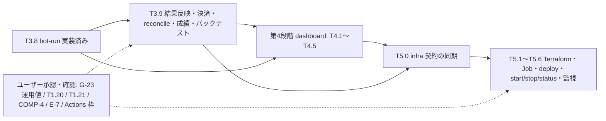

# PLAN（段階・タスク・依存）

> **2026-11-01 注記**: 完了判定の正本は `docs/COMPLETION.md`（R1〜R32 の A/B/C）。この表のチェックボックスは履歴で、実装済みでも『実機・本番で未確認』のものは B として COMPLETION に残る。『ユーザーの『次へ』を待つ』という旧記述は `CLAUDE.md` の『開発の委任（2026-11-01）』で置き換わった。

凡例: `[ ]`未着手 `[x]`完了 / `←` は依存。リポジトリ: **W**=jra-bot-web **I**=jra-bot-infra。セッションはリポジトリ単位で継続可能。

## 第0段階 ― リポジトリ確認・要件・計画（今回）
- [x] T0.1 3リポジトリのアクセス/visibility/default branch/書込権限確認（W,I）
- [x] T0.2 参照元の概観調査（変更なし）
- [x] T0.3 CLAUDE.md / docs 一式作成（W,I）
- [x] T0.4 作業ブランチで commit・push（W,I）
- [x] T0.5 PR 作成（main は Stage 0 のコミットで初期化済み。D-001 解消）

## 第1段階 ― 詳細調査・費用比較・技術選定・設計
- [x] T1.1 参照元の機能棚卸し → `MIGRATION_MATRIX.md`（2026-10-22 完了。精読が必要な箇所は同ファイル §4「精読範囲」に TODO 化）(W)
- [x] T1.2 JV-Link 調査（2026-10-22 設計完了: JVLINK_DESIGN.md / DATA_SOURCE_COMPLIANCE.md。公式一次資料は未確認＝T1.17）：Windows/32bit/COM、データ種別、取得頻度、エージェント方式、**JRA-VAN 利用規約**（2人利用 vs 一般公開、クラウド保管・再配布）(W) ← T1.1
- [x] T1.3 開催日/発走予定（2026-10-22 設計完了: RACE_CALENDAR_DESIGN.md）の取得元と、代替/中止/延期/時刻変更の検出方式設計 (W) ← T1.2
- [x] T1.4 バージョン調査 → `VERSIONS.md`（2026-10-22 暫定選定。T2.1 で最終確定）：JDK, Kotlin, Spring Boot, Gradle, Doma+doma-kotlin+processor(KSP可否), Flyway, MySQL+JDBC, Terraform+provider, GitHub Actions, フロント (W) 
- [x] T1.5 フロント選定（2026-10-22 FRONTEND_DESIGN.md。採用案 A）（Streamlit 7画面の調査 → 候補比較）(W) ← T1.1
- [x] T1.6 （infra PR #1 マージ済み: jra-bot-infra/docs/CLOUD_COSTS.md）クラウド費用比較 → `CLOUD_COSTS.md`（GCP/Azure/AWS × 条件A/B/C、無料枠とクレジット分離、停止中残額、DB停止/自動再起動仕様、確認日・通貨・為替）(I) 
- [x] T1.7 クラウド・DB 決定（根拠: infra PR #2 マージ済み。GCP を設計採用、Cloud SQL Enterprise db-g1-small、MySQL 8.4 暫定 = infra I-011〜I-013、web D-046）← T1.6, T1.4
- [x] T1.8 運用モード正本・STOPPED 実現方式（根拠: infra PR #2 の `OPERATIONS_DESIGN.md`。実リソース検証は G-OPS-1〜9 = 第5段階）(I) ← T1.7
- [x] T1.9 ML 方針（2026-10-22 ML_DESIGN.md。採用案 A）（Kotlin再実装 vs Python維持、学習/推論分離、非pickle形式）(W) ← T1.1
- [x] T1.10 アーキテクチャ確定・CONTRACTS 0.4.0（根拠: 2026-10-22 Stage 1-D② `ARCHITECTURE.md` 全面改訂、`CONTRACTS.md` 0.4.0 で D1〜D12 解消 §12、D-045〜D-059。検証ゲートは STAGE2_HANDOFF §13）(W) ← T1.3,T1.5,T1.7,T1.8,T1.9
- [x] T1.11 既存 SQLite からのデータ移行方針（2026-10-22 DATA_MIGRATION_DESIGN.md。実ファイル未取得のため Runbook 化）（実DBの所在をユーザーに確認）(W)

## 第1段階 追加タスク（T1.4 で判明）
- [x] T1.12 Spring Boot 4.2.x 移行計画（根拠: VERSIONS §7、D-053。4.2.0 は RC1 で GA 前のため移行の**実施**は GA・4.2.1 以降の段階の切れ目）
- [x] T1.13 （JV-Link/開催日 + decision.py/bet_strategy.py/fetch_historical_data.py 精読済み 2026-10-22。MIGRATION_MATRIX §6・§7。残る未読は軽微: fetch_historical_data の全行、bet_strategy 三連複流しの中間部）MIGRATION_MATRIX の未精読箇所の精読（jvlink_provider パーサ、decision/bet_strategy の分岐、fetch_historical_data）— T1.3/T3.x の前に必要な分から

## 第1段階 追加タスク（T1.2/T1.3 で判明, 2026-10-22）
- [x] T1.15 STOPPED 時の Windows エージェント契約（CONTRACTS §7）
- [ ] T1.16 **ユーザー**（2026-10-23 に再スコープ: 本人 1 名・非営利。2 人利用・配布・一般公開・JRADB は対象外）: 規約本文（第7条・第9条）の一読と、JRA-VAN への 3 問（クラウド保存／ダッシュボード・Discord 通知／取得ソフトの登録と利用キー。DATA_SOURCE_COMPLIANCE §0）。**規約確認（COMP-1）と実データのクラウド投入確認（COMP-4）は別項目。回答まで実データを投入しない**
- [ ] T1.17（2026-10-23 更新: **SDK 5.0.0・64bit 版の正式提供・共存と別利用キー・公式 Python サンプルは公式ページの抜粋で確認済み**（実機動作は T3.0 で未確認）。**SDK 本体 5.0.0 と仕様書の文書版 4.9.0.1 は別**。仕様書 12 項目は未確認: JVLINK_DESIGN §12）JV-Link/JV-Data 公式仕様書（SDK 同梱 PDF）で確認: JVOpen option 表、JVGets、JVWatchEvent、YS/TC/AV/CC/WE/JC/RA 項目位置、HR 払戻桁、RA 発走時刻の有無、0B14/0B16、64bit 版の一般提供・COM 登録（**仕様書は Git に入れず、結論のみ docs に記録**）
- [x] T1.18 infra 側 docs への同期（根拠: infra PR #2 で infra CONTRACTS を同期、差異 D1〜D12 は web CONTRACTS 0.4.0 で解消。0.4.0 で生じた infra 文書の追従は PROGRESS「infra への引継ぎ」I-H1〜I-H7）
- [x] T1.19 エージェント PoC **計画**（根拠: JVLINK_DESIGN §11、D-054。**実機検証 G-AGENT-1〜6 は未実施** → T3.0）

## 第1段階 追加タスク（Stage 1-C 後半で判明, 2026-10-22）
- [ ] T1.20 **ユーザー（実環境）**: ① 実 SQLite の所在・取得、② `SELECT prob_source, COUNT(*) FROM signals GROUP BY 1` と `SELECT model_type_used, COUNT(*) FROM race_evaluations GROUP BY 1`（H1: ML が実際に使われていたか）、③ 実 `config.yaml` の値（D-016: 関数既定との食い違い項目の運用実態）、④ `*.pkl` の所在
- [ ] T1.21 ユーザー判断: ML の確率パイプライン `legacy` / `v2`（D-037）、E 項目の C 分類 E6/E11/E12/E14/H10 と H2（MIGRATION_MATRIX §8）、フロント案 A の承認（D-032）
- [x] T1.22 E 項目ごとの新仕様整理（根拠: MIGRATION_MATRIX §8、D-055。C 分類の採否は T1.21 でユーザー判断）

## 第2段階 ― 基盤（W）
- [x] T2.1 Gradle KTS マルチプロジェクト雛形、Version Catalog、依存検査（bot⇄dashboard禁止）← T1.4,T1.10 — 根拠: PR #5 の CI（run 39826288899）が Temurin 25.0.4.1 で成功（build/ktlint/checkModuleDependencies/単体 11 件/build-logic の依存規則テスト）。違反検知は単体 9 + TestKit 4 で確認。詳細は PROGRESS
- [x] T2.2 :domain 値オブジェクト（Odds, Probability, Money 等）・Repository interface — 根拠: PR #6（claude/stage2-domain-vo）。単体 214 件 + build-logic 18 件（ローカル JDK 21 のスモーク）、CI（JDK 25）の結果は PROGRESS。D-060〜D-062。Horse/RaceHorse/Tenant の Repository 等は後続（PROGRESS「次のタスク」）
- [x] T2.3 :db-migration Flyway V1/V2/`R__grants.sql`（範囲は ARCHITECTURE §5.1）+ CLI `--mode`（CONTRACTS §4.2）。G-DB-0 ← T1.10 — 根拠: PR #7（claude/stage2-db-migration）。単体 57 件（Docker 不要）+ 統合 44 件 × MySQL 8.4 / 9.7.4 が GitHub Actions（run 39882827525）で合格。**G-DB-0 は 8.4・9.7 のコンテナで合格（9.7 は D-069 の対処後。採否は未決）。Connector/J 26.x・Doma・Cloud SQL（G-DB-6 ほか）は未検証**。VERSIONS §9
- [x] T2.4 :persistence Doma DAO/Entity/変換（Testcontainers 統合テスト）← T2.2,T2.3 — 根拠: PR #8（claude/stage2-persistence-doma）。6 Repository、単体 15 件（Docker 不要）+ 統合 86 件 × MySQL 8.4 / 9.7 が GitHub Actions（run 39898663936、Temurin 25）で緑。Connector/J 26.10.0 も 8.4 / 9.7 で 86 件合格（非ゲート）。判断 D-070〜D-075、VERSIONS §10
- [x] T2.5 CI（build/lint/unit/DB統合/イメージ）、Renovate/Dependabot ← T2.1 — **完了**（前半: PR #5。後半: PR #12 claude/stage2-images-ci）。`Dockerfile`（4 ターゲット: dashboard / ingest / bot / db-migration。JDK 25 の JRE、non-root、digest 固定）、イメージのスモーク（`tools/release/image_smoke.py`）、release-manifest のスキーマ・ドライラン生成・検証（`tools/release`）、`.github/dependabot.yml`、CI の変更内容別実行（`tools/ci`、`ci gate`）と images / Connector/J 26.x の分離。**ml-train イメージと本番 release-manifest は未完成**（ml-train は Stage 3 の T3.6、manifest は第5段階の push 後。D-094・D-095）。詳細は `STAGE2_HANDOFF.md` §14.7、`CI_AND_IMAGES.md`、D-093〜D-100
- [x] T2.6 ゴールデンテスト基盤（旧実装出力フィクスチャ生成スクリプト、実データ非含有）— **完了**（`tools/golden/`、固定コミット f7dbf69、10 ケース/447 呼び出しを旧実装から生成、CI `golden tests (Python 3.12)`。GD/G の大半は partial/planned で Stage 3 に引き継ぎ: `tools/golden/catalog.py`、D-089〜D-092）
- [x] T2.7 :cloud-gcp `ModeProvider`（GCS, CONTRACTS §5.2）+ ローカル実装 ← T2.2 — 根拠: PR（claude/stage2-gcp-mode-provider。番号と CI は PROGRESS）。`CachingModeProvider`（15 秒キャッシュ・5 秒の再試行間隔・seq 単調性・fail closed）、GCS 実装（google-cloud-storage 2.75.0・読取りのみ）、ローカルファイル実装（`APP_ENV=local` のみ）、単体 55 件（実 GCP なし）。**実 GCP での動作は未検証**（第5段階の実環境検証で確認。既存の G-OPS-1〜9 に該当項目が無いので infra で追加が必要）
- [x] T2.8 各実行アプリの最小起動（`/internal/health|ready`、`--task`、終了コード、CONTRACTS §4.3・§9）← T2.4,T2.7 — 根拠: PR（claude/stage2-app-bootstrap。番号と CI は PROGRESS）。3 アプリが独立起動、`/internal` は署名付きトークン認証（実 Google 鍵では未検証: G-AUTH-1）、スキーマ版検証（75/1 の区別）、bot の `--task` 振り分けと Job 契約（非 NORMAL で DB に触れない）、ingest 503/dashboard 409 のガード。**業務処理は未実装のスタブ**（本番は exit 1）。判断 D-081〜D-088、契約 0.4.4、STAGE2_HANDOFF §14.5
- 実装順・完了条件・クラウドで実行できる/できないテストは `STAGE2_HANDOFF.md`

## 第3段階 ― bot（W）
- [ ] T3.0 **ユーザー（実機）**: Windows エージェント PoC G-AGENT-1〜6（JVLINK_DESIGN §11）。Claude は `agent/poc/` と手順を用意 ← T1.19
- [x] T3.1 EV/Kelly/確率/判定/急落フィルタを :domain へ移植し旧実装と比較 ← T2.2,T2.6 — **完了（単勝の範囲。2026-10-23、claude/stage3-core-decision）**。`:domain` の `jp.jrabot.domain.decision`（EV・Kelly・賭け額・市場確率・正規化・判定側ブレンド・急落/人気急上昇・単勝の判定・見送り理由）、Kotlin ランナー `:golden-runner`、`tools/golden/kotlin_compare.py`（対応/未対応を分けて報告）、ゴールデン 4 ケース追加（14 ケース/562 呼び出し中、Kotlin が検証したのは 10 ケース/380 呼び出し）。**範囲外・残り**: ML 経路（T3.6）、ワイド/三連複の買い目と Plackett–Luce（T3.2）、時間帯スケジュール/adaptive_relaxation（T3.8）、DB のスナップショット取得（T3.4）、旧関数既定値の突合 GD10（T1.20）、未承認の数値変更 E6/E12/E14/H10（T1.21。既定 off・未実装）。本番で動作する Bot ではない。D-104〜D-111、PROGRESS の Stage 3-A
- [x] T3.2 ワイド/三連複 確率・推定オッズ・bet_strategy 移植 — **完了（2026-10-23、claude/stage3-combo-strategy）**。`:domain` の `jp.jrabot.domain.decision` に Plackett–Luce（`PlackettLuce`）・実オッズの注入（`ComboOdds`）・推定オッズ（`ComboOddsEstimate`）・流し/BOX・E8 の段階・`ticket_allocation`・`StrategyEntry.tickets` を追加し、`WinDecisionEvaluator` に統合。ゴールデン 7 ケース/248 呼び出しを旧実装から追加生成（21 ケース/810 呼び出し）、Kotlin が検証したのは 18 ケース/661 呼び出し（全一致、最大絶対誤差 0、比較した浮動小数 62,903 個）。**範囲外・残り**: ML 経路（T3.6）、実オッズの DB 取得と鮮度（T3.4）、通知本文（T3.7）、時間帯スケジュール（T3.8）、旧関数既定値の突合 GD10（T1.20）、未承認の数値変更 E6/E12/E14/H4/H10・生成段階の重複除去（T1.21。既定 off・未実装）。本番で動作する Bot ではない。D-112〜D-121、PROGRESS の Stage 3-B
- [x] T3.3 開催日制御（RACE_CALENDAR_DESIGN の実装: スキーマ、calendar-check、bot-run リース、手動補正、C01〜C28 のテスト）← T1.3,T2.4 — **完了（T3.3 の範囲。2026-10-23、claude/stage3-calendar-lease。PR は PROGRESS を参照）**。`:domain` の `jp.jrabot.domain.calendar`（有効予定の導出・状態遷移・版の比較・履歴・手動補正・calendar-check の判断）、`:persistence`（`race_day`・`race_schedule_event`・`calendar_override`、`bot_run` の DB リース: 取得・奪取・heartbeat・遷移・checkpoint）、`:bot` の `calendar-check`。**C01〜C28: 完了 19・一部 7（C01・C07・C10・C16・C21・C22・C27）・未対応 2（C25・C28）— 残りは T3.4〜T3.9（RACE_CALENDAR_DESIGN §11）**。本番の起動基盤（`JobLauncher` の GCP 実装）・取得の事実（YSCH）・運用値（`CALENDAR_*`・リース）・bot-run の業務ループは未実装/未確定
- [x] T3.4 取込 API とデータ取得（冪等 upsert、バックフィル、再開、多重起動防止）← T2.4 — **完了（T3.4 の範囲。2026-10-23、claude/stage3-ingest-api。PR は PROGRESS を参照）**。V3（`ingest_fetch`・`ingest_backfill`・署名鍵列）、`POST /v1/agent/ingest`・`heartbeat`、エージェント認証（契約 0.4.6 の方式が検証不能なため導出鍵 HMAC＋KEK 暗号化。**提案 P-1・未承認**）、バッチ冪等・並行・巻き戻り、取得の事実の永続化と `ScheduleFetchFactReader` の DB 実装、`RecordParser` 登録（実データ形式は未対応＝保留。合成の正規化 JSON はローカルのみ）、オッズ・ワイド・三連複の保存、ACK・カーソル、バックフィル基盤。**未解決の管理表は `docs/UNRESOLVED.md`**。実データ形式のパーサは T1.17 後。D-130〜D-143
- [x] T3.5 **実装完了（Mock・CI 範囲。2026-10-24、claude/stage3-windows-agent）。実機 PoC（T3.0）は未実施、P-1/P-2 は承認待ち、実取得は公式仕様の確認待ち**。`agent/`（独立 Python）、`:ingest` の mode/plan/update、重複 ACK の修正（D-144）。D-144〜D-151、PROGRESS の Stage 3-E。元の記述: Windows 取得エージェント（JVLINK_DESIGN の実装: 薄い Python、キュー、ビーコン、署名更新）+ `:ingest` サービス（plan・mode・update・register の残り）← T1.2,T1.17,T3.4,**UNRESOLVED D-5（署名方式 P-1）・D-6（取得セッション P-2）の承認**
- [ ] T3.6 ML ← T1.9。**前半 T3.6-A（Stage 3-F1）は実装完了（2026-10-24、claude/stage3-ml-inference-h7e43j。PR は PROGRESS を参照）**: Kotlin `FeatureBuilder`（旧互換 + point-in-time）・ハッシュ特徴・ロジスティック回帰推論・`ProbabilityPipeline`（legacy / v2 / ensemble / 市場フォールバック・理由コード）・モデル JSON の検証（正準 JSON・sha256・Ed25519・feature_schema_hash）・レジストリの読取りと run 開始時の固定・合成のローカル `ModelStore`・`DatasetExporter`（学習用データセットの出力契約）・ゴールデン G1〜G7（26 ケース/880 呼び出し中 25 ケース/874 呼び出しが Kotlin と全一致、最大誤差 1.07e-14）。ML_DESIGN §11、D-152〜D-164。**本番の確率は引き続き `legacy`。v2 は未承認で無効。**
  - [x] **T3.6-B（Stage 3-F2。実装完了 2026-10-24、claude/stage3-ml-training。PR は PROGRESS を参照。マージはユーザー。自動では T3.7 へ進まない）**: `ml/`（Python の学習 Job: データセット検証・v2 学習・評価・品質ゲート〔fail closed〕・署名つきモデル JSON・保管・レジストリ登録 CANDIDATE/REJECTED のみ）、`bot --task=export-dataset` の配線、`FeatureSource`/`DatasetSource` の MySQL 実装、馬マスタの時点履歴（V4）、GCS の `ModelStore`/`DatasetStore`、旧 pkl→JSON 変換ツール（許可リスト式。実 pkl の変換は未実施）、ml-train イメージ（5 つ目）、release-manifest v2（`feature_schemas`）、CI `ml-train` ジョブ。D-165〜D-179。**合成データのみ。実データでの学習・精度・品質閾値（D-13）・実 pkl 変換・実 GCS は未検証で、ML は本番利用可能ではない。**
- [x] T3.7 Discord 通知（分割・Retry-After・リトライ） — **実装完了（2026-10-27、claude/stage3-discord-notification。合成データ・Fake サーバのみ。実 Discord への送信は未検証。実データ由来の通知は COMP-4 まで送らない）**。`:domain` の `notify`（本文・分割・Retry-After・メンション・`SignalNotificationDispatcher`・`ErrorReporter`・理由文 G-17 ⑥）、`:bot` の `discord`（URL 検証・JDK HttpClient・`DiscordNotifier`・Bean 配線）、`listClaimedBefore`、ゴールデン G8（旧 `discord.py` と全一致）。D-181〜D-189、PROGRESS の Stage 3-G。**bot-run からの呼出し・出どころ判定・エラー通知のイベントは T3.8**
- [x] T3.8 bot-run オーケストレーション（監視ウィンドウ、結果反映後終了）← T3.1–T3.7 — **実装完了（2026-10-27、claude/stage3-bot-orchestration。合成データ・Fake HTTP サーバ・メモリ上の偽物・ローカル MySQL 8.0.46 のみ。CI〈JDK 25・MySQL 8.4/9.7〉・実 Discord・Cloud Run は未検証。PR は未作成〈Actions の無料枠不足〉）**。`:domain` の `jp.jrabot.domain.botrun`（`BotRunOrchestrator`・`LeaseKeeper`・`ModeGate`・`RaceMonitorPlanner`・`RaceCycleProcessor`・`RaceEvaluator`・`MlRunStarter`・`RunCheckpoint`）、`:persistence`（`race_evaluations` の冪等追記・馬名の読取り）、`:bot`（`BotRunSettingsParser`・`BotRunTaskHandler`・SIGTERM・`BotRunWiring`）。D-190〜D-203、CONTRACTS 0.4.12、PROGRESS の Stage 3-H。**範囲は発走まで**（評価・記録・通知）。**結果・払戻・決済・race_schedule/race_day の状態更新・reconcile は T3.9**（UNRESOLVED G-25）。通知方式〈各タイミング 1 回〉・hit_rate schedule・5 分前の強化の修正を反映済み（D-204〜D-207）。運用値は暫定サンプルのみで本番は未確定（G-23）、adaptive_relaxation は T3.9 の後に再判断（G-24）。レビュー修正後も CI は未実施
- [ ] T3.9 結果反映・払戻・決済・成績集計・recovery（reconcile）・バックテスト ← T3.8（詳細は下の「T3.8 後の道筋」と **docs/T39_DESIGN.md**〈2026-10-29 の詳細設計。本体は未着手〉）。**T3.8 のレビューとユーザーの承認の後に着手する。自動では進まない**  【2026-11-01 状況】結果待ち・開催日の進行・reconcile・retention・単勝/ワイド/三連複の紙上決済・バックテスト（計算）を実装。実データでの検証と JV-Data の実パーサは B。詳細は COMPLETION.md R7〜R17

## 第4段階 ― dashboard（W）
- [ ] T4.1 認証/認可（IAP JWT 検証、許可リスト、ロール、deny by default）← T2.4  【実装済み: IAP JWT・許可リスト・ロール・deny by default。PR #31】
- [ ] T4.2 API（DTO、Entity 非公開）← T4.1  【実装済み: /api/v1/status・runs・races・signals・performance・admin/overrides・admin/ml-models（表示のみ: D-268）・admin/agents と失効（D-270）。DTO のみ】
- [ ] T4.3 UI（日本語、レスポンシブ、最終更新、bot状態、次回予定、未更新表示）← T1.5,T4.2  【実装済み: 静的 HTML/CSS/JS（D-243）。ブラウザでの目視は B】
- [ ] T4.4 管理者操作（手動補正等）、モード表示  【一部: 手動補正の作成/取消/一覧 + CSRF + 監査ログ。エージェント失効は未実装、ML の有効化は B】
- [ ] T4.5 セキュリティテスト（認可マトリクス）  【一部: 実コンテキストの認可・CSRF 試験。認可マトリクスの網羅表は TEST_RESULTS.md】

## 第5段階 ― インフラ（I、一部 W）
- [x] **T5.0（完了 2026-11-01: infra PR #3 マージ済み〔CONTRACTS 0.4.15 に同期〕）** ~~infra の文書を web CONTRACTS 0.4.0 に追従させる（PROGRESS の I-H1〜I-H7）。解消するまで第5段階の実装に着手しない。web が古い infra 文書に合わせて 0.4.0 を戻すことはしない**
- [ ] T5.1 Terraform 基盤（state、WIF、ネットワーク、Secret、Registry）← T1.7  【infra PR #4 でコード化。実 GCP の plan/apply は未実施（B）】
- [ ] T5.2 Web/Job/DB/Scheduler リソース、IAP、スケールゼロ  【同上】
- [ ] T5.3 deploy workflow（release-manifest 入力、migrate→更新）  【infra PR #4: deploy.yml + ops deploy】
- [ ] T5.4 start/stop/status workflow_dispatch、排他（concurrency）、部分失敗表示、安全な再実行  【infra PR #4: ops-start/stop/status】
- [ ] T5.5 Terraform が mode/DB 起動状態を変更しないことの検証（plan 差分テスト）  【infra PR #4: plan_guard + terraform-plan/apply】
- [ ] T5.6 監視/アラート/予算、ロールバック手順  【infra PR #4: 定期 status + Discord + OPERATIONS.md。予算は本人設定】
- [ ] T5.7 **開催日に合わせた自動の起動・停止（D-279。案 1b）**: 通常は STOPPED、開催日の監視ウィンドウの前に NORMAL、終了・確定の後に STOPPED。STOPPED 中は DB の開催日程を読めないので、停止の前に次の開催日の一覧（実データを含まない日時だけ）を GCS の ops-state 側に書き、infra の定期ワークフローがそれを見て ops-start / ops-stop を呼ぶ案を設計する（停止の失敗は止める側に倒す・二重起動はリースで防ぐ・**ウィンドウの前の起動に失敗したら Discord に通知**して本人が手動で起動できるようにする）。前提: P-1、G-DB-1
- [ ] ※ apply・課金リソース作成は **ユーザー承認後**

## 第6段階 ― 統合・レビュー
- [ ] T6.1 旧新比較の総合結果 → `TEST_RESULTS.md`  【TEST_RESULTS.md（作成済み）。旧新比較の総合】
- [ ] T6.2 セキュリティレビュー  【独立レビュー（Opus）を各増分で実施。D-230/D-236/D-237/D-246・infra I-024〜】
- [ ] T6.3 `OPERATIONS.md`、ドキュメント整理  【OPERATIONS.md（web・infra）作成済み】
- [ ] T6.4 PR 整理（W,I）

## 第1段階の完了状況（2026-10-22 Stage 1-D②）
設計タスクは完了（本 PR マージ後）。**ユーザー/実環境のタスク T1.16・T1.17・T1.20・T1.21 は未完了のまま**（完了扱いにしない）。第2段階は合成データで進められるが、T3.x の一部（T3.5・T3.6・旧新比較）はこれらに依存する。

## 依存の要点
T1.1 → T1.2 → T1.3 → T3.3 / T1.4,T1.7,T1.10 → T2.x / T1.6 → T1.7 → T5.x。第1段階の T1.6/T1.8（I）は T1.1〜T1.5（W）と独立に別セッション可。

## T3.8 後の道筋（Stage 3-I → 第4段階 → 第5段階。2026-10-27 時点。各段階の完了後にユーザーのレビューを挟む。自動で次へ進まない）

### Stage 3-I（T3.9）— 前提: T3.8 のマージ（または T3.8 の上に積む判断はユーザー）。合成データだけで進められる
| 内容 | 前提・依存 | 完了の根拠（案） | 注意 |
|---|---|---|---|
| ① 結果・払戻の取込（ingest の `results`/`payouts` の合成観測。JV-Data の実パーサは T1.17 の確認後: G-5/G-16）と、bot-run の結果待ち（発走 + 30 分で RESULT_PENDING、5 分毎に再確認、`settle_deadline` で INCOMPLETE） | T3.4 の ingest、T3.8 のループ | 状態遷移表（`RaceScheduleTransitions`・`RaceDayTransitions`）どおりに `race_schedule.status`・`race_day.status` を更新するテスト | `bot` は `race_schedule`/`race_day` に INSERT・UPDATE 権限あり（R__grants）。履歴（`race_schedule_event`）の追記は同じトランザクション |
| ② 決済: `race_evaluations.settled_at/hit/payout_used/is_provisional/settle_status`、`bets`/`bet_legs`、`ticket_evaluations`（買い目ごとの内訳。T3.8 では未実装: MIGRATION_MATRIX §12） | ①、旧 `settle_*` のゴールデン（GD の拡張） | 旧実装との数値一致（払戻・的中判定。小数の丸め） | 払戻の計算式・丸めを変えない。未承認の改善案を有効化しない |
| ③ `--task=reconcile`（スタブからの置換）: 月曜 14:00 以降の確定成績との照合・INCOMPLETE の回復・`INCOMPLETE_AT_DEADLINE` の run の補完 | ①②、`CalendarCheckReason.NEEDS_RECONCILE` | C27（RACE_CALENDAR_DESIGN §9）のテスト | `trigger_type=RECONCILE` は通知しない |
| ④ 成績集計とバックテスト（旧新比較。`tools/` と Kotlin の範囲を決める。ML の G-ML-3 は実データが要るのでユーザーの PC） | ①②、T1.20 の実データ（あれば） | 合成データでの再現性。実データの結果は『未検証』と明記 | v2 の有効化・閾値の変更は承認が先 |
| ⑤ 持ち越し: `completed` の日の bot-run の再起動を止める（`race_day` を COMPLETED にする）、`INCOMPLETE_AT_DEADLINE` | G-25 | calendar-check の `ALREADY_COMPLETED` が働く | D-190 |
### 第4段階（dashboard）— 依存: T2.4 の土台、T3.8（bot 状態・SEND_UNKNOWN・race_evaluations）、成績の画面は T3.9
- T4.1 認証/認可（IAP JWT・許可リスト `ALLOWED_USERS`/`ADMIN_USERS`、空なら全拒否。**本人 1 名専用**。登録・招待・共有機能は作らない）→ T4.2 API（DTO、Entity 非公開）→ T4.3 UI（レース・予測・成績、最終更新、bot 状態、次回予定、未更新表示、**SEND_UNKNOWN と ML のフォールバック理由の表示**〈G-21 ⑥・D-199〉）→ T4.4 管理者操作（手動補正、DENY_RUN/ALLOW_RUN、モード表示、**モデルの ACTIVE 昇格は D-13/D-14 の承認後だけ**）→ T4.5 セキュリティテスト（認可マトリクス）。
- 成績の表示は T3.9 の後。それまでは『未集計』と表示する。
### 第5段階（infra）— **最初に T5.0。それまで実装しない**
- **T5.0（必須の前提）**: infra の文書を web CONTRACTS に追従（I-H1〜I-H9、G-9・G-14、CONTRACTS 0.4.12 の `BOT_RUN_*`・`CALENDAR_*`・`DISCORD_MENTION_USER_ID`・`MODEL_VERIFY_PUBKEY`、スキーマ版 4 と `mltrain`/`bot` の GRANT、ml-train の実行契約、Job の最大実行時間）。web のセッションから infra を直接変更しない（infra のセッション・PR で）。
- T5.1 Terraform 基盤 → T5.2 Web/Job/DB/Scheduler → T5.3 deploy workflow → T5.4 start/stop/status → T5.5 Terraform が mode/DB を変えない検証 → T5.6 監視・予算・ロールバック。**apply・課金リソースの作成はユーザーの明示的な承認後**。実データのクラウド投入は COMP-4 の公式回答の後（テストは合成）。
- ゲート: F-2（実 GCP の G-OPS-1〜9 ほか）、F-7/F-8（JDK 25・MySQL 8.4/9.7・SIGTERM）、本番 release-manifest、署名鍵運用（D-14）、E-7（ソース公開の許可）。
### 横断（どの段階でも）
- 未完了のまま持ち越す: T1.16（規約確認）・T1.17（仕様書の 12 項目）・T1.20（実 SQLite/config/pkl）・T1.21（legacy/v2・E 項目の C 分類）・COMP-4・T3.0（Windows 実機 PoC）・各種の実環境検証（F-1〜F-8）。**完了扱いにしない**。
- Actions 無料枠: 枠が戻る（またはユーザーが Public 化を完了して知らせる）まで PR を作らない。`claude/*` への push は CI を起動しない。ローカルの検証は STAGE2_HANDOFF §15。

