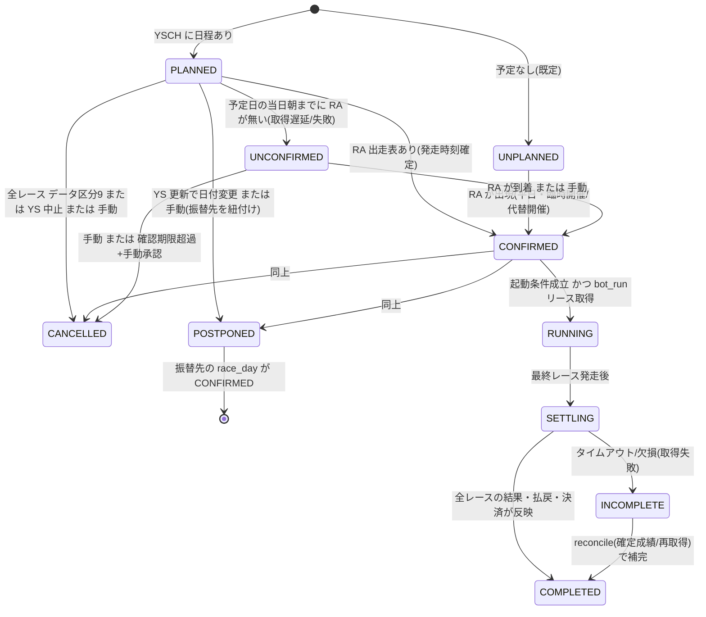
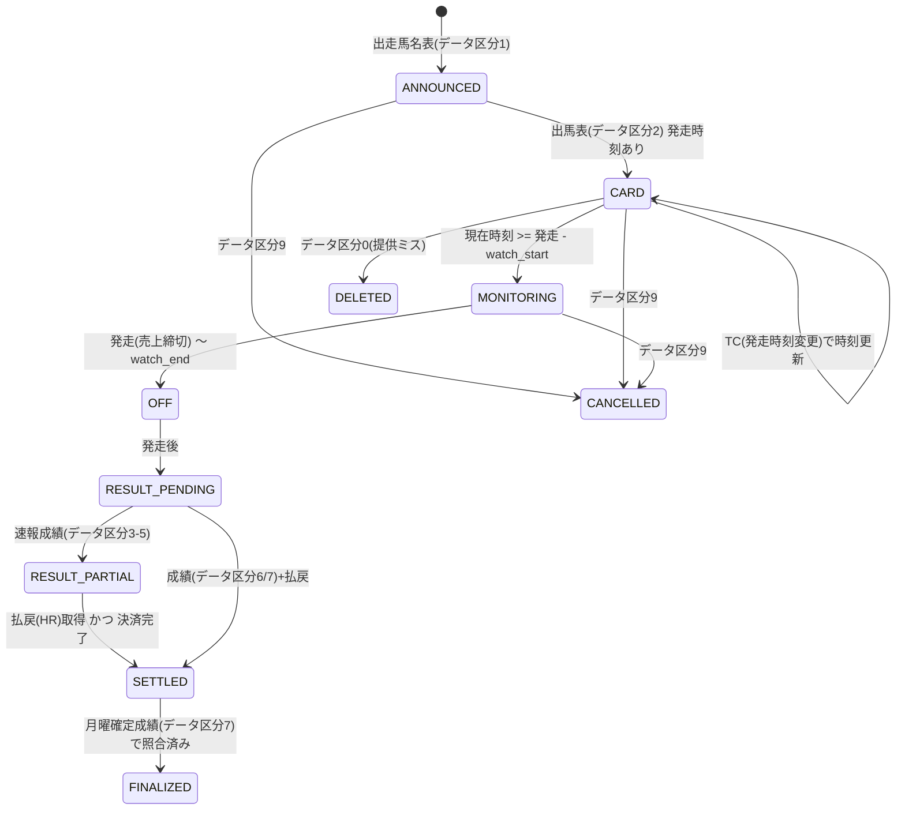
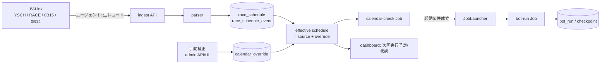
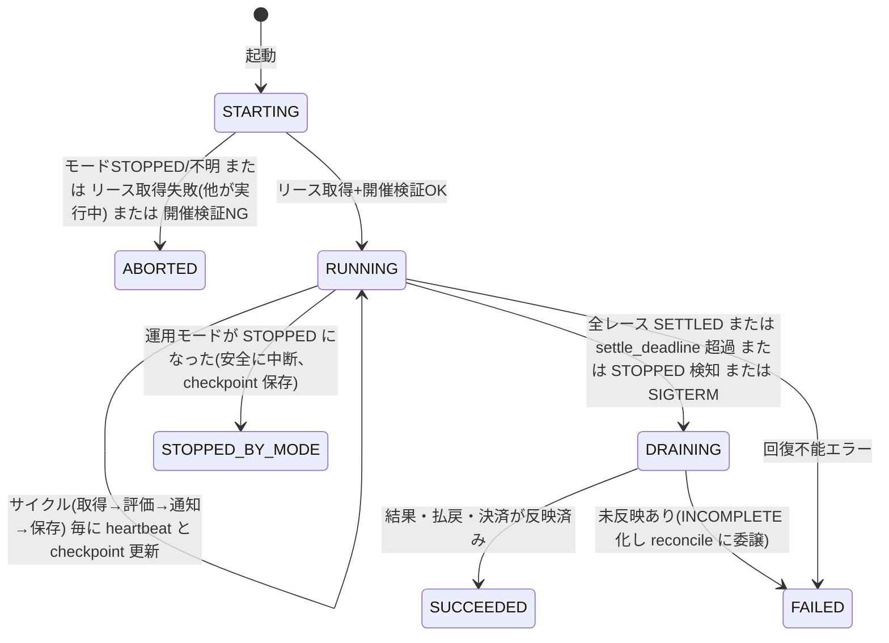

# RACE_CALENDAR_DESIGN（T1.3 開催日・発走予定・変更検知・bot 起動方式）

設計のみ（実装は第3段階）。前提: `JVLINK_DESIGN.md`（取得）、`CONTRACTS.md`（モード/プロトコル）、`DATA_SOURCE_COMPLIANCE.md`（データ取扱い）。タイムゾーンは常に **Asia/Tokyo**。単純な曜日・祝日判定は**使わない**。

## 0. 検出能力の確度（実現済みとして扱わない）
| 能力 | 想定ソース | 確度 | 扱い |
|---|---|---|---|
| 年間の開催日程（日・場・回・日目） | `YSCH`（YS レコード）。年末に翌年分、月曜 14:00 頃に今週の変更・中止・終了 | [二次] 仕様書の提供タイミングを引用する第三者解説。**一次未確認** | 第一の予定源。一次確認まで「候補」扱い |
| レース別の発走時刻・出走表 | `RACE`/`0B15` の RA（発走時刻 HHMM）。木曜に出走馬名表、金・土に出馬表 | [参照元] RA(874,4) を解析済み。木曜時点で時刻が入っているかは [要確認] | 発走時刻の第一ソース |
| 当日の発走時刻変更 | `0B14` の **TC** | [二次]。**全置換スナップショット**で取消あり | 差分イベントは**スナップショット比較**で生成 |
| 出走取消・競走除外 | `0B14` の AV、`RACE` の JG | [二次] | イベント化 |
| 騎手変更・コース変更・天候馬場 | `0B14` の JC / CC / WE | [二次] | イベント化（判定への利用は T3） |
| **レース中止** | RA の **データ区分 `9`**、`0`=該当レコード削除 | [二次]（JV-Data 仕様書「レース詳細」項番2 を引用） | 状態 CANCELLED。`0` は物理削除せず DELETED として保持 |
| **開催中止（日単位）/延期/代替開催** | YSCH の更新（月曜）、RA が別日に出現 | **仕様上の表現は未確認** [要確認] | 自動検知は保証しない。「YS 更新または RA の出現/消失」から**推定**し、確定は手動補正 |
| 通知イベント（JVWatchEvent） | 存在の確認なし | 未確認 | **使わない**（ポーリングのみ）。確認できたら高速化として追加 |
| JRA 公式サイトの開催日程 | スクレイピング不可（規約/安定性未確認） | — | 自動取得に使わず、**人が見て手動補正**する際の参照のみ |

## 1. 設計原則
1. **予定の事実はデータから**: 開催判定は DB の `race_schedule`（JV-Data 由来）だけを根拠にする。曜日・祝日カレンダーは使わない。
2. **取得失敗は「開催なし」と区別する**: 「データが無い」(UNKNOWN) と「無いことを確認した」(NO_RACE) を別状態にする。
3. **保守的に動く**: 不明なときは bot を無条件に起動しない（誤起動は費用、誤停止は取り逃し）。ただし取り逃しを防ぐため UNKNOWN 時はアラートし手動補正を促す。
4. **全イベントを履歴化**: 変更はすべて追記専用の `race_schedule_event` に残し、現在値は導出。
5. **手動補正が最優先**で、期限・理由・実施者付き。
6. **クラウド非依存**: 起動手段（Scheduler/Run Jobs）は `JobLauncher` ポートの背後に置く（§6.5）。

## 2. 状態モデル

### 2.1 開催日（`race_day`）の状態遷移

- `UNPLANNED` は「予定が無い」であり、`NO_RACE_CONFIRMED`（YS 取得が新鮮で当日に開催なしと確認）とは別。bot 起動を抑止するのは後者と `UNPLANNED`、`UNCONFIRMED` は**起動せずアラート**。
- `race_day` はレース集合から導出される要約状態で、真実の源は `race_schedule`。

### 2.2 レース（`race_schedule`）の状態遷移

- `TIME_CHANGED`/`SCRATCH`/`JOCKEY_CHANGE` は状態ではなく**イベント**（履歴）。
- 取消馬（AV）は `race_entry` 側（T3）。レース自体の状態は変えない。
- `FINALIZED` は `reconcile` ジョブ（月曜 14:00 以降）で到達。速報と確定の差異は記録し、差があれば再決済（冪等）。

## 3. データソースと更新フロー



### 3.1 エージェントへの取得計画（plan）
| 時間帯（JST） | 取得 | 目的 |
|---|---|---|
| 毎日 06:00・12:30・16:30・20:30（+ 開催が近い/当日は 10 分毎） | `YSCH`（差分）、`RACE`（今週, option 2）、`0B14`（当日, 開催日単位） | 予定・出走表・当日変更の取得 |
| 開催日の監視ウィンドウ中 | `0B14`（5 分毎）、`0B30` 系（レース別ポーリング間隔は bot 設定: far 300s/mid 60s/near 30s） | 変更検知・オッズ |
| 発走後 | `0B12`/`0B15`（結果・払戻） | 結果反映 |
| 月曜 14:00 以降 | `RACE`（確定）、`YSCH`（今週の変更・中止・終了） | reconcile |
※ 具体的な時刻は設定値。**曜日では絞らない**（毎日同じ軽い取得。取得結果が「開催あり/なし」を決める）。

### 3.2 `0B14` の扱い（全置換スナップショット）
取得のたびに前回ぶんを破棄し「いま含まれている情報」だけを使う仕様 [二次]。したがって:
1. 取得ごとに `snapshot_0b14(date, observed_at, records[])` を保存（履歴として残す。生レコードの保管期間は規約確認後）。
2. 直前スナップショットとの**差分**を取り、`TIME_CHANGE / SCRATCH / JOCKEY_CHANGE / COURSE_CHANGE / WEATHER` イベントを生成。前回あって今回無いものは `REVOKED`（取消）イベント。
3. イベントの冪等キー = `sha256(race_key, event_type, payload_normalized, snapshot_group)`。

### 3.3 発走時刻
- RA の `HHMM`（JST のローカル時刻、日付は race_date）を `scheduled_post_at`（UTC 保存）に変換。**時刻が `0000` や欠落**の場合は `post_time_unknown=true` として扱う（参照元の「00:00 や 8 時前/18 時超なら監視窓の開始時刻に置換する」暗黙処理は廃止し、UNKNOWN として明示。bot は UNKNOWN のレースでは通知しない、またはオッズ取得のみ行う設定にする）。
- 日付またぎ・深夜（`24:xx`）は JV-Data に存在しない前提だが、変換は範囲チェックして不正値は UNKNOWN。

## 4. スキーマ案（MySQL を想定。型はデザイン上の目安）

```sql
-- 契約者(テナント)境界。DATA_SOURCE_COMPLIANCE の案Aにより全表に tenant_id を持つ
CREATE TABLE race_day (
  tenant_id        BIGINT NOT NULL,
  race_date        DATE   NOT NULL,                -- JST の暦日
  venue_code       CHAR(2) NOT NULL,               -- 01..10
  kai              TINYINT NOT NULL,               -- 開催回
  nichime          TINYINT NOT NULL,               -- 日目
  status           ENUM('UNPLANNED','PLANNED','UNCONFIRMED','CONFIRMED','RUNNING','SETTLING','COMPLETED','INCOMPLETE','CANCELLED','POSTPONED') NOT NULL,
  replaced_by_date DATE NULL,                      -- 延期/代替の振替先
  first_seen_at    DATETIME(6) NOT NULL,           -- UTC
  last_confirmed_at DATETIME(6) NULL,              -- 最後に「この日はこの状態」と確認できた取得時刻(鮮度判定)
  version          INT NOT NULL DEFAULT 0,         -- 楽観ロック
  PRIMARY KEY (tenant_id, race_date, venue_code)
);

CREATE TABLE race_schedule (
  tenant_id        BIGINT NOT NULL,
  race_key         CHAR(16) NOT NULL,              -- YYYY+MMDD+JJ+KK+NN+RR (JV-Data のレースキー)
  race_date        DATE NOT NULL,
  venue_code       CHAR(2) NOT NULL,
  race_no          TINYINT NOT NULL,
  scheduled_post_at DATETIME(6) NULL,              -- UTC。NULL=未確定
  post_time_unknown BOOLEAN NOT NULL DEFAULT FALSE,
  status           ENUM('ANNOUNCED','CARD','MONITORING','OFF','RESULT_PENDING','RESULT_PARTIAL','SETTLED','FINALIZED','CANCELLED','DELETED') NOT NULL,
  data_kubun       CHAR(1) NOT NULL,               -- 直近に反映した RA のデータ区分
  source_version   VARCHAR(32) NOT NULL,           -- データ作成年月日+データ区分(新旧比較キー)
  race_name        VARCHAR(100) NULL,
  last_changed_at  DATETIME(6) NOT NULL,
  version          INT NOT NULL DEFAULT 0,
  PRIMARY KEY (tenant_id, race_key),
  KEY ix_day (tenant_id, race_date, scheduled_post_at)
);

-- 追記専用の履歴(現在値はここから再構成可能)
CREATE TABLE race_schedule_event (
  id               BIGINT AUTO_INCREMENT PRIMARY KEY,
  tenant_id        BIGINT NOT NULL,
  race_key         CHAR(16) NULL,                   -- 日単位のイベントは NULL
  race_date        DATE NOT NULL,
  event_type       ENUM('ADDED','DELETED','CANCELLED','TIME_CHANGE','SCRATCH','JOCKEY_CHANGE','COURSE_CHANGE','WEATHER','DAY_STATUS','POSTPONED','REVOKED','MANUAL_OVERRIDE','MANUAL_REVOKE','FETCH_FAILURE','STALE') NOT NULL,
  old_value        JSON NULL,
  new_value        JSON NULL,
  source           ENUM('YSCH','RACE','0B15','0B14','MANUAL','SYSTEM') NOT NULL,
  observed_at      DATETIME(6) NOT NULL,            -- エージェントの取得時刻(UTC)
  received_at      DATETIME(6) NOT NULL,
  batch_id         CHAR(36) NULL,
  dedup_hash       CHAR(64) NOT NULL,
  UNIQUE KEY uq_dedup (tenant_id, dedup_hash)
);

CREATE TABLE calendar_override (                    -- 手動補正
  id            BIGINT AUTO_INCREMENT PRIMARY KEY,
  tenant_id     BIGINT NOT NULL,
  scope         ENUM('DAY','RACE') NOT NULL,
  race_date     DATE NOT NULL,
  race_key      CHAR(16) NULL,
  action        ENUM('MARK_RACE_DAY','MARK_NO_RACE','CANCEL','SET_POST_TIME','POSTPONE_TO','ALLOW_RUN','DENY_RUN') NOT NULL,
  value         JSON NULL,                          -- 例 {"post_at":"2026-11-01T06:35:00Z"} / {"to":"2026-11-02"}
  reason        VARCHAR(500) NOT NULL,
  created_by    VARCHAR(100) NOT NULL,              -- 管理者
  created_at    DATETIME(6) NOT NULL,
  valid_until   DATETIME(6) NULL,                   -- 期限(NULL=手動で失効)
  revoked_at    DATETIME(6) NULL,
  revoked_by    VARCHAR(100) NULL
);

CREATE TABLE bot_run (                              -- 実行と排他(DB リース)
  run_id          CHAR(36) PRIMARY KEY,             -- UUIDv7
  tenant_id       BIGINT NOT NULL,
  run_date        DATE NOT NULL,
  trigger_type    ENUM('SCHEDULER','MANUAL','RECONCILE','BACKFILL') NOT NULL,
  state           ENUM('STARTING','RUNNING','DRAINING','SUCCEEDED','FAILED','ABORTED','STOPPED_BY_MODE') NOT NULL,
  lease_owner     VARCHAR(100) NULL,                -- 実行ホスト識別(コンテナID等)
  lease_expires_at DATETIME(6) NULL,
  heartbeat_at    DATETIME(6) NULL,
  active_slot     TINYINT NULL,                     -- 1=実行中。UNIQUE(tenant_id, run_date, active_slot) で二重実行を DB が拒否(NULL は重複可)
  checkpoint      JSON NULL,                        -- レース別ステージ/最終サイクル
  planned_start   DATETIME(6) NULL,
  planned_end     DATETIME(6) NULL,
  exit_reason     VARCHAR(200) NULL,
  started_at      DATETIME(6) NOT NULL,
  finished_at     DATETIME(6) NULL,
  UNIQUE KEY uq_active (tenant_id, run_date, active_slot)
);
```
- **有効予定（effective schedule）** = `race_schedule` に `calendar_override`（未失効・未期限）を適用した結果をアプリ層で導出。優先順位: 手動 `DENY_RUN` > 手動 `CANCEL/MARK_NO_RACE` > 手動 `ALLOW_RUN/MARK_RACE_DAY/SET_POST_TIME/POSTPONE_TO` > ソース状態。
- 更新履歴: `race_schedule` の変更は必ず `race_schedule_event` を同一トランザクションで追記。
- **古いデータの上書き防止**: 反映は `source_version`（データ作成年月日+データ区分、`0`/`9` は強い値）が既存より新しい場合のみ。`0`=DELETED は削除せず保持（再読込で復活しない）。
- インデックス/保持: `race_schedule_event` は 1 年保持（運用で調整）。巨大化する `odds_snapshots` 等は別設計（T1.10）。

## 5. 時刻・日付の取り扱い
| 項目 | 規則 |
|---|---|
| 暦日 | `race_date` は JST の日付（JV-Data は JST）。DB の DATETIME は UTC。変換は `Clock`/`ZoneId.of("Asia/Tokyo")` 経由のみ。`LocalDate.now()` 禁止（lint で検出） |
| 日付変更 | 起動判定は「JST の暦日」ごと。00:00 をまたぐ run は開始日の `run_date` に属する（深夜開催は無い想定。例外は手動補正） |
| 発走時刻 | `scheduled_post_at`（UTC）。`TC` で更新。RA の HHMM が `0000`/不正=UNKNOWN |
| コンテナ TZ | コンテナは UTC 想定でも正しく動くこと（テスト: TZ=UTC と TZ=Asia/Tokyo の両方） |
| 鮮度 | `last_confirmed_at` が `stale_after`（既定 2 時間・設定）を超えたら当日判定は UNCONFIRMED 扱い |

## 6. bot 実行方式

### 6.1 構成
| 要素 | 役割 | 起動 | クラウド非依存の境界 |
|---|---|---|---|
| **calendar-check**（軽量 Job） | DB の有効予定を評価し、起動条件ならば bot-run を起動。開催なし/不明なら数秒で終了（ログ+状態更新） | **Scheduler の固定間隔**（例: 毎日 06:00〜19:00 の 15 分毎。曜日では絞らない） | `Scheduler`（外部）→ Job 起動。エントリは `app --task=calendar-check` |
| **bot-run**（重い本処理） | 監視ウィンドウ内でオッズ取得結果の評価・通知・結果反映・決済。完了で終了 | calendar-check が `JobLauncher` で起動、または管理者の手動起動（検証あり） | `JobLauncher` ポート（実装: Cloud Run Jobs / 将来別クラウド / ローカル） |
| **reconcile**（軽量 Job） | 月曜 14:00 以降の確定成績との照合・補完、`INCOMPLETE` の回復 | Scheduler | 同上 |
| dashboard | 読み取りのみ。**bot を起動しない** | — | — |
`bot` イメージ 1 つで引数切替（`--task=calendar-check|run|reconcile|backfill`）。web のイメージ契約と整合。

### 6.2 起動条件（calendar-check の判定）
```
入力: now(JST), 有効予定, 運用モード, 実行中の bot_run
1. モード = STOPPED なら何もしない(exit 0, 理由 STOPPED)。モード不明なら何もしない(理由 MODE_UNKNOWN)。
2. 今日の race_day の有効状態が CONFIRMED でなければ起動しない。
   - UNCONFIRMED/UNPLANNED でデータが stale → アラート(1 日 1 回 + 解消まで 1 時間毎)、起動しない。
   - NO_RACE_CONFIRMED → 何もしない。
3. 最初の発走 first_post があり、now >= first_post - watch_start(+ 起動余裕 prestart=10分) かつ now <= last_post + settle_deadline のとき、
   実行中の bot_run が無ければ起動(lease 取得は bot-run 側で行う)。
4. 時刻変更等で窓が動いたら、実行中の bot-run は次サイクルで有効予定を再評価して窓を更新(再起動しない)。
5. すべて冪等。何度呼ばれても同じ判断。
```
- `watch_start`（参照元: 240 分 / 120 分が YAML 内で重複）は T3 で正を決める（D-016）。
- **非開催日に NORMAL へ戻しても無条件に起動しない**: 判定 2 が有効予定のみを見るため。

### 6.3 bot-run のライフサイクル

| 要件 | 設計 |
|---|---|
| 二重実行防止 | `bot_run.active_slot=1` の **UNIQUE** 制約（DB が拒否）+ `lease_expires_at`（heartbeat 60s、期限 5 分）。期限切れリースは新規実行が奪取（前実行は ABORTED 扱い） |
| 冪等性 | サイクルは `(race_key, cycle_id)` で一意。通知は送信前に `signal` 行を claim（UNIQUE(race_key, market, combo, cycle_id)）→ 送信 → sent 更新。再実行しても二重通知しない。結果反映・決済は `race_key` 単位で冪等 |
| チェックポイント | `bot_run.checkpoint` にレース別ステージ（MONITORING/OFF/RESULT_PARTIAL/SETTLED）と最終サイクル時刻。再開時は DB の `race_schedule.status` と突合して**状態を再導出**（メモリ状態に依存しない。参照元の `result_fetched` 問題を解消） |
| 再実行/バックフィル | `trigger_type=BACKFILL` は過去日付の欠損取得・再決済専用（通知しない）。`RECONCILE` は確定成績照合 |
| 手動起動 | 管理者 API/UI。**必ず calendar を検証**: 開催日(CONFIRMED)以外は `403 NOT_A_RACE_DAY`。例外は `ALLOW_RUN`（理由・期限付き override）または `BACKFILL`/`RECONCILE`/`DRY_RUN`（通知なし） |
| 終了条件 | 全レース SETTLED（結果+払戻+決済）→ 即終了。タイムアウト `settle_deadline`（最終発走 +90 分、設定）で終了し未完了は INCOMPLETE → reconcile |
| 最大稼働 | 上限 14 時間（暴走防止）。超過で ABORT+アラート |
| STOPPED 検知 | 各サイクル開始時にモードを確認。STOPPED なら DRAINING→checkpoint 保存→終了（理由 STOPPED_BY_MODE）。DB 不達なら安全終了し再試行しない（exit 75） |
| オッズ鮮度 | 取得時刻が `max_odds_age`（既定 180 秒）を超えたら**通知しない**（エージェント停止/遅延時に古いオッズで通知しない） |

### 6.4 データ取得失敗・更新遅延時の方針
| 事象 | 検知 | 動作 |
|---|---|---|
| エージェント不達（ハートビート欠落） | 窓中に 5 分欠落 | 警告、15 分で重大。オッズ鮮度ガードで通知停止。run は継続（復旧待ち）、`ingest_gap` を記録 |
| 当日朝に RA が無い | 06:30 時点で PLANNED のまま | UNCONFIRMED、10 分毎に再評価、09:00 まで解消しなければアラート（管理者が手動補正） |
| 0B14 が取れない | 取得失敗イベント | 直近スナップショットで続行、`STALE`、時刻変更の見逃しリスクをダッシュボード表示 |
| 結果が出ない | 発走 + 30 分で RESULT_PENDING | 5 分毎に再取得、`settle_deadline` で INCOMPLETE |
| 時刻変更の反映遅延 | — | 窓の開始が前倒しされた場合は次の calendar-check で起動、既に実行中なら次サイクルで窓更新 |

### 6.5 クラウド非依存の境界（T1.7 未確定のため）
```kotlin
interface JobLauncher { fun launch(task: BotTask, params: Map<String,String>): LaunchResult }   // Cloud Run Jobs / 他クラウド / ローカル実装
interface ModeProvider { fun current(): OpsMode /* NORMAL|STOPPED|UNKNOWN */ }               // 正本=DB 非依存ストア(CONTRACTS §5)
interface Clock { fun now(): Instant; val zone: ZoneId /* Asia/Tokyo */ }
```
Scheduler は「固定間隔で `app --task=calendar-check` を起動するだけ」の外部機能とし、判断ロジックはすべてアプリ内。Cloud Scheduler → 他クラウドのスケジューラ置換時にアプリ変更は不要。

## 7. 手動補正
- 管理者のみ（役割分離、監査ログ必須）。`calendar_override` で DAY/RACE 単位。理由必須、期限推奨。
- 操作例: 「この日を開催日にする（臨時・代替開催）」「この日は開催なし」「レースを中止にする」「発走時刻を設定」「延期先を紐付ける」「この日の bot 実行を許可/拒否」。
- 失効: 期限切れ/手動取消。取消時は `MANUAL_REVOKE` イベント。
- 自動データが後から手動と矛盾して到着した場合: 手動が有効な間は手動優先、`override_conflict` をダッシュボードに表示して管理者に確認を促す。

## 8. ダッシュボード表示（要件）
最終更新（`last_confirmed_at`）、今日の `race_day` 状態、bot の状態（`bot_run`）、**次回実行予定**（calendar-check が出す `next_planned_start`）、未更新/取得失敗（STALE/UNCONFIRMED/ingest_gap）、手動補正の有無。API は DTO のみ。

## 9. テストケース（状態遷移・シナリオ）
| ID | シナリオ | 入力（要点） | 期待結果 |
|---|---|---|---|
| C01 | 通常土曜開催 | YS あり、RA 全 12R×3 場、時刻あり | CONFIRMED。first_post-prestart で bot-run 起動、全 SETTLED で終了 COMPLETED |
| C02 | 平日開催（水曜等） | 曜日に依らず YS/RA あり | 同上（曜日ロジックが無いこと） |
| C03 | 祝日開催 | 同上 | 同上。祝日カレンダー未使用 |
| C04 | 開催日でない日（月曜の休み） | YS/RA なし、YS 新鮮 | NO_RACE_CONFIRMED、起動しない、ダッシュボードに「開催なし」 |
| C05 | NORMAL へ復帰（非開催日） | mode=NORMAL、予定なし | **起動しない** |
| C06 | 代替開催（雨天等で翌日に振替） | 当日 YS 更新で POSTPONED、翌日に RA 出現 | 当日 POSTPONED(replaced_by=翌日)、翌日 CONFIRMED→起動 |
| C07 | 開催日単位中止 | 全 R が データ区分9 | CANCELLED、起動しない、実行中なら DRAINING で終了 |
| C08 | 一部レース中止 | 1R のみ区分9 | 当該 R のみ CANCELLED、他は通常 |
| C09 | 延期（日付不明） | YS から消える、振替先不明 | UNCONFIRMED/POSTPONED(手動待ち)、アラート、手動補正で解消 |
| C10 | 発走時刻変更 | TC で 11R が 15:35→15:50 | `TIME_CHANGE` イベント、窓更新、実行中 run は次サイクルで反映 |
| C11 | TC の取消（全置換で消える） | 0B14 から TC が消失 | `REVOKED` イベント、元の時刻へ戻す |
| C12 | レース追加（臨時） | 新 race_key が RA に出現 | ADDED、窓へ編入 |
| C13 | データ区分0（提供ミス削除） | RA 区分0 | DELETED として保持、再読込で復活しない |
| C14 | 取得失敗（朝） | 06:30 に RA 無し・YS は PLANNED | UNCONFIRMED、アラート、起動しない。RA 到着で CONFIRMED→起動 |
| C15 | データ更新遅延（stale） | last_confirmed_at が 3h 前 | UNCONFIRMED 扱い、起動せずアラート |
| C16 | エージェント停止（窓中） | ハートビート 10 分欠落 | 警告、鮮度ガードで通知停止、復旧後再開、ingest_gap 記録 |
| C17 | 手動補正: 臨時開催日 | `MARK_RACE_DAY`+`SET_POST_TIME` | effective=CONFIRMED、起動可 |
| C18 | 手動補正: 開催なし宣言 | `MARK_NO_RACE` | 自動データがあっても起動しない、`override_conflict` 表示 |
| C19 | 手動起動（非開催日） | 管理者 API | 403 NOT_A_RACE_DAY。`ALLOW_RUN` があれば許可 |
| C20 | 二重起動 | calendar-check が連続実行、手動と競合 | 2 本目はリース取得失敗で ABORTED。DB UNIQUE が最終防壁 |
| C21 | クラッシュ後の再開 | RUNNING 中に強制終了 | リース期限切れ後に再起動で奪取、DB から状態再導出、二重通知なし |
| C22 | STOPPED への遷移（実行中） | mode=STOPPED | 次サイクルで DRAINING→checkpoint 保存→終了 STOPPED_BY_MODE。再試行しない |
| C23 | DB 不達 | 起動時に DB 接続不可 | exit 75、再試行ループなし |
| C24 | TZ/日付変更 | コンテナ TZ=UTC、JST 00:00 前後 | race_date/起動判定が JST で一貫 |
| C25 | 確定成績照合 | 月曜 14:00、速報と確定が相違 | FINALIZED、差異を記録し再決済（冪等） |
| C26 | 古いデータの上書き | 新しい版の後に古い版を再読込 | 反映されない（source_version 比較） |
| C27 | 結果が出ない | 発走後 90 分結果なし | INCOMPLETE、reconcile で回復 |
| C28 | 最大稼働超過 | 14h 超 | ABORT+アラート |

## 10. 決定案・未確認
| ID | 内容 | 状態 |
|---|---|---|
| D-024 | 開催判定は DB の有効予定のみ（曜日/祝日不使用）。UNKNOWN と NO_RACE を区別 | 案 |
| D-025 | 予定源=YSCH+RACE(RA)+0B14、`0B14` は全置換前提でスナップショット差分 | 案（一次確認 T1.17） |
| D-026 | 二重実行防止=DB UNIQUE(active_slot)+リース。状態はメモリでなく DB から再導出 | 案 |
| D-027 | 起動判定(calendar-check)と本処理(bot-run)を分離。Scheduler は固定間隔、判断はアプリ内 | 案 |
| D-028 | クラウド依存は `JobLauncher/ModeProvider/Clock` ポートの背後に隔離 | 案 |
| 未確認 | YS/TC/AV/CC/WE/JC の項目位置、RA の発走時刻が出馬表前に入るか、延期/代替開催の表現、0B14 の更新遅延、データ区分9 の運用実態 | T1.17 |
